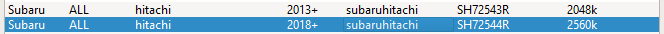

# subaru-dit-defs

RomRaider and EcuFlash definitions, logging tools and a tuning guide for Subaru's Direct-Injected Turbocharged engine ECU's- encompassing the FA20DIT, FB16DIT, and FA24DIT engine platforms. The list of supported ROM's, and which files each car uses, is below.

The definitions were built from scratch from my own analysis of stock ROMs. No existing community definition was
used as a source, so table names, scalings and descriptions are my own. Every table carries a plain-English summary
and a description of what the ECU does with it.

Across the supported ROMs, each definition averages roughly **1,280 entries**: about 1,090 maps and curves and
about 190 single values and switches. On top of that, each has a table for every trouble code (about 225), with its enable and fail-safe settings. The exact count for
each ROM is in the [lists below](#supported-roms).

> **Status: beta.** The definitions have been checked table by table against the ECU code and load cleanly in
> RomRaider and EcuFlash, but **nothing has been validated on a running engine or flashed to a car yet.** Read the
> [known issues](#known-issues) before you use them, and always keep a stock read of the ECU.

### ROM lists

Open your model for its ROM list. Model years and markets are as the ROMs were supplied to me. For the ROMs I took
from Subaru's dealer software, model, year and market come from the package names; "(unconfirmed)" and "not
confirmed" mark the ones I could not check. "Logging patch: yes" means the logging patch has a spec
for that ROM.

★ marks the newest calibration Subaru released for that car (the one a dealer update installs). Unstarred ROMs
were later replaced by an update, or are builds that Subaru's update database doesn't cover (mostly JDM).

<details>
<summary><b>WRX and WRX S4</b>: 99 ROMs, 2014–2021</summary>

| Model | Model year | Transmission | Market | ROM (calibration ID) | Tables, scalars & switches | DTCs | Logging patch |
|---|---|---|---|---|---|---|---|
| WRX | 2016 (supplied as 2014) | 6MT | Middle East | **LF75401P** ★ | 1275 | 226 | yes |
| WRX | 2015 | CVT | Canada | **LF75200T** | 1251 | 226 | yes |
| WRX S4 | 2015 | CVT | Japan | **LF75300F** | 1275 | 226 | yes |
| WRX S4 (unconfirmed) | not confirmed | CVT | Japan (unconfirmed) | **LF79001M** | 1291 | 228 | not yet |
| WRX S4 (unconfirmed) | not confirmed | CVT | Japan (unconfirmed) | **LF79100M** | 1305 | 228 | not yet |
| WRX S4 (unconfirmed) | not confirmed | CVT | Japan (unconfirmed) | **LF79101L** | 1305 | 228 | not yet |
| WRX S4 (unconfirmed) | not confirmed | CVT | Japan (unconfirmed) | **LF79101M** | 1305 | 228 | not yet |
| WRX | 2015–2016 (not stated) | CVT | not confirmed | **LF75300L** | 1275 | 226 | yes |
| WRX | 2015 | 6MT | USDM | **LF75300S** | 1275 | 226 | yes |
| WRX | 2015 | 6MT | Middle East | **LF75301P** | 1275 | 226 | yes |
| WRX | 2015 | 6MT | USDM | **LV9H000D** | 1153 | 222 | not yet |
| WRX | 2015 | 6MT | USDM | **LF75404S** ★ | 1275 | 226 | yes |
| WRX | 2015 | 6MT | USDM | **LF75200S** | 1251 | 226 | not yet |
| WRX | 2015 | 6MT | USDM | **LF75400S** | 1275 | 226 | not yet |
| WRX | 2015 | 6MT | USDM | **LF75402S** | 1275 | 226 | not yet |
| WRX | 2015 | 6MT | USDM | **LF75403S** | 1275 | 226 | not yet |
| WRX | 2015 | CVT | USDM | **LF75403T** | 1275 | 226 | not yet |
| WRX | 2015 | CVT | USDM | **LF75500T** ★ | 1275 | 226 | yes |
| WRX | 2015 | CVT | USDM | **LF75300T** | 1275 | 226 | not yet |
| WRX | 2015 | CVT | USDM | **LF75402T** | 1275 | 226 | not yet |
| WRX S4 (early software) | 2015 | CVT | Japan | **LV9N100B** | 1202 | 222 | yes |
| WRX S4 (unconfirmed) | not confirmed | CVT | Japan (unconfirmed) | **LV9N301B** | 1240 | 222 | not yet |
| WRX (early software) | 2015 | 6MT | Australia | **LV9N100F** | 1202 | 222 | yes |
| WRX (early software) | 2015 | CVT | USDM | **LV9N101C** | 1202 | 222 | yes |
| WRX (early software) | 2015 | 6MT | not confirmed | **LV9N101F** | 1202 | 222 | yes |
| WRX (early software) | 2015 | 6MT | Gulf (GCC) | **LV9N101I** | 1202 | 222 | yes |
| WRX (early software) | 2015 | not confirmed | not confirmed | **LV9N002E** | 1202 | 222 | yes |
| WRX (early software) | 2015 | CVT | Europe / General | **LV9N300E** | 1227 | 222 | not yet |
| WRX (early software) | 2015 | CVT | not confirmed | **LV9N302E** ★ | 1240 | 222 | yes |
| WRX (early software) | 2015 | CVT | Europe / General | **LV9N001E** | 1200 | 222 | not yet |
| WRX (early software) | 2015 | CVT | Europe / General | **LV9N301E** | 1240 | 222 | not yet |
| WRX (early software) | 2015 | 6MT | Europe / General | **LV9N300F** | 1227 | 222 | not yet |
| WRX (early software) | 2015 | 6MT | not confirmed | **LV9N302F** ★ | 1240 | 222 | yes |
| WRX (early software) | 2015 | 6MT | Europe / General | **LV9N301F** | 1240 | 222 | not yet |
| WRX (early software) | 2015 | CVT | not confirmed | **LV9N302G** ★ | 1240 | 222 | yes |
| WRX (early software) | 2015 | CVT | Europe / General | **LV9N101G** | 1202 | 222 | not yet |
| WRX (early software) | 2015 | CVT | Europe / General | **LV9N300H** | 1227 | 222 | not yet |
| WRX (early software) | 2015 | CVT | not confirmed | **LV9N302H** ★ | 1240 | 222 | yes |
| WRX (early software) | 2015 | CVT | Europe / General | **LV9N101H** | 1202 | 222 | not yet |
| WRX (early software) | 2015 | 6MT | Europe / General | **LV9N300I** | 1227 | 222 | not yet |
| WRX (early software) | 2015 | 6MT | Europe / General | **LV9N002I** | 1200 | 222 | not yet |
| WRX (early software) | 2015 | 6MT | not confirmed | **LV9N302I** ★ | 1240 | 222 | yes |
| WRX | 2016 | 6MT | not confirmed | **LF75300H** | 1275 | 226 | yes |
| WRX | 2016 | 6MT | Singapore | **LF75301K** | 1275 | 226 | yes |
| WRX | 2016 | CVT | not confirmed | **LF75401J** ★ | 1275 | 226 | yes |
| WRX | 2016 | CVT | Europe / General | **LF75300J** | 1275 | 226 | not yet |
| WRX | 2016 | CVT | Europe / General | **LF75301J** | 1275 | 226 | not yet |
| WRX | 2016 | 6MT | not confirmed | **LF75401K** ★ | 1275 | 226 | yes |
| WRX | 2016 | 6MT | Europe / General | **LF75300K** | 1275 | 226 | not yet |
| WRX | 2016 | 6MT | Europe / General | **LF75400K** | 1275 | 226 | not yet |
| WRX | 2016 | CVT | not confirmed | **LF75401L** ★ | 1275 | 226 | yes |
| WRX | 2016 | CVT | Europe / General | **LF75301L** | 1275 | 226 | not yet |
| WRX | 2016 | 6MT | not confirmed | **LF75401M** ★ | 1275 | 226 | yes |
| WRX | 2016 | 6MT | Europe / General | **LF75300M** | 1275 | 226 | not yet |
| WRX | 2016 | CVT | not confirmed | **LF75401N** ★ | 1275 | 226 | yes |
| WRX | 2016 | CVT | Europe / General | **LF75400N** | 1275 | 226 | not yet |
| WRX | 2016 | 6MT | USDM | **LF75404H** ★ | 1275 | 226 | yes |
| WRX | 2016 | 6MT | USDM | **LF75402H** | 1275 | 226 | not yet |
| WRX | 2016 | CVT | USDM | **LF75403G** | 1275 | 226 | not yet |
| WRX | 2016 | CVT | USDM | **LF75500G** ★ | 1275 | 226 | yes |
| WRX | 2016 | CVT | USDM | **LF75300G** | 1275 | 226 | not yet |
| WRX | 2016 | CVT | USDM | **LF75401G** | 1275 | 226 | not yet |
| WRX | 2017 | 6MT | not confirmed | **LF79002P** | 1291 | 228 | yes |
| WRX | 2017 | CVT | not confirmed | **LF79100N** | 1305 | 228 | yes |
| WRX | 2017 | 6MT (later revision) | not confirmed | **LF79100P** | 1305 | 228 | yes |
| WRX | 2017 | CVT | not confirmed | **LF79100Q** ★ | 1305 | 228 | yes |
| WRX | 2017 | CVT | Europe / General | **LF79002Q** | 1291 | 228 | not yet |
| WRX | 2017 | 6MT | Europe / General | **LF79001R** | 1291 | 228 | not yet |
| WRX | 2017 | 6MT | not confirmed | **LF79100R** ★ | 1305 | 228 | yes |
| WRX | 2017 | 6MT | USDM | **LF79103P** ★ | 1305 | 228 | yes |
| WRX | 2017 | 6MT | USDM | **LF79101P** | 1305 | 228 | not yet |
| WRX | 2017 | CVT | USDM | **LF79102N** | 1305 | 228 | not yet |
| WRX | 2017 | CVT | USDM | **LF79110N** ★ | 1305 | 228 | yes |
| WRX | 2017 | CVT | USDM | **LF79002N** | 1291 | 228 | not yet |
| WRX | 2017 | 6MT | not confirmed | **LF9C100M** ★ | 1309 | 228 | yes |
| WRX | 2017 | 6MT | not confirmed | **LF9C100R** ★ | 1309 | 228 | yes |
| WRX | 2017 | 6MT | Europe / General | **LF9C000R** | 1309 | 228 | not yet |
| WRX | 2017 | 6MT | not confirmed | **LF9C100X** ★ | 1309 | 228 | yes |
| WRX S4 | 2018 | CVT | Japan | **LF9C001K** | 1309 | 228 | yes |
| WRX | 2018 | 6MT | USDM | **LF9C001P** | 1309 | 228 | yes |
| WRX | 2018 | 6MT | not confirmed | **LF9C100P** | 1309 | 228 | yes |
| WRX | 2018 | 6MT | USDM | **LF9C102P** ★ | 1309 | 228 | yes |
| WRX | 2018 | 6MT | USDM | **LF9C101P** | 1309 | 228 | not yet |
| WRX | 2018 | CVT | USDM | **LF9C002N** | 1309 | 228 | not yet |
| WRX | 2018 | CVT | USDM | **LF9C200N** ★ | 1309 | 228 | yes |
| WRX | 2018 | CVT | USDM | **LF9C001N** | 1309 | 228 | not yet |
| WRX | 2019 (2.5 MB ECU) | 6MT | USDM | **LF9D012h** ★ | 1309 | 229 | yes |
| WRX | 2019 | 6MT | USDM | **LF9D010h** | 1267 | 229 | not yet |
| WRX | 2019 (2.5 MB ECU) | CVT | USDM | **LF9D011g** | 1321 | 229 | not yet |
| WRX | 2019 (2.5 MB ECU) | CVT | USDM | **LF9D030g** ★ | 1315 | 229 | yes |
| WRX | 2019 | CVT | USDM | **LF9D010g** | 1321 | 229 | not yet |
| WRX | 2020 (2.5 MB ECU) | CVT | USDM | **LF9G002S** ★ | 1320 | 231 | yes |
| WRX | 2020 (2.5 MB ECU) | 6MT | USDM | **LF9G003T** ★ | 1320 | 231 | yes |
| WRX | 2020 | 6MT | USDM | **LF9G001T** | 1320 | 231 | not yet |
| WRX | 2020 | 6MT | USDM | **LF9G002T** | 1320 | 231 | not yet |
| WRX | 2021 (2.5 MB ECU) | CVT | USDM | **LF9J000D** | 1320 | 231 | not yet |
| WRX | 2021 (2.5 MB ECU) | CVT | USDM | **LF9K000D** ★ | 1320 | 231 | yes |
| WRX | 2021 (2.5 MB ECU) | 6MT | USDM | **LF9J001E** | 1320 | 231 | not yet |
| WRX | 2021 (2.5 MB ECU) | 6MT | USDM | **LF9K000E** ★ | 1320 | 231 | yes |

</details>

<details>
<summary><b>WRX 2022+ (FA24DIT, RH850 ECU)</b>: 24 ROMs, 2022–2026 (first release, read the notes below)</summary>

| Model | Model year | Transmission | Market | ROM (calibration ID) | Tables, scalars & switches | DTCs | Logging patch |
|---|---|---|---|---|---|---|---|
| WRX | 2022 | 6MT | USDM | **LHBHB10B** | 1266 | 254 | no (see below) |
| WRX | 2022 | 6MT | USDM | LHBHD00B | 1266 | 254 | no (see below) |
| WRX | 2022 | CVT | USDM | LHBH740C | 1266 | 254 | no (see below) |
| WRX | 2022–2023 | CVT | USDM | LHBHC01C | 1266 | 254 | no (see below) |
| WRX | unknown | 6MT | unknown | LHBH720D | 1266 | 254 | no (see below) |
| WRX | unknown | CVT | unknown | LHBH740A | 1266 | 254 | no (see below) |
| WRX | unknown | CVT | unknown | LHBH800A | 1266 | 254 | no (see below) |
| WRX | unknown | CVT | unknown | LHBHA00A | 1266 | 254 | no (see below) |
| WRX | unknown | CVT | unknown | LHBHB00A | 1266 | 254 | no (see below) |
| WRX | 2023 | 6MT | USDM | **LHBKC40M** | 1290 | 312 | no (see below) |
| WRX | 2023 | 6MT | USDM | LHBKC30M | 1290 | 312 | no (see below) |
| WRX | unknown | 6MT | unknown | LHBKC20P | 1290 | 312 | no (see below) |
| WRX | unknown | CVT | unknown | LHBKC20R | 1290 | 312 | no (see below) |
| WRX | unknown | CVT | unknown | LHBKC20L | 1290 | 312 | no (see below) |
| WRX | 2024 | 6MT | USDM | **LHBP400b** | 1300 | 312 | no (see below) |
| WRX | 2024 | CVT | USDM | LHBP301c | 1300 | 312 | no (see below) |
| WRX | unknown | 6MT | unknown | LHBP300d | 1300 | 312 | no (see below) |
| WRX | unknown | CVT | unknown | LHBP100e | 1300 | 312 | no (see below) |
| WRX | unknown | CVT | unknown | LHBP100a | 1300 | 312 | no (see below) |
| WRX | 2026 | CVT | USDM | **LHBT210V** | 1332 | 312 | no (see below) |
| WRX | unknown | 6MT | unknown | LHBT130h | 1332 | 312 | no (see below) |
| WRX | unknown | CVT | unknown | LHBT120a | 1332 | 312 | no (see below) |
| WRX | unknown | CVT | unknown | LHBT120g | 1332 | 312 | no (see below) |
| WRX | unknown | CVT | unknown | LHBT110a | 1332 | 312 | no (see below) |

Every ROM here was placed from its own code, through the closest supported ROM, and checked through RomRaider,
EcuFlash and FastECU like the first four (in bold). Year and market come from the engine string in the ROM where it
has one, or from Subaru's bulletins; where neither says, they are "unknown". The model is WRX for all of them: those without an engine string share
most of their calibration with the WRX ROMs (60–85 %) and only about a third with the Legacy, Outback and Ascent ROMs
on this ECU. The transmission is read from each ROM's coding.

The 2022+ WRX has a new ECU generation: a Renesas RH850/E1M-S2 with new software, not a build of the SH software
the other definitions cover. 
Every tool works a little differently on this ECU, so read [2022+ WRX: what's different](docs/WRX_2022plus.md)
before you start.

There is no logging patch: this ECU has no SSM
logging over CAN, so the patch has nothing to extend. Mode-22 (UDS) logging works instead; see
[Logging](#logging).

</details>

<details>
<summary><b>Forester XT and tS</b>: 32 ROMs, 2015–2018</summary>

| Model | Model year | Transmission | Market | ROM (calibration ID) | Tables, scalars & switches | DTCs | Logging patch |
|---|---|---|---|---|---|---|---|
| Forester XT (early software; briefly also the WRX CVT) — *outdated* | early 2015 | CVT | USDM | **LV9N000C** | 1202 | 222 | yes |
| Forester XT (unconfirmed) | 2016 | CVT | USDM | **LF75403A** | 1275 | 226 | not yet |
| Forester XT (unconfirmed) | 2016 | CVT | USDM | **LF75500A** ★ | 1275 | 226 | yes |
| Forester XT (unconfirmed) | 2016 | CVT | USDM | **LF75200A** | 1251 | 226 | not yet |
| Forester XT (unconfirmed) | 2016 | CVT | USDM | **LF75301A** | 1275 | 226 | not yet |
| Forester XT (unconfirmed) | 2016 | CVT | USDM | **LF75402A** | 1275 | 226 | not yet |
| Forester XT | 2016 | CVT | not confirmed | **LF78001F** ★ | 1277 | 227 | yes |
| Forester XT | 2016 | CVT | Europe / General | **LF78000F** | 1282 | 227 | not yet |
| Forester tS (STI) | 2016 | CVT | Australia | **LF78001H** | 1282 | 227 | yes |
| Forester XT (unconfirmed) | not confirmed | CVT | Japan (unconfirmed) | **LF78003A** | 1282 | 227 | not yet |
| Forester XT | 2016 | CVT | not confirmed | **LF78002D** ★ | 1277 | 227 | yes |
| Forester XT | 2016 | CVT | Europe / General | **LF78000D** | 1282 | 227 | not yet |
| Forester XT | 2016 | CVT | not confirmed | **LF78002E** ★ | 1277 | 227 | yes |
| Forester XT | 2016 | CVT | Europe / General | **LF78001E** | 1282 | 227 | not yet |
| Forester XT | 2016 | CVT | not confirmed | **LF78002G** ★ | 1277 | 227 | yes |
| Forester XT | 2016 | CVT | Europe / General | **LF78001G** | 1282 | 227 | not yet |
| Forester XT | 2016 | CVT | not confirmed | **LF78002J** ★ | 1277 | 227 | yes |
| Forester XT | 2016 | CVT | not confirmed | **LF78002Z** ★ | 1277 | 227 | yes |
| Forester XT | 2016 | CVT | Europe / General | **LF78001Z** | 1282 | 227 | not yet |
| Forester XT | 2016 (supplied as 2017) | CVT | Australia | **LF78002H** ★ | 1277 | 227 | yes |
| Forester XT | 2017 | CVT | USDM | **LF78103B** | 1279 | 228 | yes |
| Forester XT | 2017 | CVT | USDM | **LF78106B** | 1282 | 228 | not yet |
| Forester XT | 2017 | CVT | USDM | **LF78200B** ★ | 1282 | 228 | yes |
| Forester XT | 2017 | CVT | USDM | **LF78101B** | 1282 | 228 | not yet |
| Forester XT | 2017 | CVT | USDM | **LF78102B** | 1282 | 228 | not yet |
| Forester XT | 2017 | CVT | USDM | **LF78104B** | 1282 | 228 | not yet |
| Forester XT | 2017 | CVT | Europe | **LF9C000C** | 1309 | 228 | yes |
| Forester XT (unconfirmed) | not confirmed | CVT | Japan (unconfirmed) | **LF9C000A** | 1309 | 228 | not yet |
| Forester XT | 2018 | CVT | Malaysia | **LF9C000a** | 1309 | 228 | yes |
| Forester XT | 2018 | CVT | USDM | **LF9C002B** | 1309 | 228 | not yet |
| Forester XT | 2018 | CVT | USDM | **LF9C200B** ★ | 1309 | 228 | yes |
| Forester XT | 2018 | CVT | USDM | **LF9C000B** | 1309 | 228 | not yet |

</details>

<details>
<summary><b>Legacy and Outback</b>: 7 ROMs, 2015–2017</summary>

| Model | Model year | Transmission | Market | ROM (calibration ID) | Tables, scalars & switches | DTCs | Logging patch |
|---|---|---|---|---|---|---|---|
| Outback | 2015 | CVT | Europe / General | **LV9N301K** | 1227 | 222 | not yet |
| Outback (unconfirmed) | 2015 | CVT | not confirmed | **LV9N303K** ★ | 1240 | 222 | yes |
| Legacy | 2016 | CVT | Europe / General | **LV9N300L** | 1227 | 222 | not yet |
| Legacy (unconfirmed) | 2016 | CVT | not confirmed | **LV9N302L** ★ | 1240 | 222 | yes |
| Legacy (unconfirmed) | 2017 | CVT | not confirmed | **LV9N601M** ★ | 1240 | 222 | yes |
| Legacy (unconfirmed) | 2017 | CVT | Europe / General | **LV9N600M** | 1240 | 222 | not yet |
| Outback (unconfirmed) | 2017 | CVT | not confirmed | **LV9N601N** ★ | 1240 | 222 | yes |

</details>

<details>
<summary><b>Levorg 2.0</b>: 12 ROMs, 2014–2019</summary>

| Model | Model year | Transmission | Market | ROM (calibration ID) | Tables, scalars & switches | DTCs | Logging patch |
|---|---|---|---|---|---|---|---|
| Levorg 2.0GT-S (early software) | 2014 | CVT | Japan | **LV9N100A** | 1202 | 222 | yes |
| Levorg 2.0 (early software) | 2014 | CVT | Japan | **LV9N301A** | 1240 | 222 | yes |
| Levorg 2.0 (early software) | 2014 | CVT | Japan | **LV9N302A** | 1240 | 222 | yes |
| Levorg 2.0 or WRX S4 (unconfirmed) | not confirmed | CVT | Japan (unconfirmed) | **LV9N302B** | 1240 | 222 | not yet |
| Levorg 2.0 | 2015 | CVT | Japan | **LF75401D** | 1275 | 226 | yes |
| Levorg 2.0 STI | 2017 | CVT | Japan | **LF79100K** | 1305 | 228 | yes |
| Levorg 2.0 STI | 2017 | CVT | Japan | **LF79101K** | 1305 | 228 | yes |
| Levorg 2.0 (unconfirmed) | not confirmed | CVT | Japan (unconfirmed) | **LF75300D** | 1275 | 226 | not yet |
| Levorg 2.0 (unconfirmed) | not confirmed | CVT | Japan (unconfirmed) | **LF79001K** | 1291 | 228 | not yet |
| Levorg 2.0GT-S | 2017 | CVT | Australia | **LF79100S** ★ | 1305 | 228 | yes |
| Levorg 2.0GT-S | 2017 | CVT | Europe / General | **LF79002S** | 1291 | 228 | not yet |
| Levorg STI 2.0 (2.5 MB ECU) | 2019 | CVT | Japan | **LF9F000R** | 1320 | 231 | yes |

</details>

<details>
<summary><b>Levorg 1.6 (FB16DIT)</b>: 40 ROMs, 2014–2020</summary>

| Model | Model year | Transmission | Market | ROM (calibration ID) | Tables, scalars & switches | DTCs | Logging patch |
|---|---|---|---|---|---|---|---|
| Levorg 1.6 | 2014 | CVT | Japan | **LV9N303J** | 1244 | 222 | yes |
| Levorg 1.6 | 2014 | CVT | Japan | **LV9N340J** | 1243 | 222 | yes |
| Levorg 1.6 | not confirmed | CVT | not confirmed | **LV9N301J** | 1240 | 222 | not yet |
| Levorg 1.6 | not confirmed | CVT | not confirmed | **LV9N302J** | 1244 | 222 | not yet |
| Levorg 1.6 | 2015 | CVT | Europe | **LF76400Q** | 1263 | 226 | yes |
| Levorg 1.6 | 2015 | CVT | Japan | **LF76401R** | 1265 | 226 | yes |
| Levorg 1.6 | 2016 | CVT | Europe / General | **LF76200Q** | 1258 | 226 | not yet |
| Levorg 1.6 | 2016 | CVT | Europe / General | **LF76301Q** | 1261 | 226 | not yet |
| Levorg 1.6 | 2016 (supplied as 2015) | CVT | Europe | **LF76500Q** ★ | 1263 | 226 | yes |
| Levorg 1.6 | 2015 | CVT | Japan | **LF76500R** | 1263 | 226 | yes |
| Levorg 1.6 | 2015 | CVT | Japan | **LF76600R** | 1265 | 226 | yes |
| Levorg 1.6 | 2016 | CVT | Japan | **LF76402R** | 1265 | 226 | yes |
| Levorg 1.6 | not confirmed | CVT | not confirmed | **LF76400R** | 1265 | 226 | not yet |
| Levorg 1.6 | 2016 | CVT | Japan | **LF79201U** | 1304 | 228 | yes |
| Levorg 1.6 | 2016 | CVT | Japan | **LF79202U** | 1309 | 228 | yes |
| Levorg 1.6 | 2016 | CVT | Japan | **LF79400U** | 1304 | 228 | yes |
| Levorg 1.6 | 2017 | CVT | Europe | **LF79200T** | 1304 | 228 | yes |
| Levorg 1.6 | 2017 | CVT | Japan | **LF79200U** | 1304 | 228 | yes |
| Levorg 1.6 | 2017 | CVT | Europe | **LF79300T** ★ | 1304 | 228 | yes |
| Levorg 1.6 | not confirmed | CVT | not confirmed | **LF79300U** | 1304 | 228 | not yet |
| Levorg 1.6 | 2017 | CVT | Europe / General | **LF79101T** | 1305 | 228 | not yet |
| Levorg 1.6 | not confirmed | CVT | not confirmed | **LF79101U** | 1305 | 228 | not yet |
| Levorg 1.6 | 2017 (facelift) | CVT | Japan | **LF9B003U** | 1313 | 228 | yes |
| Levorg 1.6 | 2018 (facelift; supplied as 2017) | CVT | Europe | **LF9B100G** ★ | 1308 | 228 | yes |
| Levorg 1.6 | 2018 | CVT | Europe / General | **LF9B002G** | 1313 | 228 | not yet |
| Levorg 1.6 | 2017 (facelift) | CVT | Japan | **LF9B200U** | 1308 | 228 | yes |
| Levorg 1.6 | 2018 | CVT | Europe / General | **LV3C001T** | 1230 | 228 | not yet |
| Levorg 1.6 | 2018 | CVT | not confirmed | **LV3C100T** ★ | 1220 | 228 | yes |
| Levorg 1.6 | 2019 (2.5 MB ECU) | CVT | Japan | **LF9D000d** | 1321 | 229 | yes |
| Levorg 1.6 | 2019 (2.5 MB ECU) | CVT | Europe | **LF9D100e** ★ | 1316 | 229 | yes |
| Levorg 1.6 | 2019 | CVT | Europe / General | **LF9D001e** | 1321 | 229 | not yet |
| Levorg 1.6 | 2019 (2.5 MB ECU) | CVT | Japan | **LF9D200d** | 1321 | 229 | yes |
| Levorg 1.6 | 2020 (2.5 MB ECU) | CVT | Japan | **LF9F100P** | 1320 | 231 | yes |
| Levorg 1.6 | 2020 (2.5 MB ECU) | CVT | Europe | **LF9F100Q** ★ | 1315 | 231 | yes |
| Levorg 1.6 | 2020 | CVT | Europe / General | **LF9F000Q** | 1320 | 231 | not yet |
| Levorg 1.6 | not confirmed | CVT | not confirmed | **LF9F000P** | 1320 | 231 | not yet |
| Levorg 1.6 | 2020 (2.5 MB ECU) | CVT | Japan | **LF9F200P** | 1320 | 231 | yes |
| Levorg 1.6 | not confirmed | CVT | not confirmed | **LF76100R** | 1258 | 226 | not yet |
| Levorg 1.6 | not confirmed | CVT | not confirmed | **LF76200R** | 1258 | 226 | not yet |
| Levorg 1.6 | not confirmed | CVT | not confirmed | **LF76301R** | 1261 | 226 | not yet |

</details>

<details>
<summary><b>2.0, model not confirmed</b>: 44 ROMs</summary>

Calibrations that aren't in Subaru's update database, so model, year and market aren't known. The transmission is read from each ROM's own coding.

| Model | Model year | Transmission | Market | ROM (calibration ID) | Tables, scalars & switches | DTCs | Logging patch |
|---|---|---|---|---|---|---|---|
| not confirmed | not confirmed | CVT | not confirmed | **LF75300E** | 1275 | 226 | not yet |
| not confirmed | not confirmed | CVT | not confirmed | **LF75401E** | 1275 | 226 | not yet |
| not confirmed | not confirmed | CVT | not confirmed | **LF75401F** | 1275 | 226 | not yet |
| not confirmed | not confirmed | CVT | not confirmed | **LF78001C** | 1282 | 227 | not yet |
| not confirmed | not confirmed | CVT | not confirmed | **LF78002C** | 1277 | 227 | not yet |
| not confirmed | not confirmed | CVT | not confirmed | **LF780Z2E** | 1277 | 227 | not yet |
| not confirmed | not confirmed | CVT | not confirmed | **LF79001L** | 1291 | 228 | not yet |
| not confirmed | not confirmed | CVT | not confirmed | **LF79100L** | 1305 | 228 | not yet |
| not confirmed | not confirmed | CVT | not confirmed | **LF9C000E** | 1309 | 228 | not yet |
| not confirmed | not confirmed | CVT | not confirmed | **LF9C000F** | 1309 | 228 | not yet |
| not confirmed | not confirmed | CVT | not confirmed | **LF9C000L** | 1309 | 228 | not yet |
| not confirmed | not confirmed | CVT | not confirmed | **LF9C000Q** | 1309 | 228 | not yet |
| not confirmed | not confirmed | CVT | not confirmed | **LF9C000Y** | 1309 | 228 | not yet |
| not confirmed | not confirmed | CVT | not confirmed | **LF9C000Z** | 1309 | 228 | not yet |
| not confirmed | not confirmed | CVT | not confirmed | **LF9C000b** | 1309 | 228 | not yet |
| not confirmed | not confirmed | CVT | not confirmed | **LF9C001D** | 1309 | 228 | not yet |
| not confirmed | not confirmed | CVT | not confirmed | **LF9D000f** | 1321 | 229 | not yet |
| not confirmed | not confirmed | CVT | not confirmed | **LF9D000i** | 1321 | 229 | not yet |
| not confirmed | not confirmed | 6MT | not confirmed | **LF9D000j** | 1321 | 229 | not yet |
| not confirmed | not confirmed | CVT | not confirmed | **LF9D000k** | 1321 | 229 | not yet |
| not confirmed | not confirmed | 6MT | not confirmed | **LF9D000m** | 1321 | 229 | not yet |
| not confirmed | not confirmed | CVT | not confirmed | **LF9D000n** | 1321 | 229 | not yet |
| not confirmed | not confirmed | CVT | not confirmed | **LF9F000U** | 1320 | 231 | not yet |
| not confirmed | not confirmed | 6MT | not confirmed | **LF9F000V** | 1320 | 231 | not yet |
| not confirmed | not confirmed | CVT | not confirmed | **LF9F000W** | 1320 | 231 | not yet |
| not confirmed | not confirmed | 6MT | not confirmed | **LF9F000Y** | 1320 | 231 | not yet |
| not confirmed | not confirmed | CVT | not confirmed | **LF9F000Z** | 1320 | 231 | not yet |
| not confirmed | not confirmed | CVT | not confirmed | **LV9N000A** | 1200 | 222 | not yet |
| not confirmed | not confirmed | CVT | not confirmed | **LF75100D** | 1251 | 226 | not yet |
| not confirmed | not confirmed | 6MT | not confirmed | **LF75600H** | 1275 | 226 | not yet |
| not confirmed | not confirmed | 6MT | not confirmed | **LF75600S** | 1275 | 226 | not yet |
| not confirmed | not confirmed | CVT | not confirmed | **LF76000C** | 1250 | 199 | not yet |
| not confirmed | not confirmed | 6MT | not confirmed | **LF79120P** | 1305 | 228 | not yet |
| not confirmed | not confirmed | 6MT | not confirmed | **LF9C300P** | 1309 | 228 | not yet |
| not confirmed | not confirmed | 6MT | not confirmed | **LF9D040h** | 1321 | 229 | not yet |
| not confirmed | not confirmed | 6MT | not confirmed | **LF9D050h** | 1320 | 229 | not yet |
| not confirmed | not confirmed | CVT | not confirmed | **LF9J000C** | 1320 | 231 | not yet |
| not confirmed | not confirmed | 6MT | not confirmed | **LF9L000E** | 1320 | 231 | not yet |
| not confirmed | not confirmed | CVT | not confirmed | **LF73100A** | 1221 | 226 | not yet |
| not confirmed | not confirmed | CVT | not confirmed | **LF77000C** | 1278 | 227 | not yet |
| not confirmed | not confirmed | CVT | not confirmed | **LF77000D** | 1193 | 227 | not yet |
| not confirmed | not confirmed | CVT | not confirmed | **LF77000Q** | 1193 | 227 | not yet |
| not confirmed | not confirmed | 6MT | not confirmed | **LF79130P** | 1298 | 228 | not yet |
| not confirmed | not confirmed | 6MT | not confirmed | **LF9C400P** | 1301 | 228 | not yet |

</details>

<details>
<summary><b>Ascent and Legacy / Outback XT (FA24 Early: FA24DIT on the SH72544R)</b>: 9 ROMs, 2019–2021 (first release, read the notes below)</summary>

| Model | Model year | Transmission | Market | ROM (calibration ID) | Tables, scalars & switches | DTCs | Logging patch |
|---|---|---|---|---|---|---|---|
| Ascent 2.4 | 2019 | CVT | USA | **LT8D700A** | 1261 | 250 | not yet |
| Ascent 2.4 | 2019 | CVT | USA | **LT8D800A** ★ | 1261 | 250 | yes |
| Ascent 2.4 | 2020 | CVT | USA | **LT8F200C** | 1261 | 250 | not yet |
| Ascent 2.4 | 2020 | CVT | USA | **LT8F300C** ★ | 1261 | 250 | yes |
| Ascent 2.4 | 2021 | CVT | USA | **LT8H300D** ★ | 1263 | 251 | yes |
| Legacy / Outback XT 2.4 | 2020 | CVT | USA | **LG7D430B** | 1263 | 250 | not yet |
| Legacy / Outback XT 2.4 | 2020 | CVT | USA | **LG7D501B** ★ | 1252 | 250 | not yet |
| Legacy / Outback XT 2.4 | not confirmed | CVT | not confirmed | **LG7F300F** | 1261 | 250 | not yet |
| Legacy / Outback XT 2.4 | 2021 | CVT | USA | **LG7F301F** ★ | 1261 | 250 | not yet |

The Ascent and Legacy XT run a later build of the same ECU software, so most tables are the FA20DIT ones. Boost
control is different: they have an electric wastegate, with its own Boost Control group (target, wastegate
position, feedback and actuator limits).

**Use the FA24 Early files, not FA24DIT.** The above models have the FA24DIT engine,
but their ECU's runs a later build of the FA20DIT software, so their definitions build on the FA20DIT ones. RomRaider
sections are in `FA20DIT_RomRaider.xml`, and the EcuFlash files need `FA20DIT_BASE_EcuFlash.xml` as well as
`FA24_Early_BASE_EcuFlash.xml`. The `FA24DIT_*` files are for the 2022+ WRX and the 2023+ Ascent and Legacy /
Outback XT (RH850 ECU, next section).

</details>

<details>
<summary><b>Ascent and Legacy / Outback XT 2023+ (FA24DIT, RH850 ECU)</b>: 11 ROMs, 2023–2025 (first release, read the notes below)</summary>

| Model | Model year | Transmission | Market | ROM (calibration ID) | Tables, scalars & switches | DTCs | Logging patch |
|---|---|---|---|---|---|---|---|
| Ascent 2.4 | 2023 | CVT | USDM | **LHBK240Y** | 1271 | 311 | no (see below) |
| Ascent 2.4 | unknown | CVT | unknown | LHBP201A | 1300 | 312 | no (see below) |
| Ascent 2.4 (unconfirmed) | unknown | CVT | unknown | LHBK240Z | 1271 | 311 | no (see below) |
| Ascent 2.4 (unconfirmed) | unknown | CVT | unknown | LHBK231Z | 1271 | 311 | no (see below) |
| Legacy / Outback XT 2.4 | 2023 | CVT | USDM | LHBK240G | 1271 | 311 | no (see below) |
| Legacy / Outback XT 2.4 | unknown | CVT | unknown | LHBK230H | 1271 | 311 | no (see below) |
| Outback XT 2.4 | 2024 | CVT | USDM | **LHBKG01H** | 1290 | 312 | no (see below) |
| Outback XT 2.4 | 2024 | CVT | USDM | LHBKG00H | 1290 | 312 | no (see below) |
| Outback XT 2.4 | 2024 | CVT | USDM | LHBKG01G | 1290 | 312 | no (see below) |
| Legacy / Outback XT 2.4 | 2025 | CVT | USDM | LHBR200G | 1300 | 312 | no (see below) |
| Legacy / Outback XT 2.4 | 2025 | CVT | USDM | LHBR300G | 1300 | 312 | no (see below) |

These cars moved to the same RH850 ECU as the 2022+ WRX, with the same software line: 98–99.7 % of their functions
are the WRX ROMs' own. I placed every table from each ROM's own code, through the closest WRX or already-supported
ROM, and checked them through RomRaider, EcuFlash and FastECU like the WRX ones. **Use the `FA24DIT_*` files** and
read [2022+ WRX: what's different](docs/WRX_2022plus.md); everything in it (ROM size, checksum, EcuFlash's 3 MB
copy, FastECU) applies to these ROMs too. The calibration is their own: only about a third of it matches the WRX.

The 2023 Ascent and Legacy / Outback XT builds (LHBK2…) have no second set of surge damping phase factors above
1800 RPM, so those tables and their RPM split aren't in their files. One fewer DTC there: P0047 isn't in their
fault table.

Year and market come from Subaru's bulletins where a ROM is listed; otherwise they are "unknown". For those, the model
comes from the calibration: LHBP201A matches the 2023 Ascent for 99 % of its calibration, LHBK230H the 2023 Legacy /
Outback for 99.9 %. LHBK240Z and LHBK231Z are closer to the Ascent (89 %) than to the Legacy / Outback (78 %), not
enough to be sure, so they are listed as unconfirmed.

There is no logging patch (no SSM logging over CAN on this ECU). They log through SUBUDS like the 2022+ WRX, with
each ROM's own addresses ([logger guide](logger/README.md#rh850-ecu-subuds)).

</details>

Notes on individual ROMs and credits are in the [definitions README](definitions/README.md#notes-on-individual-roms).

The calibration ID is the ROM's identifier, stored in the ROM itself; RomRaider/EcuFlash
pick the matching definition from it automatically. A ROM with a different ID is **not supported**, even if it is the
same model year; flashing with a definition for another ID will corrupt the calibration.

### Missing definitions

<details>
<summary><b>ROMs without a definition yet</b>, and why</summary>

| ROM | Why |
|---|---|
| LV9N101D (2015 USDM WRX), LV9N002F (2014 Australian WRX) | The only copies I have are incomplete (1.5 MB) reads. A complete read would make them supportable quickly. |
| Other 2015–2018 WRX and Forester XT calibrations | I don't have these ROMs. [Submit one](#submitting-a-rom) and I can add it. |
| 2013–2015 Forester XT with an AF5G…, AF56…, AF6A…, LF61…, LF6A… or LF7B… ID (e.g. LF61803B) | An older 1.5 MB ECU (SH705x) with different software; not covered by these definitions. |
| Other 2019+ calibrations | These ECUs have 2.5 MB of flash and a newer boot block, like the supported 2019–2021 WRX (LF9D…, LF9G…, LF9K…) and Levorg STI (LF9F000R), so a complete read makes them supportable. EcuFlash can open 2.5 MB ROMs. |
| Other Ascent and Legacy / Outback XT calibrations (LT8…, LG7… IDs) | Same software family as the supported ROMs; each needs a read and a port. |
| Other RH850 calibrations (LHB… IDs: 2022+ WRX, 2023+ Ascent and Legacy / Outback XT) | The same ECU generation as the supported LHB… ROMs. A later calibration of a supported build ports quickly; a different build needs its code read again. [Submit one](#submitting-a-rom) as a 4032 KB or 4 MB image. |

</details>

A list of the calibration IDs known for these ECUs, and how each relates to the supported ROMs, is in
[docs/ROM_IDS.md](docs/ROM_IDS.md).

## What's included

| Folder | Contents |
|---|---|
| `definitions/romraider/` | `FA20DIT_RomRaider.xml`: one file covering every supported 2.0 ROM and the Ascent / Legacy XT (FA24 Early). `FB16DIT_RomRaider.xml`: the same for the Levorg 1.6. `FA24DIT_RomRaider.xml`: the 2022+ WRX and the 2023+ Ascent and Legacy / Outback XT (RH850 ECU). Each also comes as `…_Checksum.xml`, which corrects the checksum when you save, with the `checksum/` folder it needs (see [Fix the checksum](#fix-the-checksum-before-every-flash)). |
| `definitions/ecuflash/Imperial/`, `definitions/ecuflash/Metric/` | The same EcuFlash definitions in two unit systems (EcuFlash can't switch units itself). Each folder has a base file per engine (every table) plus one small file per ROM; install one of the two. The Ascent / Legacy XT files are `FA24_Early_*`, on top of the FA20DIT base. The RH850 files (`FA24DIT_*`: 2022+ WRX, 2023+ Ascent and Legacy / Outback XT) are made for FastECU; EcuFlash can only open a 3 MB copy of those ROMs. |
| `logger/` | `FA20DIT_Logger.xml` (stock SSM and OBD parameters, trouble codes; also for the Levorg 1.6) and `FA20DIT_Logger_LogPatch.xml` (stock plus the logging-patch parameters). `FA20DIT_Logger_LogPatch_only.xml` holds only the new parameters, for merging into your own logger file. `FA24_Early_Logger*.xml`: the same three for the Ascent. `DIT_Logger_SUBUDS.xml`: every model, stock ROMs without the patch, for a RomRaider build with the SUBUDS protocol. `FA24DIT_*.csv`: the 2022+ WRX's mode-22 data identifiers, and 88 of them as custom PIDs for OBD apps. |
| `tools/checksum.py`, `tools/checksum.ps1` | Check and fix the ROM checksum of 2 MB, 2.5 MB and RH850 (4032 KB: 2022+ WRX, 2023+ Ascent and Legacy / Outback XT) ROMs (Python, or PowerShell for Windows). Needed after an edit in RomRaider unless you use a `_Checksum` definition, and `verify` before any flash (see below). |
| `tools/ef_view.py`, `tools/ef_view.ps1` | RH850 ROMs only (2022+ WRX, 2023+ Ascent and Legacy / Outback XT): make the 3 MB copy of a ROM that EcuFlash can open, and merge the edited copy back with the checksum fixed. |
| `tools/logpatch/` | The logging patch: `make_logpatch.py` (and `make_logpatch.ps1` for Windows) and a spec for every supported ROM, the Ascent included. |
| `docs/guide/` | [The tuning guide](docs/guide/README.md): workflows, how the logic works, appendices and a table reference. |
| `extras/can/` | The CAN dictionary: every frame the ECU receives and sends, for every supported 2.0 and 1.6 ROM, with a DBC for CAN tools and each signal's RAM address per ROM. `FA24_Early_CAN.*`: a first pass for the Ascent, which uses different frame IDs. `FA24DIT_CAN.dbc`: the 2022+ WRX (read from the WRX; not checked on the RH850 Ascent and Legacy / Outback XT). |

## Quick start

### Editing with RomRaider
1. Add `definitions/romraider/FA20DIT_RomRaider.xml` in RomRaider's Definition Manager (for a Levorg 1.6,
   `FB16DIT_RomRaider.xml`; for a 2022+ WRX or a 2023+ Ascent / Legacy / Outback XT, `FA24DIT_RomRaider.xml`, see the [2022+ WRX guide](docs/WRX_2022plus.md); the
   Ascent and Legacy XT (FA24 Early) are in the FA20DIT file; having several installed is fine).
2. Open your ROM. Tables are grouped by purpose (Fueling, Ignition Timing, Boost Control, …) in tuning order.
3. Set the user level (Settings → User Level) to match what you want to see: **Beginner** and **Intermediate** cover
   normal tuning; **Debug** shows tables your ROM's own calibration switches off, tables of unused code paths, and
   tables only the other transmission uses. Also
   untick "List tables that are above my userlevel" if you want higher-level tables hidden rather than greyed out.

**Trouble codes (DTCs)** are in Diagnostics & Switches → DTC Switches, one table per code, in code order. Each has
two cells: **Enabled** (1 = the code can set and report, 0 = it never sets) and **Fail-Safe** (1 = a failed test of
this code raises the ECU's fail-safe request; what that request limits isn't decoded yet). **These tables need
RomRaider 1.0.0 or later.** Older versions don't understand how the second cell is located and would show and change
the wrong bit.

### Editing with EcuFlash
Pick a unit system: `definitions/ecuflash/Imperial/` (psi, °F, ft-lb, mph) or `definitions/ecuflash/Metric/` (kPa /
MPa, °C, Nm, km/h). Copy that folder's base file (`FA20DIT_BASE_EcuFlash.xml`, or `FA20DIT_BASE_METRIC_EcuFlash.xml`;
for a Levorg 1.6, `FB16DIT_BASE_EcuFlash.xml` or `FB16DIT_BASE_METRIC_EcuFlash.xml`; for an Ascent or Legacy XT,
the FA20DIT base **and** `FA24_Early_BASE_EcuFlash.xml` or `FA24_Early_BASE_METRIC_EcuFlash.xml`)
and the file for your ROM into one folder under your EcuFlash metadata folder (for example
`rommetadata/subaru/FA20DIT/`) and restart EcuFlash. The base file is required: it holds the table definitions, and
the ROM file only its addresses. Install only one of the two sets: both use the same ROM IDs. Table folders are numbered in tuning order
(`01.02 Fueling - …`). EcuFlash starts at the Beginner user level, which greys out most tables; raise it in the
options (gear icon) → User Level.

Each DTC has two tables next to each other, in code order: the code itself (enabled or not) and `[Fail-Safe]`
(whether it triggers fail-safe). To flip one, select its value and press **Increment ( `]` ) once**; don't use
Decrement. The calibration switches (folder 11.02, EGR Enable and the like) show as on/off and flip the same way.
The [EcuFlash README](definitions/ecuflash/README.md) explains why.

### Fix the checksum before every flash

This ECU checks a 16-bit checksum over the whole flash, and a ROM with a bad checksum won't run. **EcuFlash corrects
it when you save** a 2015–2018 (2 MB) ROM. It can't for the 2019+ (2.5 MB) ROMs: fix those with the checksum tool. **RomRaider corrects it when you save** with the `_Checksum` definitions
(`FA20DIT_RomRaider_Checksum.xml`, `FB16DIT_RomRaider_Checksum.xml`, `FA24DIT_RomRaider_Checksum.xml`, each with the
`checksum/` folder next to it), for 2 MB and 2.5 MB ROMs alike. Those need a RomRaider that can load a checksum module from the definition folder: my change for that ([RomRaider pull request #248](https://github.com/RomRaider/RomRaider/pull/248)) is merged into RomRaider after 1.1.0, so use the next RomRaider release, or until it is out a RomRaider built from the current source. RomRaider 1.0.0 and 1.1.0 can't open the images with the
`_Checksum` files, so with those versions install the plain files and run every edited ROM through the checksum
tool, as for every 2.5 MB ROM edited in EcuFlash. **PCMFlash** is reported to correct the checksum as it writes (not tested by me;
see [Reading your ECU](#reading-your-ecu)). Either way, confirm the file you're about to flash with `verify`:

```
python3 tools/checksum.py fix  edited.bin  edited_fixed.bin
python3 tools/checksum.py verify  edited_fixed.bin
```

On Windows without Python, use the PowerShell version (Windows PowerShell 5.1 or later, nothing to install):

```
powershell -ExecutionPolicy Bypass -File tools\checksum.ps1 fix  edited.bin  edited_fixed.bin
powershell -ExecutionPolicy Bypass -File tools\checksum.ps1 verify  edited_fixed.bin
```

Every line of `verify` must say OK. A ROM with a bad checksum sets P0605 or is refused by the ECU. The same commands
work for an RH850 ROM (2022+ WRX, 2023+ Ascent and Legacy / Outback XT); its rule is different, and the tool picks it by the file size
([details](docs/WRX_2022plus.md)). The Python tool
needs only Python 3 (no extra packages).

### Logging

`logger/FA20DIT_Logger.xml` works in RomRaider Logger with every supported 2.0 and 1.6 ROM: I checked each ROM's own
SSM parameter table against it. Over SSM it has 46 parameters and
shows pending and stored trouble codes in the DTC tab. Switch the logger protocol to OBD for 32 standard OBD-II
parameters, including actual fuel rail pressure. On a stock ROM some of the most useful values (feedback knock
correction, target boost, target torque, combustion mode, the rail-pressure target) can't be read with RomRaider at
all. The **logging patch** fixes that. See the [logger README](logger/README.md).

The **Ascent** has its own logger files, `logger/FA24_Early_Logger*.xml`. Its SSM table has the same layout, so the stock
parameters carry over, except wastegate duty: the Ascent drives an electric wastegate, and that slot shows a value
nothing uses. Its DTC tab lists the Ascent's own codes at each position.

### The logging patch

The patch points 41 unused entries of the ECU's SSM parameter table at RAM values worth logging, adding 24 parameters:
target and throttle torque, base timing, FBKC / FLKC / KCA / total knock correction, combustion mode, rail pressure
actual and target, target boost, boost pressure, wastegate duty and feedback, closed-loop target, A/F correction and
learning, throttle-model values, the throttle target, cam targets and injector pulse. Nothing else in the ROM changes,
and the checksum is fixed for you. Patch your own (stock or tuned) ROM with the spec for its calibration ID:

```
python3 tools/logpatch/make_logpatch.py tools/logpatch/specs/logpatch_LF75404S.json your_rom.bin your_rom_logpatch.bin
```

Every supported ROM has a spec, the Levorg 1.6 and the Ascent included. The tool refuses a ROM of another calibration ID, a ROM whose checksum is already bad, and any slot that is not
unused. Then log with `logger/FA20DIT_Logger_LogPatch.xml` (parameters L01–L24). The patch uses the same slots on
every ROM with a spec, so one logger file covers all of them.

On the **Ascent**, log with `logger/FA24_Early_Logger_LogPatch.xml` instead. It has L01–L24 except the WRX wastegate pair
(L13, L14), and adds the electric wastegate: motor duty, position, position command, the feed-forward position,
control mode and position sensor voltage, plus boost error and the boost target before its corrections (L25–L32).
Target boost (L11) and boost pressure (L12) are the Ascent's own.

The SSM files above don't cover the **RH850 ECU** (2022+ WRX, 2023+ Ascent and Legacy / Outback XT): it has no SSM
logging over CAN. It logs through SUBUDS instead (below), with the same `DIT_Logger_SUBUDS.xml` and the module
**ECU-RH850** selected: 97 parameters, the values the ECU itself publishes as UDS data identifiers (knock corrections,
DAM, target boost, wastegate, wideband lambda, cams and OCVs, throttle and pedal, switches and more), at each ROM's
own addresses, on all 35 supported RH850 ROMs. RomRaider's OBD protocol still logs the standard OBD-II parameters.
Not tested on a car yet; see [the logger guide](logger/README.md#rh850-ecu-subuds).

### Logging without a patch (SUBUDS)

**SUBUDS** is a RomRaider logger protocol I added that reads values straight from the ECU's RAM over CAN, using
diagnostic services the ECU allows without a security unlock. It works on a stock ROM with no reflash, so everything
the logging patch adds can be logged without it. One logger file covers every supported ROM, the Ascent and the
RH850 cars included: `logger/DIT_Logger_SUBUDS.xml`. It needs a RomRaider build with the protocol:
[my fork of RomRaider](https://github.com/Jengacat/RomRaider/tree/subuds-pr) has it, with Windows and Linux
builds on the fork's [subuds-22plus-update-2 release](https://github.com/Jengacat/RomRaider/releases/tag/subuds-22plus-update-2)
(the older subuds-test-1 build can't read the file any more).
It hasn't been run on a car yet. Once it has, the protocol will go to the RomRaider project. If you try it, please
[open an issue](../../issues/new/choose) with how it went. Details: [logger README](logger/README.md#logging-without-the-patch-subuds).

## Units

Every table whose unit depends on the system has both an imperial and a metric scale.

- **RomRaider:** one file with both. Tables open in: engine load in **g/rev** (% available as an alternate scale;
  100 % = 1.293 g/rev on the 2.0, 1.034 on the 1.6, 1.552 on the 2.4), torque in **ft-lb** (Nm), boost in **psi gauge** (kPa absolute, psia), manifold pressure in
  psia (kPa absolute), rail pressure in **psi** (MPa, kPa), temperatures in **°F** (°C), vehicle speed in **km/h** as
  stored (mph), AFR (λ), timing in degrees BTDC, injector size as flow in g/s. Switch scales from the table's View
  menu. Exception: about 40 tables (mostly coolant-temperature compensations) have a fixed list of temperatures as
  their axis, which RomRaider can't rescale; those labels are in °F.
- **EcuFlash:** has one scale per table, so there are two sets. **Imperial**: psi, °F, ft-lb, mph. **Metric**: kPa
  (absolute for boost and manifold pressure), MPa for rail pressure, °C, Nm, km/h. Units that both systems use (g/rev,
  RPM, %, AFR, degrees, g/s) are the same in both.
- **Logger:** every parameter with a unit-specific value already offers both (choose in RomRaider's logger).

## Known issues

- **Untested on hardware.** No ROM edited with these definitions has been flashed and driven yet. Start from a known
  good stock read, change little at a time and log everything.
- **Checksum.** A ROM with a bad checksum won't run, so check it before every flash
  ([how](#fix-the-checksum-before-every-flash)). EcuFlash corrects it on save for 2 MB ROMs, and PCMFlash is reported
  to correct it when it flashes (not tested by me). RomRaider corrects it with the `_Checksum` files and a current
  RomRaider. Otherwise, and for 2.5 MB ROMs in EcuFlash, use `tools/checksum.py` or `tools/checksum.ps1`.
- **Use RomRaider 1.0.0 or later.** Older versions read the DTC tables wrong.
- **Ascent: first release.** Fewer tables than the 2.0 and 1.6 definitions (about 1,100 against 1,200), and
  not yet checked against a read from a car. The checksum is the same as the 2.5 MB WRX's. These ROMs come
  from Subaru's dealer software, which has no boot block, so `verify` reports one boot marker as BAD on them; a full
  read from a car should pass.
- **RH850 ECU (2022+ WRX, 2023+ Ascent and Legacy / Outback XT): first release.** Placed from the ROMs' own code, not yet checked against a car. Its checksum
  rule is not yet proven on a car (see the [2022+ WRX guide](docs/WRX_2022plus.md)). The "(Monitor)" tables are copies the ECU's
  torque monitor reads: keep each one equal to its main table, or the monitor can close the throttle (see the
  [definitions README](definitions/README.md#notes-on-individual-roms)). Some codes in the DTC list have no name yet.
  Its EcuFlash-format files are only fully usable in FastECU: EcuFlash can't load the right memory model for these
  ROMs and needs the 3 MB copy.
- **Ascent files renamed.** The Ascent and Legacy / Outback XT now use the FA24 Early files: their RomRaider
  sections are in `FA20DIT_RomRaider.xml`, and their EcuFlash, logger and CAN files are `FA24_Early_*`. Delete any earlier `FA24DIT_RomRaider.xml` or `FA24DIT_*_EcuFlash.xml` you
  installed for them; those names are the 2022+ WRX's now.
- **Inferred items** are marked "inferred" in their descriptions; everything else is read from the ECU code.

## Reading your ECU

Use EcuFlash with the **larger, 2 MB** read setting. A smaller read stops partway through the flash and is not usable:
a complete read of a 2015–2018 ECU is exactly **2,097,152 bytes**. Keep that stock read somewhere safe before you
change anything.

EcuFlash may not show the calibration ID if it has no definition for the ROM yet. That's fine: the ID is inside the
file (open it with these definitions, or submit it as below and I'll identify it).

**PCMFlash** (commercial, licensed per module) is another option for reading and writing. Its "Subaru Hitachi" module
(module 16) lists the SH72543 / 2 MB ECU used in these cars
([module list](https://ecutools.eu/chip-tuning/pcmflash/#subproduct-group-8037)), and it has been reported to me that
it reads and writes these ECUs and **corrects the checksum when it flashes**. I haven't tested it on these ECUs myself,
so treat it as an alternative to EcuFlash rather than a recommendation, and still run `verify` on the file first.

The 2019 and later ECUs (WRX, Levorg and presumably other DIT cars) have 2.5 MB of flash. A 2 MB read of one of those is
incomplete. EcuFlash has a 2.5 MB memory model, SH72544R: with the read template
`read_subaruhitachish72544.xml` (in both [`Imperial`](definitions/ecuflash/Imperial/read_subaruhitachish72544.xml) and `Metric`) in your
EcuFlash definitions folder, EcuFlash offers a 2560k read for these ECUs and can open 2.5 MB files:



**Not tested yet:** the template only tells EcuFlash the chip and size. Whether EcuFlash's `subaruhitachi` method can
actually read (or write) a 2019+ ECU is unknown, so for now treat it as reported, not confirmed. PCMFlash may be able to read them: a 2019 JDM Levorg STI 2.0 (LF9F000R) on
the RomRaider forum was read in full (2,621,440 bytes, valid checksum) with PCMFlash's "Levorg 2018+ 2.0 DIT CAT
(Hitachi SH72544/2.5 MB)" module and a Tactrix OpenPort 2.0. That 2.5 MB module isn't on the module list linked above, and
whether it covers the 2019+ WRX isn't confirmed.

**FastECU** (free, open source, works with a Tactrix OpenPort 2.0) now has a read-only protocol for these ECUs:
"Subaru 2019+ 2.0 DIT CAN (Hitachi SH72544R/2.5MB), read only", which I added to the project
([miikasyvanen/FastECU#159](https://github.com/miikasyvanen/FastECU/pull/159)). It uses the ECU's own diagnostic memory
read, so nothing is written to the ECU, and it reads the full 2.5 MB (2,621,440 bytes). Three caveats: it isn't in a
FastECU release yet (only in the current source); a follow-up fix that makes it appear in the protocol list
([my branch](https://github.com/Jengacat/FastECU/tree/sh72544-car-model)) hasn't been merged yet; and I haven't tested
it on a car yet. If you try it, a complete read is exactly 2,621,440 bytes; please let me know how it went. Writing
the 2.5 MB ECUs isn't supported yet.

## Submitting a ROM

Have a ROM that isn't supported, or a complete read of one listed above as incomplete? Open a
[ROM submission](../../issues/new?template=rom_submission.yml) issue. Please send a **raw `.bin` read of a stock
ECU**, made as described in [Reading your ECU](#reading-your-ecu), not a modified tune and not a container format from a flashing tool (those can contain your VIN). Issue
attachments are public, so don't include anything you wouldn't post publicly.

## Reporting a problem

If a table looks wrong, a scaling doesn't match what you log, or something behaves differently on the car, open a
[bug report](../../issues/new?template=bug_report.yml) with the ROM ID, the table name and, ideally, a log.

## License

Copyright (C) 2026 Jengacat.

The definitions, logger files, documentation and tools in this repository are free software: you can redistribute
them and/or modify them under the terms of the GNU General Public License, version 3, as published by the Free
Software Foundation. See [LICENSE](LICENSE) for the full text. They are distributed in the hope that they will be
useful, but WITHOUT ANY WARRANTY; without even the implied warranty of MERCHANTABILITY or FITNESS FOR A PARTICULAR
PURPOSE.

## Disclaimer

Modifying an engine ECU can damage the engine, void warranties, and may not be legal for road use (including
emissions rules) where you live.
These files are provided as-is, without warranty of any kind. You are responsible for what you flash to a car.
Subaru, WRX, STI, Forester, Levorg, SI-Drive and other Subaru model, trim and feature names are trademarks of Subaru
Corporation or its affiliates. Other product and company names (including Tactrix, OpenPort, EcuFlash, RomRaider,
PCMFlash, FastECU and Hitachi) are trademarks of their respective owners. This project is not affiliated with or
endorsed by any of them.

Generative AI tools were used in creating and maintaining this repository, including the analysis behind the
definitions, the documentation and the tooling. All of it remains untested on a running engine; check it against your
own logs before relying on it.
