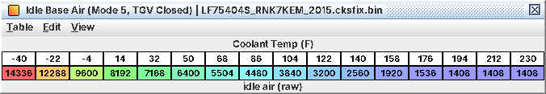

# A17. Idle control tables

Reference for C17 and the idle parts of C10. Stock LF75404S (2015 WRX, manual). Coolant axes of the idle tables run
−40 to 230 °F in 18 °F steps (−40 to 110 °C in 10 °C steps). A "pass" is one run of the idle code (rate not settled;
the 40 ms and 10 ms figures come from the code that uses each table). Decoded from code, untested on a car.

## A17.1 The idle air sum

```
target = ramp(mode table(coolant)) -> max(minimums) -> service overrides
air    = base air(mode, coolant, TGV closed?)
       + 1/2 x ( A/C + electrical/fan/accessory + post-start + target-change feed-forward
                 + rpm-drop recovery + pull-away anti-stall + learned air )
air    = (2 x air + feedback + carry-over) x altitude factor, limited to [minimum air, maximum air]
area   = Idle Air Request to Throttle Area( min(air, coolant limit) )   -> added to the throttle area
```

* Base-air units: the raw unit of the Idle Base Air tables; hot 1536 ≈ 1.9 % commanded throttle. Adders shown as "idle
  air (base-air units)" are already on the same scale.
* Minimum air = **Minimum Idle Air (Moving in Gear)** while rolling in gear, otherwise a fixed 1280. No maximum in
  stock.
* A torque request from another module over CAN can raise idle air to the area that delivers it,
  via **Idle Air from Throttle Area (Torque Request)**.

## A17.2 Targets and ramps

| Mode | Table (level 2) | Stock |
|---|---|---|
| 1, 2 | **Idle Speed Target (Post-Start, Modes 1/2)** | 1,800 to 104 °F; 1,450 at 122-176 °F; 700 from 194 °F |
| 3 | **Idle Speed Target (Warm Start, Mode 3)** | 1,800 to 104 °F; 1,450 at 122; 825 at 140; 725 at 158; 700 from 176 °F |
| 5 | **Idle Speed Target (Warm Idle, Mode 5)** | 1,450 cold, 1,200 at 68 °F, 950 at 122, 725 at 158, 700 from 176 °F |
| 7 | **Idle Speed Target (Warm-Up Drive-Off, Mode 7)** | as modes 1/2 |
| 4 | **Idle Speed Target (Cold Idle, Mode 4, Off in Stock)** | never entered |
| 6, 8 | **Idle Speed Target (Warm Idle, AT/CVT, Mode 6)**, **Idle Speed Target (Warm-Up Drive-Off, AT/CVT, Mode 8)**, **Idle Speed Target (In Drive, AT/CVT)** | AT/CVT only |

*Mode logic (manual coding).* Mode 1 while the engine is not turning. First turning pass: mode 2 if start coolant is
below 167 °F (75 °C), else mode 3. After 2 s: 2 → 7 if moving (≥ 2 km/h) while the warm-up flag is set; 2 → 5 if
moving with it clear, or once coolant reaches **Idle Post-Start Mode Exit Coolant** (122 °F for cold starts, never for
starts at 167 °F and up). Mode 3 behaves the same, so it only leaves by driving off. 7 → 5 when the warm-up flag
clears (about 167 °F).

| Ramp table (level 3, by coolant) | Stock |
|---|---|
| **Idle Target Ramp Rate (Mode 1 to 2)**, **Idle Target Ramp Rate (Mode 1 to 3)** | 128 rpm/pass |
| **Idle Target Ramp Rate (Mode 1 to 5)** | instant |
| **Idle Target Ramp Rate (Mode 2 to 5)**, **Idle Target Ramp Rate (Mode 3 to 5)**, **Idle Target Ramp Rate (Mode 7 to 5)** | 0.59 rpm/pass (slow fade) |
| **Idle Target Ramp Rate (Mode 2 to 7)**, **Idle Target Ramp Rate (Mode 3 to 7)** | 128 rpm/pass |

The ramp moves the target; base air follows it in proportion.

## A17.3 Minimum idle speed

| Source | Stock |
|---|---|
| **Idle Speed Minimum (Baro, Oil Temp)** (level 3) | 575 rpm; 650 at 248 °F (120 °C) oil; 700 at 266 °F (130 °C), every baro |
| Electrical / fan load minimum (calibration, not defined) | about 675 rpm |
| Other condition minimums (calibration, not fully decoded) | 700-862 rpm |
| CAN minimum idle request | from another module |
| **CAN Idle Speed Request (Alternate, Off in Stock)** and its two remap tables | unused |

## A17.4 Base idle air (level 3)

| Table | Stock (−40 → 230 °F) |
|---|---|
| **Idle Base Air (Mode 5)** | 14336 at −40 °F, 7296 at 32 °F, 4224 at 104 °F, 2048 at 158 °F, 1536 from 194 °F |
| **Idle Base Air (Mode 5, TGV Closed)** | same shape, 1408 hot; probably the table in use at a settled warm idle |
| **Idle Base Air (Post-Start, Modes 1/2)** (+ TGV Closed) | 17920 cold … 4864 at 176 °F, 1792 from 194 °F |
| **Idle Base Air (Warm Start, Mode 3)** (+ TGV Closed) | as Post-Start to 122 °F, then 2816 at 140, 2048 at 158, 1792 from 176 °F |
| **Idle Base Air (Warm-Up Drive-Off, Mode 7)** (+ TGV Closed) | as Post-Start |
| **Idle Base Air (Cold Idle, Mode 4, Off in Stock)** (+ TGV Closed) | unused |

Above 1,200 rpm base air is frozen. Edit each table together with its TGV Closed twin.



*Warm-idle feed-forward air by coolant with the TGVs closed: about nine times more air at −40 °F than hot*

## A17.5 Adders

| Group | Tables | Stock / note |
|---|---|---|
| A/C (level 3) | **A/C Idle Air Steady (A/C Load Sw Off, Neutral Sw On, Below 14 km/h)** and siblings, plus the matching Initial Kick tables: 16 in all, by A/C load switch, neutral switch and speed above / below 14 km/h (9 mph) | Steady 1024-1920; Kick up to 3584 at standstill, applied for 0.4 s after engagement, then fading to Steady. The "(Alternate, …, Off in Stock)" path is unused |
| Electrical (level 4) | **Idle Air Adder (CAN 0x370 Load Value)**, **Idle Air Adder (CAN 0x280 Stage)**, **Idle Air Trim (Charging Command)**, **Electrical Load Idle Air Hold Release (Alternator Command)** | Up to 1188 for electrical load (input inferred); up to −217 at low charging demand |
| Target change (3) | **Idle Air Target-Change Feed-Forward** | −1536 at a −200 rpm target step … +847 at +200 rpm, applied at once |
| Rpm drop (3) | **Idle RPM-Drop Recovery Air (Drop Continuing)** / **Idle RPM-Drop Recovery Air (Drop Slowing)** | 2560 when rpm falls ≥ 150 rpm/pass with the pedal released and ≥ 40 rpm below target |
| Pull-away (3) | **Pull-Away Anti-Stall Air** (+ Reference Decay / Offset) | 1188 at a 10 rpm dip up to 5939 from 30 rpm (standstill in gear, pedal pressed) |
| Post-start (3) | **Post-Start Idle Air (Initial)**, **Post-Start Idle Air Decay**, **Post-Start Idle Air Decay Delay**, the Post-Start Staged Air set, **Post-Start Staged Air IAT Add**; each with a "(TGV Closed)" twin | 15360 at −40 °F first start … 640 from 104 °F, decaying ×0.97-0.99 per 40 ms once rpm reaches target; the staged bump is non-zero only at −40 °F and from 158 °F (probably hot restarts). Start-type meanings inferred |

## A17.6 Feedback

*Air loop* (level 3; at idle with rpm near or below target):

| Table | Axes | Stock |
|---|---|---|
| **Idle Speed Feedback Map (Target MAP Offset)** | rpm change per pass (−40 … +40) × rpm error (−300 … +400, rpm − target) | +0.28 psi when 300 rpm slow and falling 40/pass; 0 at zero error, steady; −0.20 psi when 400 rpm fast and rising 40/pass |
| **Idle Speed Feedback RPM Error Factor (Above Target)** | rpm error ≥ 0 | 1.0 falling to 0.98 |
| **Idle Speed Feedback Gain Multiplier (Time in Feedback)** | passes in feedback | 1.0 flat |

Velocity-form PI: P on "flow" error (target MAP × shaped rpm − MAP × rpm), I on MAP error, with fixed gains.

*Torque loop* (level 3; inferred to be torque-based idle control; within about 500 rpm of target):

| Table | Stock |
|---|---|
| **Idle Speed Torque Feedback P** (idle target × error, error = target − rpm) | −5.8 … −14.8 ft-lb at 200 rpm too fast; +1.1 … +2.6 ft-lb at 200 rpm too slow |
| **Idle Speed Torque Feedback D** (idle target × rpm change over 20 ms) | below a 1,200 rpm target: +8 … +12 ft-lb on a fast fall, down to −49 … −66 ft-lb on a fast rise |
| **Idle Speed Torque Feedback Reference Torque** (rpm) | 15-19 ft-lb; never 0 |

The negative P part is kept only below about 8 km/h (5 mph); above that P is floored at 0. The row axis of P and D is
the idle target, not engine speed.

*Carry-over* (level 4): **Idle Feedback Carry-Over Decay (Positive)** / **Idle Feedback Carry-Over Decay (Negative)**
by rpm change; **Idle Feedback Carry-Over Limit (Positive)** (1.0 at the idle opening, 0.1 from about 35 % throttle)
/ **Idle Feedback Carry-Over Limit (Negative)** (1.0 at idle, 0 from about 24 %).

## A17.7 Learning (level 4)

| Table | Stock |
|---|---|
| **Idle Learn Filter Gain (Before First Transfer)** | 0.1 for 0.9 s, then 0.001 |
| **Idle Learn Filter Gain (A/C Off)** | 0.002 per 10 ms pass |
| **Idle Learn Filter Gain (A/C On)** | 0.001 flat |
| **Idle Learn Bias** | −238 at index 0 (long idling), 0 at 400-1,200 (1,000 = start value), +238 from 1,700 |
| **Idle Learn Bias Index Step** | negative at standstill, positive from 20 km/h; only at 176 °F (80 °C) and up, every 2 s |

Slot learning (A/C off; A/C on in two variants) steps by fixed amounts when feedback stays outside a band. All learned
values are backup RAM, cleared by the diagnostic idle-learning reset.

## A17.8 Altitude, area and limits

| Table | Level | Stock |
|---|---|---|
| **Idle Air Altitude Factor (Key-On/Cranking)**, **Idle Air Altitude Factor (Running, A/C Off)**, **Idle Air Altitude Factor (Running, A/C On)** | 3 | 1.72 at 8.4 psia (58 kPa) → 1.0 at 14.5 psia (100 kPa); identical, edit all three |
| **Minimum Idle Air (Moving in Gear)** | 3 | A10 |
| **Idle Air Request to Throttle Area** (+ **Idle Air Request to Throttle Area (Monitor)**) | 4 | Idle air → area; keep the Monitor identical |
| **Idle Air from Throttle Area (Torque Request)** | 4 | Exact inverse of the above |
| **Idle Air Request Limit (Coolant)** | 4 | Limit on idle air before the area conversion |

## A17.9 Idle spark

| Table | Level | Stock | Role |
|---|---|---|---|
| **Base Timing (Pedal Released, TGV Open)** / **Base Timing (Pedal Released, TGV Closed)** | 3 | 19-28° in the idle area, 34° at 2,000 rpm | Base side of the min() rule: a ceiling in stock |
| **Closed-Pedal Timing Target** | 3 | 6° at 500-700 rpm, 7 at 800, 8 at 900, 9 at 1,000, 10.5 at 1,200, 12 at 1,400, 15 at 1,800, 17 from 2,000 | Request side, the lower one in stock: sets idle and coast timing; fired directly during a scan-tool timing check |
| **Post-Start Closed-Pedal Timing Advance (Coolant at Start)** | 3 | +8° at a 32 °F start, +15° at 140 °F, 0 from 176 °F; not below 27 °F | Adds to the request side just after a start (stationary, ≤ 1,000 rpm), then ramps out |
| **Closed-Pedal Timing Coolant Compensation** × **Closed-Pedal Timing Coolant Compensation RPM Multiplier** | 3 | +13° cold, +7° at 68-140 °F, 0 from 176 °F; ×0.5 to 700 rpm | Both sides, so it moves fired idle timing |
| **Ignition Timing Cap (Pedal Released, TGV Open)** / **Ignition Timing Cap (Pedal Released, TGV Closed)** | 3 | A07 | Final cap |
| **A/C Cut Timing Retard Hold (RPM)** | 3 | 12 events at 650-1,200 rpm | 5° retard after the compressor switches off near standstill |
| **Base Timing: Pedal-Released Tables Enable** | 4 | set | Switch for the pedal-released base maps |

## A17.10 Logging

No idle value is on any logger definition (stock or patched). Log rpm (J01), coolant (J02), MAP (J07), commanded
throttle (J11), battery (J12), speed (J13), timing (J04). With a memory-read logger on LF75404S only: idle target rpm
at FFF8B236 (u16, rpm × 5.12) and final idle air at FFF8B202 (u16, base-air units). Other images not mapped.

## A17.11 Per-image differences

| Item | WRX 2015-2018 (manual) | Forester tS LF78001H, LV9N101C (CVT) |
|---|---|---|
| Warm-idle mode | 5 | 5, or 6 in some transmission states (not settled) |
| **Idle Speed Target (Warm Idle, Mode 5)** hot | 700 rpm | 575 rpm (mode 6: 700) |
| **Idle Base Air (Mode 5)** hot | 1536 | 2304 |
| 2018 LF9C100P | Mode 5 target 825 rpm at 122 °F instead of 950 | |

The early-2015 LV9N images lack the TGV Closed post-start staged-air set and the fallback-latch ramp tables.
