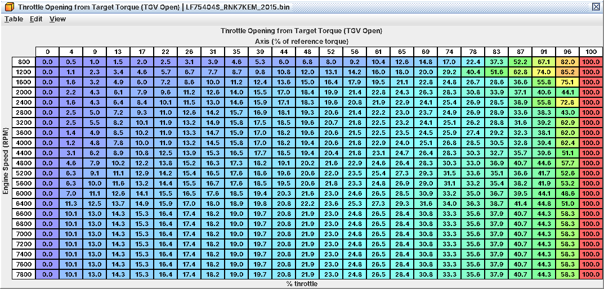

# 1. How this ECU makes power decisions

Read this once before you touch a table: where a table sits in the chain, what overrides it, and whether the car even
runs on the copy you are editing.

> *Nothing in these definitions has been verified on a running engine.* Every table, unit and behaviour was decoded
> from the ECU code and checked against the calibration of every supported ROM (the 2014-2020 WRX, WRX S4, Forester XT
> and Levorg 2.0 ROMs, and the Levorg 1.6); no change has been logged on a car yet. Treat your first logs as the real
> test.

*One guide for both engines.* The FA20DIT (2.0) and the FB16DIT (Levorg 1.6) ECUs run the same software: the same
tables, read by the same code, at each ROM's own addresses. Everything here applies to both unless it says otherwise;
1.10 lists what differs on the 1.6.

*The reference ROM.* Values quoted as "stock", and anything said to be zeroed or unused "on the reference ROM", are
from **LF75404S** (2015 USDM WRX, 6-speed manual). Other ROMs carry their own calibration: open yours and check before
you rely on a number. Unused on the reference ROM means the calibration does not use the table there (a switch or
threshold gates it out); it is not broken, and another ROM, or your edit to the gate, can bring it into play. C11
lists the differences between ROMs that matter.

## 1.1 What catches tuners coming from older Subarus

| You expect | On this ECU |
|---|---|
| Pedal maps to throttle | The pedal asks for *torque*. Throttle, boost, fuel and spark all follow a target torque (1.2). |
| Boost tables on rpm × throttle or rpm × pressure | **Target Boost** and the wastegate duty maps are rpm × *target torque* (ft-lb). Higher boost cells are only reached if the torque request gets there. |
| Base timing + knock advance = timing | Fired timing is the *lower* of Base Timing and Primary Ignition + KCA + FLKC. On the reference ROM the Primary side is lower at high load, so it is the real WOT map and Base Timing is a ceiling (C07). |
| Load in g/rev, open-ended | Same unit, but the ECU clamps load at 3.31 g/rev (256 %), and many tables also accept a % view where 100 % = 1.293 g/rev (1.4). |
| FBKC bleeds off as soon as knock stops | Inside the knock window it *holds* until about 100 knock-free events, then gives timing back at **FBKC Recovery Step (State 0x0F)**. A flat FBKC trace after a knock event is normal (C07). |
| One requested-torque map | Four drive-mode maps (SI-Drive), each with a Monitor copy, plus separate AT/CVT maps (1.6). |
| Rev limiter is a spark/fuel cut table | It is a torque request of zero: fuel cut to all four cylinders and the throttle closes; no spark cut (C09). |
| A boost cut you can raise freely | **Overboost Limit** above about 236 kPa abs (19.5 psi gauge) can never trigger with the reference ROM's margins: the pressure reading runs out first (C04, C09). |
| Rail pressure fault at the limit you set | P0088 trips at **P0088 Rail Pressure High Limit** + 2.5 MPa (about 17.5 MPa / 2,540 psi stock) and recovers only below the limit itself (C03). |

## 1.2 The chain

```
 pedal ─► Requested Torque (drive mode / SI-Drive)                         C05, C19
            │
            ▼  lowest of: Maximum Torque (IAT), Maximum Torque (DAM), VDC limit (CAN)
            ▼  tip-in / tip-out shaping: Target Torque Rise / Fall
       TARGET TORQUE (ft-lb) ───────┬──────────────────────────┐
            │                       │                          │
            ▼                       ▼                          ▼
   Target Boost (rpm × ft-lb)   Throttle Opening from      limit states (rev, overboost,
   Wastegate Duty Initial /     Target Torque              decel, faults) → torque cap
   Maximum (rpm × ft-lb)        (rpm × % of reference)     → throttle cap, cylinders cut (C18)
   + boost feedback (C14)       → ETC target (C13)
            └──────────────► air in the cylinders (MAF + manifold model) ─► LOAD (g/rev)
                                                                              │
                                  ┌───────────────────────────────────────────┤
                                  ▼                                           ▼
        fuel = air × target fuel/air, ÷ injector flow          spark = min( Base Timing,
        (closed-loop target or open-loop map) + latency             Primary Ignition + KCA + FLKC )
                                                                    + FBKC + retards
```

What a tuner takes from it:

* *Target torque is the master value.* It sets the boost target, the wastegate feed-forward and the part-throttle
  opening at the same time. A stock ROM cannot log it; the logging-patched ROM can (C02).
* *To make more power you raise the torque the driver can ask for* and the caps above it, then the boost and duty
  tables in the columns that request now reaches (C05). Raising **Target Boost** alone does nothing if target torque
  never reaches those columns.
* *Throttle at part load comes straight from the Throttle Opening from Target Torque maps*, e.g.
  **Throttle Opening from Target Torque (TGV Open)**. Every row reaches 100 % at
  **Throttle Opening Map Reference Torque** (stock about 220 ft-lb / 300 Nm from 2,000 rpm), so the throttle is wide
  open from there up and boost does the rest.
* *Boost Limit is not a boost cut.* The torque model uses it as its full-load manifold pressure. Raise it with
  **Target Boost** or the model caps the target.
* *Fuel follows modelled cylinder air*, which the MAF anchors in steady state (C04, C03).
* *Limits take power away through torque.* The limit-state machine picks a torque cap, and the ratio of cap to actual
  torque becomes a number of cylinders to cut (0-4). The rev limiter asks for zero, so all four injectors cut on every
  event while the throttle closes toward about 37 ft-lb (50 Nm). Fuel comes back once rpm is at or below the reset rpm
  *and* manifold pressure is under **Rev Limit Reset Maximum MAP** (stock about 9.7 psi gauge).



*Part-throttle opening by rpm and % of reference torque: every row reaches 100 % at the reference*

## 1.3 What overrides what

| If you change … | … it only takes effect when | Otherwise the winner is |
|---|---|---|
| **Requested Torque (Drive Mode 1, Default)** | The caps allow it, and the car is in that drive mode | The lowest torque cap; the active drive-mode map |
| **Base Timing (EGR Off, TGV Open)** | It is the lower side of the timing min() | Primary Ignition + KCA + FLKC (on the reference ROM at high load) |
| **Primary Open Loop Fueling** (leaner) | The other open-loop path is leaner too | The richer of the two open-loop paths (C06) |
| A monitor-copied table | Its (Monitor) copy is edited the same | A plausibility fault (inferred, 1.7) |
| Any "(TGV Open)" table | The TGVs are open (most warm driving) | The "(TGV Closed)" twin, including warm idle |
| Any table on a manual car tagged "(AT/CVT …)" | Never on a manual coding | The non-AT/CVT table |

## 1.4 Load in g/rev

Load is modelled cylinder air per revolution, shown in g/rev by default with % as the alternate unit. 100 % = 1.293
g/rev (a full 2.0 L of air at standard density per cycle; the same unit on the 1.6). Stock high-load maps run to about 2.6-3.1 g/rev (200-240
%). The ECU clamps load at 3.31 g/rev (256 %): every load axis tops out there, whatever the turbo flows. Other air
ceilings: C04.

## 1.5 Combustion modes in one paragraph

After every start the ECU steps through five combustion modes: 0 start (compression-stroke injection), 1 early
warm-up (split injection: an intake-stroke pulse plus a late compression pulse with about 40 % of the fuel),
2 stratified catalyst heating (a single late compression pulse timed off a big spark retard, rail pressure held at
2,175 psi / 15 MPa, coolant up to 167 °F / 75 °C, at most **Catalyst Heating Maximum Time**, 10 s), 3 a milder second
warm-up phase (split injection again, less retard), and 4 normal running (one injection per cycle). Everything in
Part II is mode 4 unless it says otherwise; open-loop enrichment and closed-loop learning run only there. Tables that
carry a mode in their name (rail pressure, closed-loop lean limits, catalyst heating) only matter in that phase. If a
cold-start log looks odd, log the mode first (L08, C02). C12 covers the start sequence.

## 1.6 Which copy is the car running on

Most maps come in sets. The name says which branch a table is, and every description starts with a "When used:" line.

| Selector | What decides it | Tables that follow it | Tuning note |
|---|---|---|---|
| TGV open / closed | TGV position, blended by open fraction | Base Timing, open-loop fuel, closed-loop target, throttle maps, VE, cam targets, idle air | Open in most warm driving; *closed* at a settled warm idle, so the "(TGV Closed)" idle tables are the live ones. |
| AVCS active / inactive | Both cams under control | Open-loop TGV/AVCS sets, Primary Ignition | "Active" is warm running. |
| EGR active / off | Commanded EGR on at 3.0 %, off below 2.5 % | Base Timing, closed-loop target, throttle maps | Part load uses EGR; WOT runs "EGR Off". |
| Pedal released | Pedal at 0 % | Base Timing (Pedal Released, …), **Target Rail Pressure (Pedal Released)** | Idle and coast. |
| High-pedal latch | Pedal ≥ 90 %, released < 85 % | AVCS set 2, alternate injection timing | At sea level **Intake Cam Target 2B (TGV Open, High Pedal, Sea Level)** sets WOT intake cam (C08). |
| Drive mode (SI-Drive) | CAN request from the meter | Requested Torque, Target Torque Rise, TGV torque thresholds, cruise pedal | See below. |
| Transmission coding | Calibration bits, clear on a manual | Every "(AT/CVT …)" table | See below. |

*SI-Drive maps.* The four Requested Torque maps are named by drive mode and position: 1 = Default (no SI-Drive
request, and the fallback), 2 = Sport (S), 3 = Intelligent (I), 4 = Sport Sharp (S#). *The positions are inferred from
the stock maps*, not confirmed with a CAN capture. On the WRX manual images modes 1-3 are identical and mode 1 is the
one the car runs on (no SI-Drive switch); keep the others consistent if you want the same behaviour whatever request
arrives. Mode 4 on the reference ROM is the mode-1 map on a compressed rpm axis: more torque than mode 1 at low rpm, less from
about 2,400 rpm. Mode 3 is refused until coolant passes about 126 °F (52 °C). C05 and C19 have the detail.

*AT/CVT tables.* On an AT/CVT-coded image (the CVT WRX, WRX S4, Forester and every Levorg) the "(AT/CVT)" Requested Torque table *is*
the whole map for its drive mode and the plain table is ignored. On a manual they are unused. The definition reads the
coding from each ROM and puts the other transmission's tables at Debug level.

## 1.7 Monitor copies

A second copy of the torque and throttle model runs as a plausibility monitor with its own copies of the maps, shown
with "(Monitor)" in the name right after the original. *Always edit a monitor copy identically with its original.* If
the two differ, expect a throttle or torque plausibility fault (inferred: the fault reaction has not been traced).

Monitor copies exist for every Requested Torque and Throttle Opening from Target Torque map, the reference and loss
torques (**Throttle Opening Map Reference Torque**, **Full-Load Reference Brake Torque**,
**Full-Load Reference Torque Loss**, **Friction and Pumping Torque Loss**) and the throttle area tables (C04).

The opposite case also exists: where several ROM pointers share the same bytes, one table edits them all (its
description says so).

## 1.8 The definition

### Folders, in tuning order

| Folder | Contents |
|---|---|
| 1 Fueling | Injectors & rail; open loop; closed loop & trims; transient; cranking; injection timing; catalyst heating; decel cut; purge |
| 2 Ignition Timing | Base timing; compensations; knock control and detection; retards; idle & closed-pedal timing |
| 3 Boost Control | Targets; wastegate duty; feedback & compensations |
| 4 Torque & Throttle | Requested torque; torque limits & protection; throttle; torque model (incl. Primary Ignition) |
| 5 Airflow & Engine Model | VE, throttle flow; exhaust & temperature models |
| 6-8 | AVCS; Idle; EGR & TGV |
| 9 Vehicle Functions | Cruise; brake override & VDC; fan, charging, A/C; CAN-side |
| 10-11 | Sensors; Diagnostics & Switches (monitor thresholds, calibration switches, DTC enables) |

Main maps first, then compensations, then minor tables; category names carry numbers ("01.02 …") to keep this order.

*Editors and units.* RomRaider (1.0.0 or later) uses one file per engine, with an imperial and a metric scale on every
table whose unit depends on the system. EcuFlash has one scale per table, so its definitions come as an Imperial and
a Metric set: install one. This book quotes the imperial units.

### User levels

| Level | What is there |
|---|---|
| 1 Beginner | About 50 tables that make a normal tune: injectors, open/closed-loop targets, base timing, KCA maxima, boost and duty, requested torque, torque caps, rev limit, throttle maps, MAF scaling |
| 2 Intermediate | Common compensations and limits, DTC enables |
| 3 Advanced | Everything else that is live on the reference ROM |
| 4 Highest | Model physics, knock signal processing, monitor thresholds, calibration switches (Primary Ignition is here) |
| 5 Debug | Tables this ROM's calibration does not use (zeroed, or gated out by a switch or threshold), tables of code paths nothing calls, and the other transmission's tables; flagged red in the editor |

Every workflow in this book gives the level of each table.

### Name tags

* Table names say what a table is, not what a particular calibration holds. A table whose reading code this ROM's
  calibration bypasses, or gates with a value it never reaches, sits at level 5 in that ROM: editing it does nothing
  unless you change the gate too. The level is set per ROM, so the same table can be at level 4 in a ROM that uses it.
* "(Unused Routine)", "(Unused Mode)": the table belongs to a code path nothing calls.
* "(AT/CVT …)", "(Monitor)": see 1.6 and 1.7.

When a table's short summary and long description seem to disagree, the long description carries the evidence.

## 1.9 Where to go next

Set up logging before the first change (C02), then work through Part II in order: fuel hardware (C03), air measurement
(C04), power (C05), fueling (C06), timing and knock (C07), cams (C08), limits (C09), drivability (C10). Keep C11 open
while you work.

## 1.10 The Levorg 1.6 (FB16DIT)

* Same software as the 2.0 ROM of the same version, so the chain above, the folders and the workflows are the same.
  The calibration is the 1.6's own (injectors, torque, boost and timing maps all differ): read the values from your
  ROM, not from this guide.
* All 1.6 ROMs are CVT: the "(AT/CVT …)" tables are the live ones.
* The 2014-2017 1.6 ROMs have a shorter knock background function with four extra rows,
  **Knock Background Clear Step (Event 1)** to (Event 4) (A07).
* The 2015 1.6 ROMs (LF76…) are a software build no 2.0 ROM shares. They have a second base-timing IAT pair,
  **Base Timing IAT Compensation 2** and **Base Timing IAT Compensation Multiplier 2** (C07), and an intake cam
  target ceiling, **Intake Cam Target Limit** with its temperature offset and factor (C08).
* The stock logger definition works unchanged; there is no logging patch for the 1.6 yet (C02).
* The 2019-2020 1.6 ROMs (LF9D…, LF9F…) are 2.5 MB ROMs, like the 2019 Levorg 2.0 STI: see C11 for checksum and
  flashing.
