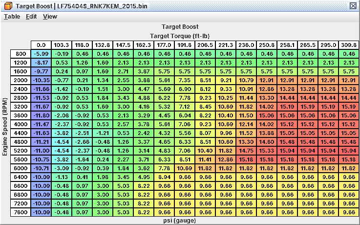

# 2. Logging and setup

Set up logging before the first change. On this ECU the values you tune against (target torque, knock corrections,
rail pressure, boost target) are not visible on a stock ROM, and a stock baseline log is the only way to prove a later
change did what you meant.

## 2.1 Stock logger or logging-patched ROM

| Option | What you get | Needs | Status |
|---|---|---|---|
| Stock logger definition | 46 parameters (J01-J46), same on every 2015-2018 image, plus pending/stored trouble codes in the DTC tab | Nothing | Decoded from code; conversions checked |
| Stock logger, OBD protocol | 32 standard OBD-II PIDs, including actual rail pressure, commanded λ and oil temperature | Switch RomRaider's logger protocol to OBD (one protocol per session) | Standard scalings; sources read in code |
| Logging-patched ROM | The 46 plus 24 more (L01-L24): target torque, knock terms, rail pressure, boost target, final closed-loop target … | Flash the patched copy of your ROM | Built for all ten images; *untested on hardware* |
| Passive CAN | rpm, pedal, throttle, torque request / estimate / maximum, coolant, oil temp, MAP, gear, SI-Drive mode, wheel speeds | CAN tool + the DBC | Decoded from code (C19) |

The patch only re-points logger index entries and fixes the checksum, so engine behaviour is unchanged; one logger
definition fits every patched ROM. Check on the car that the new parameters move: one stuck at a constant means the
patch did not take.

*Recommendation:* if you are going to tune more than injectors and MAF, flash the patched ROM first and log your stock
baseline on it. Tuning boost, torque or timing blind to target torque and FBKC is guesswork on this ECU.

## 2.2 The parameters that matter

A02 has every parameter with its conversion. The ones you will use, and what to watch for:

| ID | Parameter | Tuner notes |
|---|---|---|
| J04 | Ignition Timing | Fired timing, 0.5° resolution |
| J05 / J06 | Mass Airflow / MAF Sensor Voltage | J05 flat-lines at 300 g/s: log J06 for high-flow MAF work |
| J07 / J08 | Manifold Absolute / Relative Pressure | One byte: J07 shows at most 255 kPa abs |
| J11 / J15 | Commanded Throttle / Throttle Position | ECU command vs actual blade |
| J13 | Vehicle Speed | From the VDC over CAN; 10 km/h if that frame is lost |
| J20 | Closed Loop Target | Early stage, only λ 0.96-1.17: use L15 |
| J28 | Long-Term Fuel Trim | 0.39 % per count (older definitions showed double) |
| J33 | Accelerator Pedal | The pedal the torque request uses |
| J35 | A/F Sensor Lambda | The ECU's own front-sensor λ; compare with your wideband |
| L01 / L02 | Target Torque / Throttle Torque Request | The boost axis; spotting a torque cap or a cut on the throttle side (C05, C09) |
| L03 | Base Timing | The ceiling side of the timing min() (C07) |
| L04 / L05 / L06 | FBKC / FLKC / KCA | Knock work. L07 is only their sum, not what gets fired |
| L08 | Combustion Mode | Cold starts; 4 = normal (C12) |
| L09 / L10 | Fuel Rail Pressure / Target | Pump keeping up (C03) |
| L11 / L12 | Target Boost / Boost Control Pressure | Boost tracking, overboost margin |
| L13 / L14 | Wastegate Duty (Full Resolution) / Feedback | How much of the duty is feedback |
| L15 / L16 / L17 | Closed Loop Target / A/F Correction / A/F Learning | Final target and the trims |
| L22 / L23 | Intake / Exhaust Cam Target | Against actual J29-J32 |
| L24 | Injector Pulse Width | Injector headroom; idle minimum pulse |

Parameters still named by an internal tag (J16-J19, J21-J27) are only partly decoded: do not tune to them. *Not
reachable on a stock ROM over SSM:* everything in the L rows. Over OBD (A02.4) a stock ROM does give actual rail
pressure (PID 0x23) and the commanded λ (PID 0x44), but not FBKC/FLKC, target boost, target torque or the rail target.

## 2.3 What to log for each job

Keep the list short: the logger polls every parameter in turn, so fewer parameters means a faster sample rate.

| Job (chapter) | Stock ROM | Add with the patch |
|---|---|---|
| Every log | J01, J07, J33 pedal, J11, J04 | L01 |
| Injectors, rail, E85 (C03) | J28, J05, J37, wideband; rail pressure from OBD PID 0x23 in a separate session | L09/L10, L16/L17, L24 |
| MAF, intake, MAP (C04) | J06, J28, J03, J07, wideband | L16 |
| Torque, boost, throttle (C05) | J07/J08, J10, J11, J15 | L01, L02, L11/L12, L13/L14, L21 |
| Fueling (C06) | J28, J35, wideband | L15, L16, L17 |
| Timing and knock (C07) | J04, J14 | L03, L04, L05, L06 |
| Cams (C08) | J29-J32 | L22/L23 |
| Limits (C09) | J01, J07, J13, J11 | L01, L02, L12 |
| Idle, starting, drivability (C10) | J01, J02, J11, J33 | L08, L21 |

A wideband of your own is still the reference for WOT AFR: the ECU's values say what it is aiming for, not what the
engine burns in open loop.

Two log-reading habits specific to this ECU:

* *FBKC holds.* After a knock event inside the knock rpm window, FBKC stays flat for about 100 knock-free events
  before it recovers. A flat retard trace does not mean the knock is continuing (C07).
* *Fuel trims are spread over two values.* Steady-state error is L16 + J28, not J28 alone, because the learned trim
  cells are by load and rpm, not by MAF voltage (C04).

## 2.4 Units

The definition shows these units by default; most tables offer the alternate.

| Quantity | Default | Alternate | Notes |
|---|---|---|---|
| Engine load | g/rev | % | 100 % = 1.293 g/rev; the ECU clamps at 3.31 g/rev (256 %) |
| Torque | ft-lb | Nm | The internal encoding tops out at about 457 ft-lb (619 Nm) |
| Boost (targets, limits) | psi gauge | kPa abs | Gauge = relative to a fixed 101.325 kPa, not measured baro. Absolute limits are quoted in both: the 256 kPa abs MAP clamp is 22.4 psi gauge |
| Temperatures | °F | °C | |
| Fuel targets | AFR (gasoline, 14.7) | λ | λ = AFR / 14.7; on E85 read every AFR as λ (C03) |
| Ignition timing | ° BTDC | | 0.5° steps; negative = ATDC |
| Knock corrections | ° | | 0.35° steps |
| Rail pressure | psi | MPa | Stock peak 15.0 MPa ≈ 2,175 psi |
| Injector Scaling | g/s at the 0.3 MPa reference | | Stock 2.61 g/s (about 15.2 g/s at 10 MPa) |
| Pulse widths, latency | µs | | Do *not* follow Injector Scaling (C03) |
| Cam timing | crank ° | | Intake: advance from rest; exhaust: retard from rest; larger = more overlap on both |

MAP and VE axes are psia. Controller gains and model states stay raw. Every "V" assumes a 5 V ADC reference
(inferred).

## 2.5 Reading a stock map

Before changing a cell, check four things:

1. *The axes.* The ones that trip people up: rpm × load (g/rev) for timing, open-loop fuel, AVCS and rail pressure;
   rpm × *target torque* (ft-lb) for **Target Boost**, **Wastegate Duty Initial** and **Wastegate Duty Maximum**; rpm
   × pedal for Requested Torque; rpm × % of reference torque for the throttle maps; psia for VE.
2. *The "When used:" line.* If the table is selected only by a condition never met in stock it is "(Off in Stock)" and
   your edit does nothing.
3. *The stock shape.* Many families are identical in stock (drive modes 1-3 on the WRX, the TGV/AVCS open-loop sets,
   the two injector flow compensation tables). Keep a family identical unless you know which member the car runs on.
4. *Partners.* Monitor copies (C01), the "what has to move with them" list of each workflow, and the hard limits in
   C11.

*Target Boost on rpm × target torque: the column axis is ft-lb, not throttle or pressure; stock peaks about 15.9 psi near 5,200 rpm*

### First look

Note the stock values of: **Requested Torque (Drive Mode 1, Default)** (258 ft-lb / 350 Nm from about 60 % pedal at
2,400-4,400 rpm), **Maximum Torque (IAT)**, **Maximum Torque (DAM)**, **Target Boost** (peak about 15.9 psi gauge),
**Boost Limit**, **Overboost Limit**, **Base Timing (EGR Off, TGV Open)**,
**Primary Ignition (TGV Open, AVCS Active)**, **Primary Open Loop Fueling** and **Rev Limit RPM** (6,700 rpm).

## 2.6 Before the first change

1. Save the untouched stock read where you will not overwrite it.
2. Flash the logging-patched ROM if you will use it, and confirm the L parameters move.
3. Log the stock car: a cold start to warm idle, part-throttle driving, and a WOT pull in 3rd or 4th.
4. Note DAM, LTFT and FLKC after a few drives: your learning baseline.
5. Change one workflow's group of tables at a time (Part II), log the same conditions again, compare.
6. Correct the checksum before every flash (not covered here).
