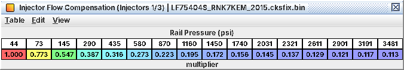
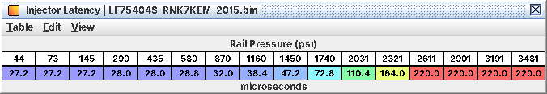
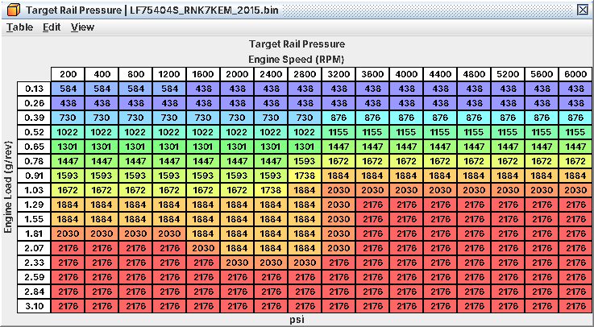

# 3. Injectors, fuel pressure and E85 without a flex sensor

The hardware side of fueling: what to change when the injectors change, how to raise rail pressure without tripping
the fuel-system fail-safe, and how to run a fixed ethanol blend on an ECU that has no ethanol input. Mixture targets
are C06; the full fuel calculation is C15; numbers and arithmetic are in A03.

*Untested on a car.* The arithmetic is read from the code; the conclusions marked inferred are mine.

## 3.1 What you need to know first

Fuel is metered by mass: cylinder air ÷ 14.7 (a constant, not a table) → pulse via **Injector Scaling** → × enrichment
and trims → converted to actual rail pressure by **Injector Flow Compensation (Injectors 1/3)** /
**Injector Flow Compensation (Injectors 2/4)** → + **Injector Latency** → floored at **Injector Minimum Pulse Width**.

Three consequences drive every injector or fuel change:

* *Injector Scaling is a flow at 0.3 MPa, not at operating pressure.* Stock 2.61 g/s. The stock flow compensation
  follows √(0.3 MPa / P), so the ECU assumes about 15.2 g/s at 10 MPa. Never enter a 10 MPa rating directly.
* *Mass-based tables follow Injector Scaling by themselves.* Open loop, enrichments, after-start fuel, closed loop: no
  change needed.
* *Tables in µs of pulse do not.* Cranking fuel, the throttle-rate transient fuel and the HPFP fuel-quantity axes must
  be rescaled by hand (3.3), and so must the load axis of **Transient Fuel Film Target**.

*Stock flow compensation: the √(0.3 MPa / P) law referenced to 0.3 MPa*

## 3.2 Workflow: bigger injectors

*Goal.* Same fuel mass and AFR with injectors that flow more.

*Tables.*

| Table | Level | Change |
|---|---|---|
| **Injector Scaling** | 1 | New flow at the 0.3 MPa reference |
| **Injector Latency** | 1 | New opening delay by rail pressure (stock 27 µs at low pressure to 220 µs from about 2,600 psi) |
| **Injector Minimum Pulse Width** | 2 | New minimum controllable pulse (stock 450-600 µs) |
| **Injector Flow Compensation (Injectors 1/3)**, **Injector Flow Compensation (Injectors 2/4)** | 1 | Only if the new injector does not follow √P; keep the two identical |

*What has to move with them.* Every table in 3.3. Not optional: otherwise cranking and transient fuel come up short,
the pump gets the wrong feed-forward and the wall-film fuel works at the wrong loads.

*Procedure.*

1. Get the new injector's flow at a known pressure. From g/s at 10 MPa (keeping the stock compensation curve):
   **Injector Scaling** = flow at 10 MPa × 44 / 256. From a flow ratio measured the same way for both injectors: new =
   2.61 × new flow / stock flow. Data sheet in cc/min: g/s = cc/min × the density of the test fluid it names / 60.
2. Enter latency and minimum pulse from the injector data. The latency table has no battery-voltage axis, only rail
   pressure (fits a DI driver on a regulated supply, inferred).
3. Work out k = stock flow / new flow (below 1 for bigger injectors) and apply it to every table in 3.3.
4. Leave the open-loop, enrichment and closed-loop tables alone.

*Log / verify.*

* L16 + J28 at idle and cruise, wideband at WOT. An offset everywhere = **Injector Scaling**; only at idle or short
  pulses = latency or minimum pulse.
* Injector pulse (L24) at idle must stay clearly above **Injector Minimum Pulse Width**, or the floor adds fuel the
  ECU did not ask for and purge gets cut (3.6).
* Cold starts at several temperatures, since cranking fuel was rescaled by hand.

*Pitfalls.*

* **Injector Flow Compensation (Injectors 2/4)** is looked up at rail pressure plus
  **Injector 2/4 Rail Pressure Offset** (stock 0). Keep the two compensation tables equal unless you mean to trim one
  pair.
* Very large injectors: check the short compression-stroke start injections stay above the minimum pulse (C12).

*Injector opening delay by rail pressure, added to every pulse*

## 3.3 The tables that do not follow Injector Scaling

Multiply by k = stock flow / new flow (for E85, by 14.7 / stoichiometric AFR of the blend; 3.5).

| Table | Level | What it is | Rescale |
|---|---|---|---|
| **Cranking Fuel (First Attempt)**, **Cranking Fuel (Repeat Attempt)** | 2, 3 | Cranking pulse by coolant | × k |
| **Cranking Fuel Secondary (First Attempt)**, **Cranking Fuel Secondary (Repeat Attempt)** | 3 | Cranking pulse when the crank runs in normal combustion mode (after about 10 s of cranking, the low-rail-pressure start latch, or a re-crank), and a decaying running floor | × k |
| **Transient Fuel Throttle-Rate Gain**, **Transient Fuel Throttle-Rate Gain (AT/CVT)** | 2 | Fuel on throttle movement | × k |
| **Transient Fuel Throttle-Rate Term Minimum** | 3 | Largest throttle-closing fuel reduction | × k |
| **Transient Fuel Film Target** | 2 | Wall-film target; values are mass, but the *load axis* is fuel-based | axis × k |
| **HPFP Feedforward Command** | 4 | Pump command by fuel quantity (µs) × rpm | fuel-quantity axis × k |
| **HPFP Integral Threshold** | 4 | Pump integrator deadband by fuel quantity (µs) | axis × k |
| **Injector Latency**, **Injector Minimum Pulse Width** | 1, 2 | Injector timing properties | From injector data, not × k |
| **Purge Injector Minimum Pulse Margin** | 4 | Margin on time above the minimum pulse | Probably leave |

Off-in-Stock and "Unused Routine" cranking variants need no rescaling.

## 3.4 Workflow: raising rail pressure

*Goal.* More injector flow at the same pulse (flow grows with √P: 15 → 20 MPa is about +15 %), or better atomisation.

*Stock target.* **Target Rail Pressure** (level 1, rpm × load) runs from about 435 psi (3 MPa) at light load to 2,175
psi (15.0 MPa): from about 1.29 g/rev at 3,600 rpm and up, but only from about 2.1-2.6 g/rev below 3,600 rpm. With the
pedal released **Target Rail Pressure (Pedal Released)** (level 2) takes over; start and warm-up have their own
targets (C12). The target only moves when the change exceeds about 54 psi (0.37 MPa).

*Stock rail pressure target: about 435 psi at light load to 2,175 psi at high load*

*Tables.*

| Table | Level | Stock |
|---|---|---|
| **Target Rail Pressure** | 1 | 435-2,175 psi |
| **P0088 Rail Pressure High Limit** | 3 | 2,175 psi (15.0 MPa); trips at + 2.5 MPa |
| **Rail Pressure Sensor Voltage High Limit (P0193)** | 3 | 3.254 V = 20.6 MPa (2,990 psi) |

*What has to move with them.*

* **P0088 Rail Pressure High Limit**: the code trips when actual pressure exceeds this *plus a 2.5 MPa (363 psi)
  hysteresis* for about 2 s, so stock it trips at about 17.5 MPa (2,540 psi). Once tripped it recovers only when
  pressure falls back to the limit itself. A trip sets P0088 and a fuel-system fail-safe flag, and while the code is
  pending **Throttle Limit (Fuel Pressure Fault)** caps the throttle (stock about 18 % at 2,000-4,000 rpm, 6 % from
  4,400 rpm): the car falls flat. Rule: keep peak actual pressure, overshoot included, below limit + 2.5 MPa, and keep
  the limit above your normal operating pressure so a trip can recover.
* **Rail Pressure Sensor Voltage High Limit (P0193)**: targets near 20 MPa need it raised, and the sensor's own range
  checked.
* The deviation monitors (**P0087 Rail Pressure Deviation Limit**, 3.3 MPa below target for about 10 s;
  **P0088 Rail Pressure Deviation Limit**, 6.0 MPa above target) are relative to the target and move with it. A
  deviation fault or a rail sensor fault also forces **Fail-Safe Rev Limit (Rail Pressure Fault)**, a 6,100 rpm full
  fuel cut (the bit mapping is inferred). **P0087 Rail Pressure Low Limit** (0.70 MPa) counts only below the table −
  0.30 MPa.
* No fuel table changes for the pressure itself: flow compensation already accounts for it.

*Procedure.*

1. Raise **P0088 Rail Pressure High Limit** first.
2. Raise **Target Rail Pressure** only in the high-load cells where you need the flow; leave light load alone (pump
   load, noise).
3. Log and confirm the pump holds the new target before relying on it.

*Log / verify.* Fuel Rail Pressure (L09) against Target (L10) through WOT pulls to redline, with injector pulse (L24).
Patched ROM only (C02). A pump that cannot keep up shows actual falling away from target as rpm and fuel demand rise.

*Pitfalls.*

* Pump capacity is hardware: if actual sags at high demand, a higher target only makes it worse.
* The target table holds at most about 23.3 MPa (3,380 psi); the sensor conversion stops at 30 MPa.
* The pump loop itself (level 4: **HPFP Feedforward Command**, **HPFP Proportional Gain**, **HPFP Integral Step**,
  **HPFP Integral Threshold**) is clamped between **HPFP Command Minimum** and **HPFP Command Maximum Base** +
  **HPFP Command Range** (stock 225-345°). The upper limit does *not* move with the minimum.
  **HPFP Solenoid Window End Limit** already trims the window with rpm at normal battery voltage. Leave all of these
  alone unless the pump changes.
* A WRX "stuck at 6,100 rpm" has a fuel-system fault set: rail pressure deviation, rail sensor, or injector driver
  (**Fail-Safe Rev Limit (Injector Driver Fault)**). On the Forester tS 6,100 rpm is the normal rev limit.

## 3.5 Workflow: E85 without a flex sensor

*What the ECU has.* No ethanol input: every analog and CAN input is mapped (A04) and none is a fuel-composition
sensor. 14.7 is a constant in the base-fuel code. So E85 means a *fixed-blend tune*: lower **Injector Scaling** so
each unit of "fuel" the ECU meters is more liquid.

*Tables.*

| Table | Level | Change |
|---|---|---|
| **Injector Scaling** | 1 | × AFRstoich(blend) / 14.7 |
| Every table in 3.3 except latency and minimum pulse | 2-4 | × 14.7 / AFRstoich(blend) |
| **Base Fuel Quantity Limit** | 3 | × 14.7 / AFRstoich(blend), to keep the stock air ceiling |
| Mixture targets (C06) | 1 | Re-think in λ |
| Timing, boost (C05, C07) | 1 | Your call |

True E85 (stoichiometric about 9.8 AFR, factor about 1.5): **Injector Scaling** 2.61 → about 1.74 g/s, the µs tables
and **Base Fuel Quantity Limit** × about 1.5. Use the ratio of the blend you actually have.

*Why it works (inferred from the arithmetic).* Every mass-based fuel quantity scales by the same factor, which is what
a lower stoichiometric ratio needs; closed loop and trims work in λ and stay correct.

*Reading AFR on E85.* Every AFR in the definition is λ × 14.7. Read them as λ: "11.8 AFR" in
**Primary Open Loop Fueling** means λ 0.80 on any fuel. Set your wideband to λ, or to the gasoline scale, but do not
mix the two.

*Log / verify.*

* Wideband λ against commanded across the map; L16 and J28.
* Trims that move with the seasons mean the blend moved. Open loop gets no correction, so a blend that drifts lean
  shows up only at WOT.
* Injector pulse (L24) and rail pressure (L09/L10) at peak power: E85 needs 40-50 % more fuel volume, so injectors and
  pump run out sooner.

*Pitfalls.*

* *The fuel-quantity ceiling.* **Base Fuel Quantity Limit** allows 4.98 g/rev of air at stock scaling, but the ceiling
  falls with the displayed flow: at 1.74 g/s it is about 3.32 g/rev, just above the 3.31 g/rev load clamp, and below
  about 1.73 g/s it becomes the first limit hit. Above it the base pulse stops rising with air and the mixture goes
  lean. Scale it as in the table. Bigger injectors raise the ceiling and need no change.
* Cold starts on E85 are harder: the cranking tables only scale fuel, they know nothing about E85's poor cold
  vaporisation. Expect to add cranking and after-start fuel by testing.
* A gasoline-scaled tune on E85, or the reverse, is a mixture error of about 50 % at full load.

## 3.6 Per-injector trims and the rest

* **Per-Injector Fuel Trim 1** to **Per-Injector Fuel Trim 4** (level 3): multipliers per cylinder by fuel quantity
  and rpm, 128 = no change, stock all 128. Use them once you have per-cylinder evidence (EGT per port, plugs). Slot n
  is cylinder n (inferred, strong).
* **Per-Injector Fuel Multiplier 1 (Single Injection)** to 4 (level 3): the same idea for the single-injection
  strategy, stock 128.
* Multiple injections in normal running are off: **Double Injection Quantity Window Low** and the other window tables
  are at maximum in stock, so normal running always injects once. The cold-start split in combustion modes 1 and 3 is a
  separate mechanism and stays active (chapter 12). Outside this guide.

* **Purge Injector Minimum Pulse Margin**: with rich purge vapour, purge is cut when any pulse comes this close to the
  minimum pulse. Big injectors at idle can hit it; idle trims that wander when the canister is loaded are the symptom.
