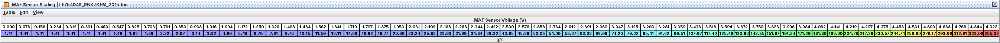
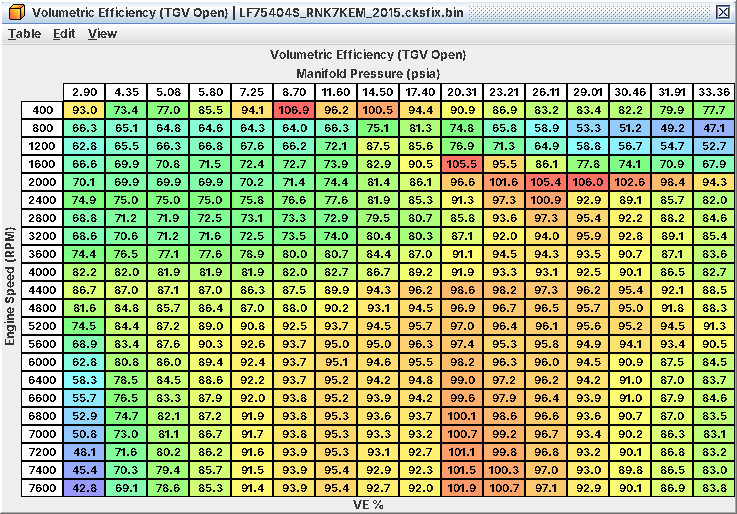
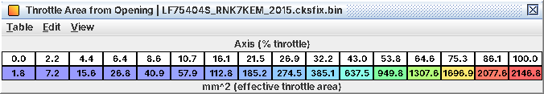

# 4. MAF scaling, intakes, MAP sensor, throttle body and IAT

What to change for an intake, a MAF housing, a TMAP sensor or a throttle body, and the air ceilings no table removes.
The air model is C15; sensor details are in A04.

*Decoded from code, untested on a car.*

## 4.1 What you need to know first

* *The MAF anchors the air.* The ECU runs a manifold model (VE, manifold pressure, IAT 2, throttle flow) and
  continuously pulls it toward the MAF. In steady running cylinder air equals MAF flow; VE mostly shapes transients
  (inferred, C15). So **MAF Sensor Scaling** is the first table to get right after any intake change, and VE is
  second.
* *Load is g/rev* (100 % = 1.293 g/rev), clamped at 3.31 g/rev (256 %). Stock fuel and timing maps run to about 3.1
  g/rev.
* *Two intake temperatures.* IAT 1 (probably in the MAF housing) is the logged IAT and the input of the IAT
  compensations (timing, boost, wastegate, fuel). IAT 2 (probably the TMAP thermistor) is the air-density temperature
  of the manifold model and also feeds requested torque, ignition and AVCS.
* *MAP stops at 256 kPa abs (22.4 psi gauge)* whatever sensor you fit (4.4).

## 4.2 Workflow: MAF scaling for a new intake or housing

*Goal.* Correct airflow reading after changing the intake, the MAF housing diameter or the sensor.

*Tables.*

| Table | Level | Notes |
|---|---|---|
| **MAF Sensor Scaling** | 1 | 64 points, g/s at fixed voltages 0-4.92 V |
| **MAF Sensor Voltage High Limit (P0103)** | 3 | Only if peak flow must go above 4.79 V |
| **Intake Air Temp Sensor Scaling** | 3 | Only if the new housing has a different IAT thermistor (temperatures only) |
| **Volumetric Efficiency (TGV Open)**, **Volumetric Efficiency (TGV Closed)** | 3 | Second step, 4.3 |

*What has to move with it.* Nothing else for fuel: base fuel, load and every load axis follow the MAF. If peak airflow
rises a lot, the ceilings in 4.7 start to matter.

*Procedure.*

1. First pass: for a bigger housing with the same sensor, scale all 64 points by the cross-section area ratio (physics
   estimate, not from the code).
2. Reset the learned trims, then drive steady states in closed loop across the voltage range: idle, cruise in several
   gears, gentle ramps.
3. For each MAF voltage, total error = A/F correction (L16) + LTFT (J28), in %. Multiply that point by (1 + total /
   100). Use the sum, never J28 alone: the learned trim cells are by load and rpm, not by MAF voltage.
4. Above the closed-loop range use open-loop WOT pulls with a wideband: multiply the point by measured λ / commanded λ
   (leaner than commanded = MAF under-reads = raise the point). Only once closed loop is right.
5. Keep the curve smooth and monotonic; bumps between neighbouring points show up as surging fuel.
6. Repeat until trims sit within a few percent everywhere.

*Stock MAF curve: 1.4 g/s up to 0.47 V, 312.6 g/s at 4.77 V, 355.3 g/s at 4.92 V*

*Log / verify.* J06 MAF Sensor Voltage (not J05: the logged g/s flat-lines at 300), L16, J28, wideband, J07, J03.

*Pitfalls.*

* *P0103 at 4.79 V* (about 318 g/s on the stock curve). Rescaling does not move it: every sensor fault limit is on raw
  voltage. Size the housing so peak flow stays below 4.79 V, or raise the limit knowingly.
* Above 4.92 V the last point holds; there is no extrapolation.
* **MAF Sensor Voltage Floor** (0.4 V) clips the corrected voltage after start. Leave it.
* Trims learned on the old curve are still in memory; reset them after a big change or the LTFT masks the new curve.

## 4.3 Workflow: VE after cams, head or big intake changes

*Goal.* Keep the manifold model consistent with new hardware.

*Tables.* **Volumetric Efficiency (TGV Open)** and **Volumetric Efficiency (TGV Closed)** (level 3), rpm × manifold
pressure (psia), blended by actual TGV position. The "AVCS Not Ready" VE table is Off in Stock.

*What I know.* With the MAF anchoring steady-state air, a VE error mostly shows as wrong *modelled* manifold pressure
and transient fuel errors (tip-in, tip-out, gear changes), not as a steady trim offset (inferred). Modelled MAP is not
on the logger, so there is no direct check.

*Procedure.*

1. Bolt-on intakes and exhausts: leave VE alone.
2. Cams or head work that change breathing: scale VE in the affected rpm band by your estimate of the change.
3. With steady-state trims flat, judge by wideband dips and spikes on tip-in and tip-out.

*Pitfalls.* The VE pressure axis is limited by the 256 kPa MAP clamp. A MAF fault probably drops the model onto MAP
and VE alone (inferred), so badly wrong VE makes limp-home fueling worse.

*VE by rpm and manifold pressure (psia), TGVs-open side of the blend*

## 4.4 Workflow: MAP / TMAP sensor swap

*Goal.* Read manifold pressure correctly with a different sensor.

*Tables.*

| Table | Level | Notes |
|---|---|---|
| **MAP Sensor Multiplier** | 2 | Slope in kPa per volt (stock 63) |
| **MAP Sensor Offset** | 2 | Reading extrapolated to 0 V, kPa (stock −23.6) |
| **Intake Air Temp Sensor 2 Scaling** | 2 | If the TMAP thermistor differs (temperatures only) |
| **MAP Sensor Voltage Low Limit (P0107)**, **MAP Sensor Voltage High Limit (P0108)** | 3 | Only for an unusual output range |
| **Intake Air Temp Sensor 2 Voltage Low Limit (P0097)**, **Intake Air Temp Sensor 2 Voltage High Limit (P0098)** | 3 | If the thermistor range differs |

*Procedure.*

1. Take two points from the data sheet, (V1, P1) and (V2, P2), in kPa absolute.
2. Multiplier = (P2 − P1) / (V2 − V1); offset = P1 − multiplier × V1. Example: 0.5 V = 20 kPa, 4.5 V = 300 kPa gives
   70 kPa/V and −15 kPa.
3. Enter the thermistor curve in **Intake Air Temp Sensor 2 Scaling**, temperatures only.
4. Key on, engine off: J07 must match J09 barometric pressure within a kPa or so.

*What a 3-bar sensor really buys you.*

* The ECU's MAP value is clamped in code at 256 kPa abs (22.4 psi gauge at sea level), whatever the sensor. VE axis,
  model fallback and logged MAP all stop there. The stock sensor already reaches the clamp at 4.44 V.
* The boost loop uses its own pressure copy that runs 13.3 kPa lower before clamping, so it can see up to 269.3 kPa
  abs (24.4 psi gauge). The stock sensor needs 4.65 V for that, which it may not reach (not known from the code); a
  3-bar sensor gets there easily.
* So: above about 22.4 psi gauge nothing can measure MAP for the model, and above about 24.4 psi not even the boost
  loop. With the WRX 33 kPa cut margin, an **Overboost Limit** above about 236 kPa abs (19.5 psi gauge) can never
  trigger the overboost cut (C09). Beyond that takes a code patch, not a table.

*Pitfalls.* The fault limits are raw voltages; a 0.5-4.5 V sensor needs no change to them. Barometric pressure comes
from a separate sensor (probably inside the ECU, level 4 tables); leave it.

## 4.5 Workflow: throttle body

*Goal.* Tell the torque and airflow models the new throttle's effective area. Part-throttle feel is *not* set here but
by the Throttle Opening from Target Torque maps (C05).

*Tables* (all level 4).

| Table | Change |
|---|---|
| **Throttle Area from Opening** + **Throttle Area from Opening (Monitor)** | New effective area (mm²) at each opening % |
| **Throttle Opening (Required Area)** + **Throttle Opening (Monitor)** | The exact inverse of the above |
| **Throttle Area from Throttle Position (Airflow Model)** | The same mm² as **Throttle Area from Opening** |

Stock wide-open area is about 2,150 mm².

*What has to move with them.* Main and Monitor copies must stay identical, or expect a throttle plausibility fault
(inferred). Leave the orifice physics alone (**Throttle Flow Function**, **Throttle Flow Temperature Correction**,
**Throttle Flow Coefficient (Forward Flow)** at 1.0). **Throttle Flow Curve (Area per RPM, MAP Fallback Model)** may
need rescaling for a much larger body, but it is raw: leave it unless you can measure.

*Procedure.*

1. Measure or obtain effective open area against opening (%).
2. Fill **Throttle Area from Opening**; build **Throttle Opening (Required Area)** as its inverse (swap axis and data,
   resample onto the existing axis).
3. Copy both into their Monitor copies and into **Throttle Area from Throttle Position (Airflow Model)**.

*Effective throttle area (mm²) against opening; about 2,150 mm² wide open*

*Log / verify.* J11 vs J15, L20, L21, wideband on tip-in, and idle stability (idle air goes through throttle area
too).

*Pitfalls.* An inconsistent inverse pair makes commanded opening and modelled area disagree.

## 4.6 Intake air temperature sensors

* **Intake Air Temp Sensor Scaling** (IAT 1, level 3) and **Intake Air Temp Sensor 2 Scaling** (IAT 2, level 2) share
  *one voltage axis*. Edit temperatures only; touching the axis moves both sensors.
* A wrong IAT 2 curve shifts modelled air and load.
* Relocating IAT 1 into the charge pipe changes what every IAT compensation sees: they were calibrated for air before
  the turbo. Re-check **Target Boost IAT Compensation**, **Wastegate Duty IAT Compensation** and
  **Base Timing IAT Compensation**. Note that **Wastegate Duty IAT Compensation** is 0 below about 14 °F (−10 °C): no
  boost control in very cold air.
* Fault limits are raw voltages. A faulted IAT is replaced by a fixed value of about 68 °F (20 °C).

## 4.7 Air ceilings

| Limit | Value | Changeable? |
|---|---|---|
| MAP value | 256 kPa abs (22.4 psi gauge) | No (code) |
| Boost-control pressure | 269.3 kPa abs (24.4 psi gauge) | No (code) |
| Overboost cut (WRX) | Never triggers with **Overboost Limit** above about 236 kPa abs (19.5 psi gauge) | Only by lowering the cut margin (C09) |
| MAF | Table ends at 4.92 V; P0103 above 4.79 V (about 318 g/s) | P0103: **MAF Sensor Voltage High Limit (P0103)** |
| Load | 3.31 g/rev (256 %) | No (code) |
| Base fuel quantity | 4.98 g/rev at stock **Injector Scaling**; about 3.32 g/rev at an E85 scaling | Yes: **Base Fuel Quantity Limit** (C03) |

A 218 g/s ceiling on one copy of the air value only affects side functions (purge, TGV request, monitors, the CAN
torque value). Fuel, load, ignition and boost use the unsaturated value, so it does not limit a big-turbo build (A04).
