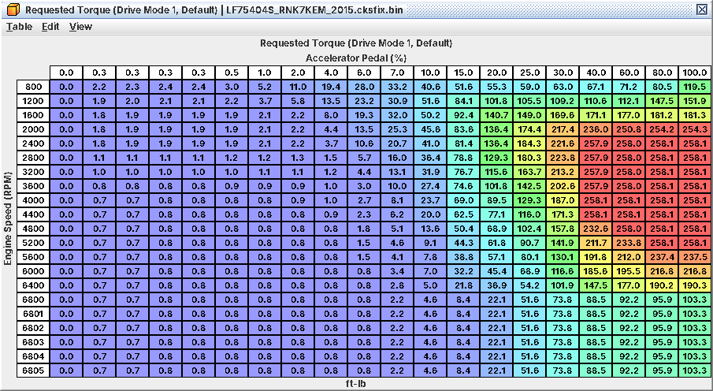
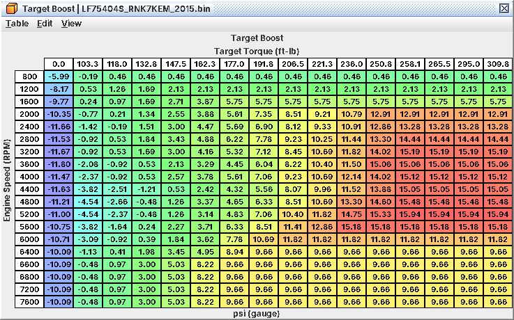
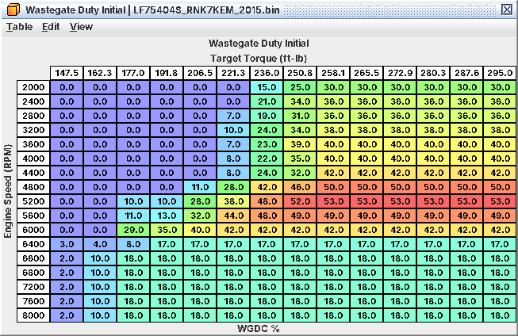

# 5. Making power

On this ECU you do not add boost by editing a boost table. You raise the torque the ECU may ask for, then make sure
every table keyed on that torque has sensible values at the new level. Get fuel (C03, C06) and timing (C07) right
first. Limits and cuts are in C09; the models behind them in C13 (torque, throttle) and C14 (boost loop). Stock values
are LF75404S (2015 WRX 6MT); the procedure follows from the code and has not been proven on a running engine.

## 5.1 How the request turns into boost

```
pedal ──► Requested Torque (drive mode)
      ──► min( Maximum Torque (IAT), Maximum Torque (DAM), CAN torque limit, internal limits )
      ──► tip-in / tip-out rate shaping (C10) ──► max( idle and cruise floors )
      ══► TARGET TORQUE (ft-lb)
             ├──► Target Boost (rpm x target torque) ──► boost feedback ──► wastegate duty
             ├──► Wastegate Duty Initial / Maximum (rpm x target torque)
             └──► Throttle Opening from Target Torque (rpm x % of reference torque) ──► throttle
```

What catches tuners coming from older Subarus:

* *The pedal asks for torque, not throttle.* The throttle opens as far as the target torque needs.
* *Boost and duty are looked up on target torque, after the limits*, not on pedal or load. If a cap holds the target
  at 258 ft-lb, nothing in the higher columns of **Target Boost** or **Wastegate Duty Initial** is ever used.
* *The throttle is wide open early*: at about 217-223 ft-lb from 2000 to 4800 rpm
  (**Throttle Opening Map Reference Torque**). Everything above that, up to the stock 258 ft-lb, is made by the
  wastegate.
* *Two kinds of limit.* Torque caps lower target torque, so boost target, duty and throttle drop together. The rev
  limiter and overboost cut act on throttle and fuel only (C09).

Torque is the ECU's model figure, not a measurement: a scale the calibration is consistent with.

## 5.2 Requested torque and SI-Drive



*Driver demand by rpm and pedal: 258 ft-lb from about 40 % pedal in the midrange, falling off from 5,600 rpm*

**Requested Torque (Drive Mode 1, Default)** (level 1) maps rpm and pedal to ft-lb. Stock at full pedal: 258 ft-lb
from about 40 % pedal between 2400 and 4400 rpm, then 237 ft-lb at 5600, 217 at 6000, 190 at 6400, 103 at 6800 rpm.
Low-pedal columns are pedal feel; high-pedal cells are power.

The drive mode comes over CAN from the cluster. The SI-Drive positions below are *inferred* from the stock maps (C19).

| Mode | SI-Drive position | Table (level) | Stock, WRX MT |
|---|---|---|---|
| 1 | Default: no request; the only map without SI-Drive | **Requested Torque (Drive Mode 1, Default)** (1) | The map |
| 2 | Sport (S) | **Requested Torque (Drive Mode 2, Sport)** (1) | Same as mode 1 |
| 3 | Intelligent (I) | **Requested Torque (Drive Mode 3, Intelligent)** (1) | Same as mode 1 |
| 4 | Sport Sharp (S#) | **Requested Torque (Drive Mode 4, Sport Sharp)** (2) | Mode-1 data on a compressed rpm axis |

* *Manual WRX:* no SI-Drive, so mode 1 runs (inferred). Keep the others consistent anyway.
* *Mode 4 is not "the soft map".* Its 1200 rpm row is mode 1's 1600 rpm row, and so on: more torque than mode 1 at low
  rpm (119 vs 63 ft-lb at 800 rpm, 30 % pedal), less from about 2400 rpm (103 vs 190 ft-lb at 6400 rpm, full pedal).
* *AT/CVT coding (Forester tS, LV9N):* the plain tables are ignored; the (…, AT/CVT) family, for
  example **Requested Torque (Drive Mode 1, Default, AT/CVT)**, is the whole map. Edit one per mode you use.
* *Monitor copies.* Every Requested Torque table has a (…, Monitor) twin, for
  example **Requested Torque (Drive Mode 1, Default, Monitor)**. Make the identical edit, axes included, or expect a
  throttle plausibility fault.
* **Accelerator Pedal Scaling** (level 3) is 1:1 in stock. Shape feel in the Requested Torque tables instead.

## 5.3 Torque limits

Target torque is the lowest of the request and these caps:

| Table | Level | Stock |
|---|---|---|
| **Maximum Torque (IAT)** | 1 | 258 ft-lb from 2000 rpm when warm; 118-221 ft-lb below 2000 rpm; less in cold air (below 68 °F (20 °C) at 2000 rpm, below 14 °F (-10 °C) from 3200 rpm); 148-170 ft-lb above 6000 rpm at 32 °F (0 °C) and below |
| **Maximum Torque (DAM)** | 1 | DAM 1.0: 258 ft-lb to 5200 rpm, 238 at 5600, 217 at 6000, 190 at 6400, 181 from 6600. DAM 0: up to 47 ft-lb lower from 4400 rpm (148 ft-lb from 6800) |

* *Maximum Torque (DAM) is the stock top end, even at full DAM.* Its DAM 1.0 row matches the full-pedal request above
  5200 rpm. More torque up top means raising both.
* Losing DAM drops target torque from 4400 rpm, and boost and duty with it. Keep a DAM-dependent shape.
* A CAN torque limit (probably transmission/VDC side) also caps the request
  (C19). **External Torque Limit Baro Factor** and its IAT twin do nothing on a stock car.
* **Rev/Boost Limit Torque (Base)** only acts during the rev or overboost cut (C09). Raising it gains nothing.

## 5.4 Target boost



*Boost target in psi gauge by rpm and target torque; stock never reaches the columns above 258 ft-lb*

**Target Boost** (level 1) is boost by rpm and target torque, shown in psi gauge; the ECU works in absolute. Stock
peak about 15.9 psi (211 kPa abs) at 5200 rpm and 258 ft-lb; positive boost starts around 115-160 ft-lb. The torque
axis runs to 310 ft-lb; stock never reaches the columns above 258 ft-lb, which hold near-flat copies.

Two multipliers act on the target in absolute pressure:

* **Target Boost IAT Compensation** (level 1): 0.78 at -40 °F, 1.05 near 104 °F (40 °C), 0.96 from 140 °F (60 °C). On
  absolute pressure, 0.96 on a 211 kPa abs target is about 1.2 psi less boost, not 4 % of 15.9 psi.
* **Target Boost Baro Compensation** (level 1): 1.0 near sea level, down to 0.6 at altitude between 4000 and 6000 rpm.

**Boost Limit** (level 1) is not a cap: it is the full-load manifold pressure of the torque/throttle model (C13).
Stock it equals the Target Boost peak at each rpm. Raise it with Target Boost or the model holds the target back.

## 5.5 Wastegate duty



*Feed-forward duty by rpm and target torque: 0 % until about 210 ft-lb in the midrange, 30-53 % at 258 ft-lb*

```
duty = min( Initial x comp + P + I ,  Maximum x comp )
comp = Wastegate Duty Baro Compensation x Wastegate Duty IAT Compensation
```

* **Wastegate Duty Initial** (level 1): feed-forward duty. Stock 0 % up to about 206-221 ft-lb below 4800 rpm
  (162-177 ft-lb from 5200 rpm), where the throttle does the work; 30-53 % at 258 ft-lb.
* **Wastegate Duty Maximum** (level 1): stock Initial + 10 %. Also stops the integral growing.
* Both use the same axes (2000-8000 rpm, 148-295 ft-lb); rescale them together.
* **Wastegate Duty IAT Compensation** (level 2) multiplies both: 0 below about 14 °F (-10 °C), so no boost
  control; 0.58 at 32 °F, 0.92 at 68 °F, 1.27 at 104 °F, 1.31 from 122 °F (50 °C). On a warm day the car runs about
  30 % more duty than the table shows.
* **Wastegate Duty Baro Compensation** (level 2) multiplies both; down to about 0.55 at altitude and high rpm.

Get Initial close enough that feedback (C14) only trims: stock **Boost Integral Maximum** allows just +10 % and the
integral builds slowly, so a big feed-forward error takes seconds to correct.

## 5.6 Overboost while raising boost

Full detail in C09.

* **Overboost Limit** (level 1) is compensated like the target. Stock it equals Boost Limit from 2000 rpm.
* **Overboost Margin** (3.9 psi) held for **Overboost Delay** (2.0 s) sets the overboost flag. The margin is unsigned:
  a negative entry acts as about +36 psi.
* **Overboost Cut Margin (Limit State)** (4.8 psi WRX, 1.5 psi Forester tS / LV9N) starts the overboost cut: throttle
  closed at once, and with the flag set, fuel cut on all four cylinders. It
  releases **Overboost Cut Hysteresis (Limit State)** (2.2 psi; 2.9 psi Forester / LV9N) below the cut level.
* *Ceilings* (C11): the boost controller's pressure reading stops at 269 kPa abs (24.4 psi), so with the WRX margin an
  Overboost Limit above about 236 kPa abs (19.5 psi gauge) can never trigger the cut. MAP reads at most 256 kPa abs
  (22.4 psi at sea level) whatever sensor is fitted.

## 5.7 The throttle side

Stock the throttle is wide open at about 220 ft-lb from 2000 rpm. Raise only the request, the caps and the boost side
and that stays true: every ft-lb above it comes from boost. That is the simplest coherent tune.

Two limits bind higher up:

* **Throttle Torque Request Cap** (level 3, stock 369 ft-lb) caps request plus engine losses (12-85 ft-lb), so it
  binds at about 284-358 ft-lb of request, first at high rpm. Raise it for peaks above about 280 ft-lb.
* **Air Quantity for Torque** (level 4) has a torque axis ending at 277 ft-lb. It feeds the torque estimate behind
  spark torque reduction and the cylinder-cut level (C13). Extend it if request plus losses exceeds that.

Optional, for a consistent model (C13):

* **Full-Load Reference Brake Torque** (level 3, plus Monitor): the full-load torque every request is divided by. It
  does *not* change part-throttle opening; it moves the full-load handover, target MAP and the throttle-side limits.
* **Throttle Opening Map Reference Torque** (level 2, plus Monitor): the torque that counts as 100 % in the opening
  maps. Stock it equals Full-Load Reference Brake Torque from 2000 rpm, and the definition says raise them together.
  But it also moves every part-throttle request to a lower column (less throttle per ft-lb), so
  re-map **Throttle Opening from Target Torque (TGV Open)** and its siblings, or retune pedal feel (C10).

## 5.8 Workflow: raise power coherently

*Goal.* More torque and boost at WOT, protections working, part-throttle feel unchanged.

*Tables.*

| Table | Level | Change |
|---|---|---|
| **Requested Torque (Drive Mode 1, Default)** + Monitor | 1 | High-pedal cells to the new curve (AT/CVT: the AT/CVT tables, each mode used) |
| **Maximum Torque (IAT)** | 1 | Warm cells to the new peak |
| **Maximum Torque (DAM)** | 1 | DAM 1.0 row to the new curve; scale the lower rows |
| **Target Boost** | 1 | Fill the columns between old and new peak torque |
| **Boost Limit** | 1 | New target peak by rpm |
| **Overboost Limit** | 1 | New target peak; not above about 19.5 psi |
| **Wastegate Duty Initial** | 1 | Duty for the new columns |
| **Wastegate Duty Maximum** | 1 | Initial + about 10 % |
| **Throttle Torque Request Cap** | 3 | Above new peak + 85 ft-lb, for a peak above about 280 ft-lb |
| **Air Quantity for Torque** | 4 | Torque axis past new peak + losses |

*What has to move with them.*

* Fuel: open-loop targets (C06), injector and pump headroom (C03).
* Timing (C07): at high load fired timing is **Primary Ignition (TGV Open, AVCS Active)** + KCA + FLKC, under
  the **Base Timing (EGR Off, TGV Open)** ceiling. Extend both into the new load cells (Primary Ignition stops
  at 2.84 g/rev, Base Timing at 3.10 g/rev).
* Every Monitor copy of a table you touch.
* A higher rev limit: the request falls to 103 ft-lb at 6800 rpm, Target Boost to 9.7 psi from 6400 rpm, Maximum
  Torque (DAM) to 181 ft-lb from 6600 rpm. Reshape those rows (C09).

*Procedure.*

1. Log the stock car: target torque, boost and duty at full pedal in 3rd or 4th.
2. Pick a target torque curve (for example stock + 10-15 %) the fuel system and engine can take.
3. Raise the request from about 60 % pedal up; copy to the Monitor. Leave the low-pedal columns alone.
4. Raise the caps: Maximum Torque (IAT) warm columns (50 °F and up) to the new curve, cold columns only if you trust
   the car in the cold; Maximum Torque (DAM) DAM 1.0 row to the new curve, lower rows at the stock ratio.
5. Fill Target Boost in the newly reached columns, interpolating from the 258 ft-lb column. Peak above 310 ft-lb:
   rescale the torque axis. Stay under 256 kPa abs.
6. Set Boost Limit and Overboost Limit to the new peak at each rpm, keeping the stock margins above target.
7. Fill Wastegate Duty Initial for the new columns, allowing for the hot-air multiplier (x1.31 from 122 °F). Maximum =
   Initial + 10 %. Peak above 295 ft-lb: rescale both tables' torque axis.
8. Check the throttle-model limits (5.7). Raise the two reference torques only if you will re-map part throttle.
9. Flash, pull, and correct Wastegate Duty Initial until duty feedback stays within a few percent. Then fuel and
   timing at the new load.

*Log / verify.*

* Target Torque (L01) reaches the new curve at full pedal; if not, a cap holds it (5.9).
* Commanded Throttle (J11) is 100 % at full pedal from about 2000 rpm.
* Boost (L12) tracks Target Boost (L11) within about 1 psi after spool, overshoot a couple of psi at most.
* Duty (L13) under its compensated maximum, feedback (L14) small; DAM (J14) at 1.0; FBKC quiet (C07).

*Pitfalls.*

* Raising only Target Boost does nothing if target torque never reaches the new columns.
* A Requested Torque edit without its Monitor is the quickest way to a plausibility fault.
* Duty right at 68 °F is about 40 % higher at 122 °F (0.92 → 1.31). Match the IAT curve to your turbo, or flatten it
  and tune duty at one temperature.
* Below about 14 °F intake air, duty is forced to 0: no boost control. Stock protection.
* Overboost Limit above about 19.5 psi quietly disables the overboost cut.

## 5.9 Reading the logs when something holds power back

The stock logger cannot see target torque or target boost; the logging-patched ROM adds them (C02; untested on
hardware).

| What you see | What is holding it | Where to look |
|---|---|---|
| Target Torque (L01) flat below the request for that rpm and pedal | A torque cap | **Maximum Torque (IAT)** at the logged IAT, **Maximum Torque (DAM)** at the logged DAM |
| L01 at 181-238 ft-lb above 5200 rpm with DAM 1.0 | Maximum Torque (DAM) top end | 5.3 |
| Full pedal, throttle (J11) under 100 % above 2000 rpm, boost low | Target torque below the reference torque: a cap or a low request | L01, the request at 100 % pedal |
| Throttle 100 %, boost under target, duty (L13) at the compensated maximum | Duty authority, or the turbo is done | **Wastegate Duty Maximum**, **Wastegate Duty IAT Compensation** |
| Duty under maximum, feedback (L14) pinned at +10 % | Integral at its ceiling; Initial too low | **Wastegate Duty Initial**, **Boost Integral Maximum** (C14) |
| Boost oscillates around target | Feedback too hot, or Initial far off | **Boost Proportional**, integral steps (C14) |
| Boost overshoots, then the throttle snaps shut | Overboost cut (limit + 4.8 psi) | **Overboost Limit**, duty |
| Same, and the engine cuts out | Overboost flag (3.9 psi over for 2 s): full fuel cut | C09 |
| Boost target drops at altitude | **Target Boost Baro Compensation** | 5.4 |
| No boost in very cold weather (IAT under about 14 °F) | Wastegate Duty IAT Compensation = 0 | 5.5 |
| Duty 0 with a positive target | Boost control fault state | DTCs, C14 |
| Fuel cut at 6700 rpm, throttle pulled closed | Rev limiter | C09 |
| Fuel cut at 6100 rpm on a WRX | Fail-safe rev limit: a fuel-system fault is active | C09 |
| Fired timing (J04) far below Base Timing (L03) at full load | Normal: the request side is lower | C07 |
| Soft just after tip-in, then normal | Tip-in rate shaping (Target Torque Rise tables) | C10 |
