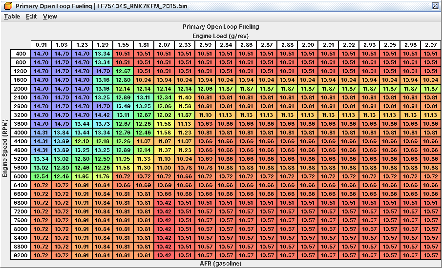
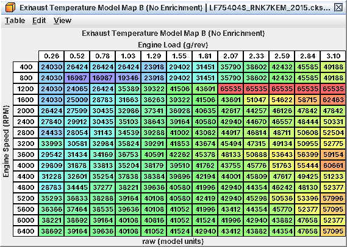
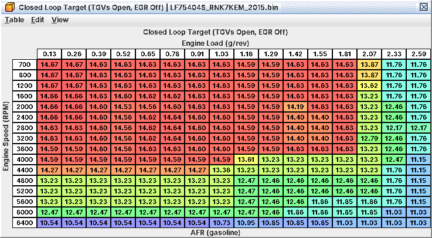
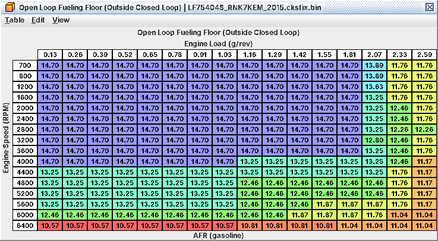

# 6. Fueling: open loop, closed loop, trims

Mixture targets: what the ECU aims for, when it listens to the front A/F sensor, and how the trims learn. Injectors
and pump are in C03, the pulse calculation in C15, controller detail in A06. AFRs in the definition are λ × 14.7; on
other fuels read them as λ (C03). Decoded from code, untested on a car.

## 6.1 Open or closed loop

The ECU computes stoichiometric fuel and multiplies it by a fuel factor.

* *Open loop:* an enrichment term is in the fuel factor; the A/F sensor is not used for control.
* *Closed loop:* no enrichment term; feedback trims fuel to the closed-loop target and the long-term trims learn.

*Any active enrichment term means open loop*, and so does a closed-loop target richer than λ 0.80. In open loop the
richest active request wins:

| Term | Main tables | Active when |
|---|---|---|
| Power enrichment | **Primary Open Loop Fueling** and its TGV/AVCS group | Exhaust temperature estimate high, or load over a threshold for a delay (6.2, 6.3) |
| Open-loop floor | **Open Loop Fueling Floor (Outside Closed Loop)** (+ **Low-DAM Enrichment**) | Whenever out of closed loop |
| Warm-up | **Warm-Up Enrichment (TGV Open)** / (TGV Closed) | Cold engine |
| Start, after-start | Start and After-Start tables (C10) | After a start |
| Short events | Standstill tip-in, TGV transition, fuel-cut recovery (6.7) | Briefly |

## 6.2 Power enrichment: two paths, richer wins

*Power-enrichment target by rpm and load: stoich at light load, about 10.4-11.1 AFR at the highest loads (identical to the four TGV/AVCS tables)*

The WOT target comes from two paths and the ECU uses the *richer*:

1. **Primary Open Loop Fueling** (level 1), rpm × load. Contributes only while the exhaust temperature estimate is
   high enough (6.3); below that, nothing, whatever the load.
2. The TGV/AVCS group of four tables (level 1), for example **Primary Open Loop Fueling (TGV Open, AVCS Active)**,
   blended by TGV position and AVCS state. Contributes only after load has stayed
   above **Open Loop Delay Load Threshold** (level 2) for a delay (stock 1.23 g/rev at most rpm, 1.03 g/rev at 2000
   and 3600-4000 rpm, 0 from 4400 rpm, so always on up there). The delay depends on coolant, drive mode and conditions
   not fully decoded.

Stock all five are identical: stoich at light load, richening to about 10.4-11.1 AFR (λ 0.71-0.76) from 2.59 g/rev
(about 11.9 AFR at 2000 rpm). On top of both paths, **Primary Open Loop Fueling Additive** and its (TGV/AVCS Group)
twin (level 2) add fuel as DAM falls: full at DAM 0, none at DAM 1.0. The Subtractive tables (level 3) are zero.

*Editing rule.* To richen, either path is enough. *To lean, lean all five*, and
check **Open Loop Fueling Floor (Outside Closed Loop)**: in open loop the mixture is never leaner than the floor.

## 6.3 When enrichment starts: the exhaust temperature model

*Steady-state exhaust temperature estimate (raw) by rpm and load; where it is high, power enrichment starts*

Power enrichment is not switched on by load or throttle but by an estimate that behaves like exhaust or catalyst
temperature (inferred: enrichment lowers it, retard raises it). It turns **Primary Open Loop Fueling** on at a fixed
threshold (not in the definition) and off with hysteresis.

| Tables (level) | Role |
|---|---|
| **Exhaust Temperature Model Map B (No Enrichment)** / (Enriched) / (Standstill High Load) (3) | The value the estimate settles to: *the "where does enrichment start" map* |
| **Exhaust Temperature Model Map A (No Enrichment)** / (Enriched) / (Standstill High Load) (3) | Transients only; the settled value does not depend on it |
| **Exhaust Temperature Model Retard Multiplier B (No Enrichment)** / (Enriched), and the A pair (3) | More retard, hotter estimate (stock 0.75 to 1.2) |
| Filter A / B, Fuel Cut Step / Decay (4) | Follow rates; a fuel-cut term |
| **Exhaust Temperature Estimate 2 Map (No Enrichment)** and siblings (4) | When high enough, skips the TGV/AVCS-path delay |

* The (Enriched) maps take over once enrichment is on; they are lower, which gives the off hysteresis.
* The (Standstill High Load) Map A applies at about 3 mph or less, pedal 80 % or more, load 0.52 g/rev or more, for
  1 s.
* *Earlier enrichment* (lower load, sooner in a pull): raise Map B where it should start, Map A for a faster reaction.
  Lower them to delay it. More boost or more retard raises the estimate on its own.
* 2017+ images have three Enrichment Adder tables, for
  example **Exhaust Temperature Model Map B Enrichment Adder**: live but zero, so filling them takes
  effect.

## 6.4 Workflow: set the full-load AFR

*Goal.* A chosen WOT mixture (for example λ 0.78 on boost), reached promptly, no lean gap.

*Tables.*

| Table | Level | Why |
|---|---|---|
| **Primary Open Loop Fueling** | 1 | Path 1 |
| The four Primary Open Loop Fueling (TGV …, AVCS …) tables | 1 | Path 2; keep equal to path 1 |
| **Open Loop Fueling Floor (Outside Closed Loop)** | 1 | Minimum richness out of closed loop |
| **Closed Loop Target (TGVs Open, EGR Off)** | 1 | Its rich top-load cells (6.5) |
| **Exhaust Temperature Model Map B (No Enrichment)** (and Map A) | 3 | When enrichment begins |
| **Open Loop Delay Load Threshold** | 2 | When path 2 may begin |

*What has to move with them.*

* Leaning: all five tables and the floor.
* More boost, more load: extend the rich region into the new cells. The five maps share a load axis ending
  at 2.97 g/rev (cells above 2.84 g/rev are padding); beyond it the last column holds.
* Enrichment ramps **Timing Request Enrichment Retard** (up to -4° from 5600 rpm) into the timing request, and at high
  load that reaches the spark (C07). Moving where enrichment starts moves that retard too.

*Procedure.*

1. Decide the target per rpm/load region, in λ, and write it into all five tables.
2. Check the floor is not richer than you want where you lean.
3. Make the rich Closed Loop Target cells agree with the open-loop target, so the mixture does not step as the state
   changes.
4. Pull and watch the first second. Stoich at first, richening only after a second or two at high load, means the
   estimate is the gate: raise Map B / Map A there, or rely on the floor.

*Log / verify.* Wideband, rpm, load, MAP (J07), Closed Loop Target (L15 or J20), A/F Correction (L16): a moving L16
means you are still in closed loop. The OBD commanded λ counts only primary, warm-up and additional enrichment in open
loop (not the floor, after-start or tip-in), so it can read leaner than commanded (C15). Log knock too (C07).

*Pitfalls.*

* Leaning only **Primary Open Loop Fueling** does nothing where the TGV/AVCS group is richer, and vice versa: the
  usual "the table does nothing".
* Between reaching high load and enrichment starting, the closed-loop target or the floor sets the mixture.
* Open loop has no sensor feedback but keeps the learned trim. A MAF error at high flow goes straight into the
  mixture.

## 6.5 Closed loop: target, limits, drop-out

*Closed-loop target; the λ 0.80 and richer cells at top load drop the ECU into open loop*

*The target* is one of four tables picked by TGV state and estimated EGR flow (EGR Active = above
about 0.67 g/s): **Closed Loop Target (TGVs Open, EGR Off)** (level 1, holds the rich full-load cells), and at level 2
the TGVs Open EGR Active, TGVs Closed EGR Active and TGVs Closed EGR Off tables, for
example **Closed Loop Target (TGVs Open, EGR Active)**. Then:

* **Closed Loop Target Lean Limit (TGVs Open, Normal Mode)** and its three siblings (level 3, by coolant and load) cap
  it. *Warm stock values cap the target at about 14.75 AFR*: a leaner cell is silently cut back unless you raise the
  matching lean limit. Cold, the limit forces richer.
* **Closed Loop Target Cold-Start Trim (TGVs Open)** / (TGVs Closed): about 0.03 AFR richer after cold starts.
* **Low-DAM Enrichment** × its DAM multiplier (level 3) richens the target, the override and the floor as DAM falls:
  up to 24 % at very high load, only with knock history (none from DAM 15/16).
* The catalyst-monitor target and **Closed Loop Target Override** replace it in special cases. Leave both at stock.

*When closed loop drops out.*

* **Closed Loop Minimum Target** (level 3, stock λ 0.80 = 11.76 AFR): a richer target means open loop. The stock TGVs
  Open, EGR Off table sits exactly at λ 0.80 at 2.33-2.59 g/rev (still closed loop) and goes richer at 2.59 g/rev from
  4000 rpm and everywhere at 6400 rpm: those cells mean "open loop here".
* Any active enrichment, a sensor or monitor fault, or coolant at or below 5 °F (-15 °C) also means open loop.
* The closed-loop target is never added to base fuel; as far as decoded it acts only through feedback (A06). So when a
  rich cell drops the ECU into open loop before power enrichment is on, *the floor keeps it rich*. Keep the floor rich
  wherever the closed-loop target is below λ 0.80.

*Minimum enrichment out of closed loop: stoich below 4,000 rpm except at very high load, rich from 4,400 rpm*

Stock floor: stoich below 4000 rpm except from 2.07 g/rev; 13.25 AFR or richer from 4400 rpm; richer again from
6000 rpm.

### Workflow: change the cruise mixture

*Goal.* A different closed-loop target (slightly lean cruise, or richer for EGT).

*Tables.* The four Closed Loop Target tables (level 1-2) and the four Lean Limit tables (level 3).

*Procedure.* Change the target; leaner than about 14.75 AFR needs the matching lean limit raised over the same
coolant/load region. EGR runs at warm part load in stock, so the EGR Active tables matter at cruise.

*Verify.* Closed Loop Target (L15) shows the new value; the wideband follows with A/F Correction (L16) near zero after
learning. L15 not moving means the lean limit is cutting it.

*Pitfalls.* Lean cruise raises catalyst temperature and emissions.

## 6.6 Trims and learning

*Short-term.* A/F Correction (L16; J21 on the stock logger) is an integrator: shaped error
× **Closed Loop Integral Gain (Positive Error)** / (Negative Error) (level 4; stock 5 at idle to 14 at higher rpm and
load). Six shaping curves (idle / warm / cold, by error sign) turn error into a step; the warm ones add a minimum step
of about 2.2 %. Touch them only if the trims oscillate or crawl.

*Long-term.*

* *0.39 % per count* (128 = 0 %). Older logger definitions showed double; use LTFT (J28) or A/F Learning (L17).
* Ten cells: 5 load ranges × 2 rpm ranges, split by **LTFT Load Range Boundary 1** to 4 (0.026 / 1.62 / 1.81
  / 2.07 g/rev) and **LTFT RPM Range Boundary** (4800 rpm), level 4. Nearly all cruising is load range 2, so the car
  mostly learns one low-rpm and one high-rpm cell.
* Each update averages the correction over **Closed Loop Learning Averaging Passes** and steps
  by **Closed Loop Learning Step**: nothing below 0.8 %, one count at 0.8-1.6 %, up to 4.4 % at 10 %.
* Learning needs closed loop, coolant at 167 °F (75 °C) or more, a small error, no enrichment of any kind (after-start
  included), transient fuel near zero and normal combustion mode (A06). The learned trim applies in open loop too.

*Other corrections.* **Fuel Factor Correction (RPM x Load)** (level 3) applies in both loops: stock -5 % to +6 % below
1600 rpm and 0.39 g/rev. Check it before blaming the MAF for idle trims. Trims that move with a loaded canister are
purge (C15).

## 6.7 Other enrichments you will meet

Most need nothing for a power tune.

* **Warm-Up Enrichment (TGV Open)** / (TGV Closed) (level 3): coolant enrichment, blended by TGV position.
* **Fuel Cut Recovery Enrichment (Pedal Pressed)** / (Pedal Released) (level 3): up to 15 % after long fuel cuts while
  the sensor reads lean; probably refills the catalyst.
* **TGV Transition Enrichment (Closing)** and its hold, decay and coolant tables (level 3): cold-only, below 3600 rpm.
* **Standstill Tip-In Enrichment** (level 2): cold drive-away fuel (C10).
* **Additional Enrichment A** / B and **Primary Open Loop Fueling (Alternate)**: unused.

## 6.8 Checklist

* Leaning full load: all five Primary Open Loop Fueling tables, plus the floor.
* Closed-loop cells richer than λ 0.80 need a rich floor behind them.
* Leaner cruise: raise the lean limit with the target.
* Enrichment late in a pull: Map B / Map A, or Open Loop Delay Load Threshold.
* LTFT is 0.39 % per count; judge trims as L16 + J28.
