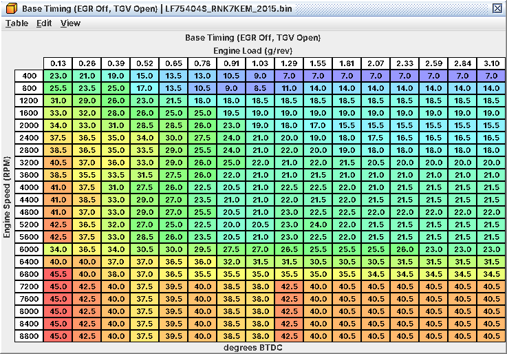
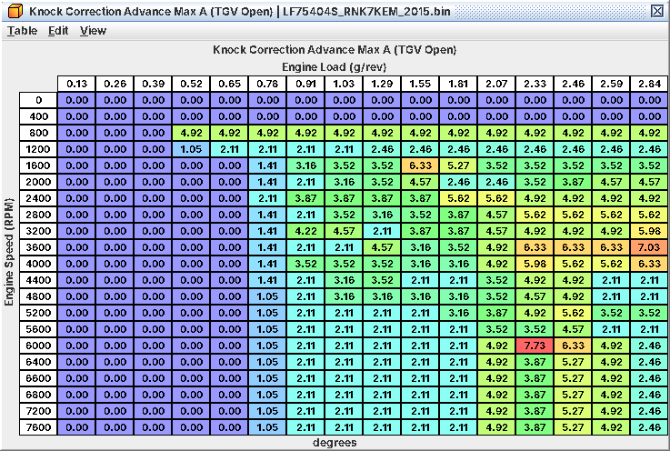
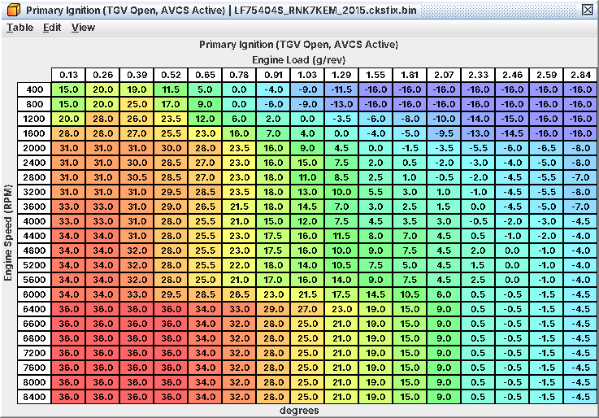
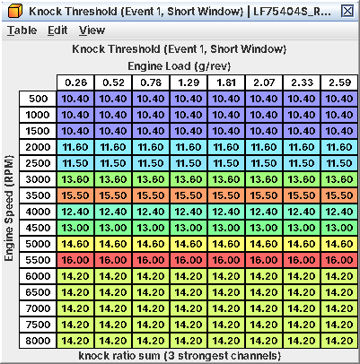

# 7. Timing and knock

The timing you fire, the corrections stacked on it, and the knock control that protects it. Stock values are LF75404S
(2015 WRX); other images differ where noted (A07.14). Everything is decoded from code and untested on a running
engine: treat stock numbers as "what the ROM holds" until your logs confirm the effect. Knock detection (how the
sensor signal becomes a knock event) is in C16; per-table detail in A07.

## 7.1 The one rule: fired timing is the lower of two sides

If you come from older Subarus, unlearn "base timing + knock advance". Here *Base Timing is a ceiling*, and the
timing you actually fire is the lower of two sides:

```
base side    = Base Timing (one of six maps)  + IAT comp + coolant comp           (logged: Base Timing, L03)
request side = Primary Ignition (TGV/AVCS blend) + IAT comp + coolant comp
               + EGR Timing Advance + Timing Request Enrichment Retard + KCA + FLKC
limit        = min( base side , request side )
fired        = limit - torque-reduction and tip-in retard
               + FBKC - gear high-load retard - tip-out / A/C / decel-resume retard + surge damping
               floored at Minimum Ignition Timing                                  (logged: Ignition Timing, J04)
```

What that means at the coil:

* *At high load in stock the request side is lower.* **Primary Ignition (TGV Open, AVCS Active)** + KCA + FLKC is, in
  effect, the WOT timing map. Example (4000 rpm, 2.07 g/rev, TGVs open, AVCS active): Primary Ignition 3°, KCA
  about 6.7° at full DAM, so about 9.5° fired, under a Base Timing cell of 21°.
* *Raising Base Timing adds timing only where Base Timing is the lower side.* Elsewhere it changes nothing.
* *KCA and positive FLKC add timing only where the request side is below Base Timing*, and never lift it above Base
  Timing. A negative FLKC stays hidden until it pulls the request below Base Timing.
* Many light and part-load cells are on the request side too (7.7). Check which side you are on with a log (7.6).
* *Pedal released:* the request side is **Closed-Pedal Timing Target** and its corrections, which sets idle and coast
  timing in stock (7.9).
* *FBKC is the only knock term added straight to the fired timing.* Total Knock Correction (L07 = FBKC + KCA + FLKC)
  is logged but nothing on the coil path uses it.
* During the rev limiter and overboost cut the request side replaces the comparison, with no added retard in stock
  (**Limit-State Spark: Normal Target in Rev/Overboost Cut** is set).

The min() is built from **Ignition Efficiency vs Retard** and its exact inverse **Torque Reduction Spark Retard**.
Leave both alone, or edit them as a pair (7.5).

## 7.2 Which Base Timing map



*The WOT/boost ceiling: 15.5-22.5° across 2000-5600 rpm at high load, then a steep climb from 6000 rpm*

| Table | Used when | Level |
|---|---|---|
| **Base Timing (EGR Off, TGV Open)** | Pedal pressed, EGR off, TGVs open: WOT, boost, high rpm | 1 |
| **Base Timing (EGR Active, TGV Open)** | EGR flowing, TGVs open: warm part-throttle cruise | 1 |
| **Base Timing (EGR Off, TGV Closed)** | EGR off, TGVs closed | 1 |
| **Base Timing (EGR Active, TGV Closed)** | EGR flowing, TGVs closed | 1 |
| **Base Timing (Pedal Released, TGV Open)** | Pedal at zero, TGVs open | 3 |
| **Base Timing (Pedal Released, TGV Closed)** | Pedal at zero, TGVs closed | 3 |

* *EGR active* = target EGR rate above about 3 % (off below about 2.5 %). EGR only runs warm at part load, so at WOT
  you are on an EGR Off map.
* *TGV closed* is the ordinary TGV-close command, a switch for the base maps (the rate limit smooths the change). The
  Primary Ignition maps are blended by TGV opening instead.
* The pedal-released maps are used only while **Base Timing: Pedal-Released Tables Enable** is set (stock). From
  1200 rpm their rows equal Base Timing (EGR Off, TGV Open).

*The top rows look alarming.* Base Timing (EGR Off, TGV Open) holds 23-26.5° at 6000 rpm, 30.5-31.5° at
6400, 34.5-35.5° at 6800 and 40-42.5° from 7200 rpm, even at 3.10 g/rev. They are a ceiling: the stock request side
there is far lower (Primary Ignition about 9° at 6400 rpm and 1.81 g/rev, plus KCA). Raise the rev limit and the
top-end timing comes from Primary Ignition and KCA (7.6). Lowering those Base Timing rows to a value you would fire
makes them a real safety ceiling.

Axes: 400-8800 rpm by 0.13-3.10 g/rev. Primary Ignition and **Knock Correction Advance Max A (TGV Open)** stop
at 2.84 g/rev.

## 7.3 Compensations

Added to *both* sides, so they move fired timing whichever side is lower:

* **Base Timing IAT Compensation** × **Base Timing IAT Compensation Multiplier** (level 2): 0 to 86 °F (30 °C), -3° at
  104 °F, down to -21° at 230 °F (110 °C) at full multiplier. The multiplier is 0 below about 0.52-0.65 g/rev
  and 0.125-0.875 above, so hot-air retard bites under load. Active above about 800 rpm.
* **Base Timing Coolant Compensation (TGV Open)** / (TGV Closed) (level 2): +15° at 14 °F (-10 °C) and below, 0 from
  158 °F (70 °C), blended by TGV opening; the open side is weighted
  by **Base Timing Coolant Compensation Weight (TGV Open)** (100 % at light load, 13-27 % at high load and
  rpm). **EGR Coolant Timing Adjustment (TGV Closed)** is part of the same term.

Request side only (they reach the coil only where the request side is lower):

* **EGR Timing Advance (TGV Open)** / (TGV Closed) (level 3): up to +11° / +13.5° at part load, scaled by EGR flow.
* **Timing Request Enrichment Retard** (level 3): ramped in with open-loop enrichment; 0 up to 3200 rpm, down to -4°
  from 5600 rpm at 1.94 g/rev. At high load in stock it does reach the spark.

## 7.4 Knock control

The knock code runs once per combustion event (every 180° of crank). Its event slots 1-4 are not yet mapped to
cylinders.

### FBKC: the fast one, and it holds before it recovers

FBKC is always 0 or negative and goes straight into the fired timing. One count is 0.35°. It is *one value for the
whole engine*: knock on any cylinder retards all four.

| Table (level 2) | Stock | Effect |
|---|---|---|
| **FBKC Retard Step (Knock, State 0x0E)** / **FBKC Retard Step (Knock, State 7)** | 1.41° | Pulled per knock event. Keep the two equal. |
| **FBKC Recovery Step (State 0x0F)** | 0.35° | Given back per event, *after* 100 knock-free events |
| **FBKC Recovery Step** | 0.35° | Given back per event outside the window, pedal released / low load, and a few special states |
| **FBKC Maximum Retard** | 11.95° | Floor |
| **FBKC Window RPM Minimum** | 1200 rpm | Below it: no new retard; existing retard is given back at FBKC Recovery Step |
| **FBKC Window RPM Maximum** | 6400 rpm (Forester 6300) | Above it: held, no new retard and no recovery |

*Hold, then recover.* Inside the window, once knock stops, FBKC is held where it is for 100 knock-free events, then
recovered at **FBKC Recovery Step (State 0x0F)**. At 4000 rpm that hold is about 0.75 s. If you are used to a steady
recovery rate, expect FBKC to sit flat after knock before it climbs back. With a knock-sensor fault FBKC goes to a
fixed -4.9° (inferred: the fault default).

### KCA and DAM: the slow, learned advance

DAM is 0-1.0 in 1/16 steps, starts at 11/16 after a reset, and is logged as *Knock Learning (DAM)* (J14). Fine
learning moves it: each learning step is scaled by **DAM Step Gain (FLKC Cell)** (level 2) for the current cell. Stock
gains are non-zero only below 7200 rpm and between 0.41 and 3.19 g/rev; knock in the lowest load range never moves
DAM.

KCA has two parts, by rpm × load, blended by TGV opening:

* **Knock Correction Advance Max A (TGV Open)** / (TGV Closed) × **KCA DAM Curve A**: ramps from 0 at DAM 0 to full at
  DAM 11/16.
* **Knock Correction Advance Max B (TGV Open)** / (TGV Closed) × **KCA DAM Curve B**: 0 up to DAM 11/16, full at 1.0.
  B only comes in near full DAM.

Stock maxima about 7.7° (A) and 8.1° (B), TGVs open; zero below about 0.52-0.65 g/rev. Both DAM curves have a stock
axis quirk (no 1/16 point, 15/16 twice): keep the axis increasing if you edit it.



*KCA part A: zero at light load, 1-7.7° from about 0.65 g/rev up*

KCA sits on the request side, so where that side sets the timing (most of the stock high-load map) *losing DAM costs
fired timing almost degree for degree*. It can never lift timing above Base Timing.

DAM reaches further than timing on this ECU:

* **Maximum Torque (DAM)** caps target torque from 4400 rpm (up to 47 ft-lb lower at DAM 0), so *losing DAM costs
  boost at high rpm* (C05).
* **Low-DAM Enrichment** adds up to 24 % fuel at very high load as DAM falls; **Primary Open Loop Fueling Additive**
  adds open-loop fuel (C06).

### FLKC: per-cell learned correction

One learned value per cell, added to the request side like KCA. Cells are rpm ranges × load ranges, split
by **FLKC Range Boundary RPM 1** to 6 (2400 / 4400 / 7200 / 10,000 / 11,000 / 12,000 rpm)
and **FLKC Range Boundary Load 1** to 4 (0.41 / 0.92 / 1.70 / 3.19 g/rev), with 50 rpm / 0.13 g/rev hysteresis (level
3). Only three rpm ranges sit under the rev limit, so 15 cells are live. Keep the boundaries increasing. FLKC is per
cell, not per cylinder.

* Positive learning is capped at the KCA that DAM has not yet given.
* **FLKC Advance Learning Inhibit Zones** (level 3) stops upward learning (inferred) in the high-load 2100-4300 rpm
  area, on its own rpm/load grid (A07.9).

## 7.5 The other terms you will see in a log

| Term | Tables | Stock size | When |
|---|---|---|---|
| High-load retard by gear | **Timing Retard High Load (1st Gear)** … (5th Gear), **Timing Retard High Load (3rd Gear / Fault)** | 2.1° (1st) … 0.2° (5th) | Above 2800 rpm and 0.84 g/rev, gears 1-5 (none in 6th) |
| Tip-in retard | Tip-In Timing Retard families (C10) | 10° for the strongest tip-ins | 3900-6375 rpm, 0.3-0.5 s |
| Tip-out retard | **Tip-Out Timing Retard** | up to 30° | Rpm rising just after a lift, warm, above walking pace |
| Surge damping | Surge Damping Timing tables (C10) | up to -25° | Low gears, after a throttle step |
| A/C cut retard | **A/C Cut Timing Retard Hold (RPM)** | 5° for 12 events | A/C switching off near standstill |
| Decel-fuel-cut resume | **Decel Fuel Cut Resume Timing Retard** | up to -25° | A few events as fuel returns |
| Timing limit / torque reduction | **Torque Reduction Spark Retard** + **Ignition Efficiency vs Retard** | pulls down to the request side; at most about 34° with the pedal pressed | Always (7.1); more when a torque cap asks the spark to cut torque |
| Base Timing DAM Blend | **Base Timing DAM Blend (DAM 0)** / (DAM 1) and the B pair | flat 32 = no change | Pedal above 90 % |

* *Keep Torque Reduction Spark Retard the exact inverse of Ignition Efficiency vs Retard.* Edit one alone and fired
  timing lands somewhere between the two sides, by an amount nobody has worked out.
* The gear retards are forced to 0 with knock control off; with a CAN or vehicle-speed fault the 3rd-gear table is
  used in every gear.
* The Base Timing DAM Blend pairs act after the limit, so filled in they could add DAM-dependent timing above Base
  Timing. Untested.

## 7.6 Workflow: WOT and boost timing

*Goal.* High-load timing that suits your fuel and boost, without knock.

*Tables.*

| Table | Level | Role at WOT |
|---|---|---|
| **Primary Ignition (TGV Open, AVCS Active)** | 4 | Sets stock WOT timing (with KCA and FLKC) |
| **Primary Ignition (TGV Open, AVCS Inactive)** | 4 | Used while the cams are not under control; keep it a few degrees safer |
| **Knock Correction Advance Max A (TGV Open)**, **Knock Correction Advance Max B (TGV Open)** | 1 | The DAM-dependent share |
| **Base Timing (EGR Off, TGV Open)** | 1 | The ceiling: keep it above the request where the request should rule, or lower it to cap |
| **Base Timing IAT Compensation** and its multiplier | 2 | If intercooling changes charge temperatures |
| **Timing Retard High Load (1st Gear)** … (5th Gear) | 3 | Gear-dependent margin |

The TGV Closed tables do not apply at WOT.



*The real WOT timing map: about 3° at 4000 rpm and 2.07 g/rev, before KCA*

*What has to move with them.*

* *Both sides together.* To add timing where the request side rules, raise Primary Ignition (or KCA) and check Base
  Timing is still at least as high. Where Base Timing rules, raise Base Timing. Raising one side alone can do nothing.
* Keep the request within about 34° of Base Timing: with the pedal pressed the pull is limited to about that.
* *Primary vs KCA* (my suggestion, untested): put the timing you trust on any fuel into Primary Ignition and keep a
  KCA share on top. KCA follows DAM, so a car that learns knock loses that share by itself.
* Higher rev limit: Primary Ignition rows from 6600 rpm and the KCA rows from 6400-6800 rpm up are copies; shape them.
  Raise **FBKC Window RPM Maximum** above the new limit, and consider **FLKC Range Boundary RPM 3** (7200 rpm) if you
  want the top of the range in its own learning cell.
* More boost: Primary Ignition and KCA A stop at 2.84 g/rev, Base Timing at 3.10 g/rev; above the last column the last
  value holds. Make sure your peak load is inside the axes.
* Primary Ignition also feeds the torque model's spark target and the P050B cold-start monitor (A07.12). Large changes
  may move the torque estimate; how much is not worked out.

*Procedure.*

1. Flash with the timing unchanged and log several 3rd-gear pulls on the logging-patched ROM (C02).
2. Find the side that rules: compare Ignition Timing (J04) with Base Timing (L03), allowing for FBKC (L04) and the
   retards in 7.5. J04 on L03: Base Timing rules. J04 well below: the request side (Primary + KCA (L06) + FLKC (L05))
   rules. Stock, expect the request side at high load.
3. Note every cell where FBKC goes negative.
4. Add 0.5-1° at a time on the side that rules, only in cells with no FBKC over repeated pulls. Pull 1-2° where FBKC
   acts repeatably.
5. Edit the AVCS Inactive map with the Active one, so a cam fault does not bring back more timing.
6. Smooth along rpm and load; avoid steps over about 2° between neighbouring high-load cells.
7. Watch DAM (J14). If it drops, knock has been learned and KCA shrinks: find the cell from FLKC (L05) and fix timing
   there, not the knock tables.
8. Re-check on a hot day and a heat-soaked pull.

*Log / verify.* Stock logger: rpm, Ignition Timing (J04), MAP (J07), IAT (J03), DAM (J14), pedal (J33). Patched ROM:
Base Timing (L03), FBKC (L04), FLKC (L05), KCA (L06), Target Torque (L01), boost (L11/L12). FBKC is not readable over
SSM on a stock ROM, so tune timing on the patched ROM.

*Pitfalls.*

* Raising **Base Timing (EGR Off, TGV Open)** to add WOT timing: in stock it is the ceiling, not the timing.
* Expecting KCA to add timing above Base Timing. It cannot.
* Raising the rev limit without raising the FBKC window: above 6400 rpm FBKC is frozen, so knock near the limiter is
  neither retarded nor recovered.
* FBKC steps per combustion event: 200 events a second at 6000 rpm, so 1.41° a step adds up fast.
* The hot-air retard (up to -21°) is the design. Fix charge temperatures before flattening it.

## 7.7 Workflow: part-throttle and cruise timing

*Goal.* Economy or response off boost.

*Tables.* Ceilings **Base Timing (EGR Active, TGV Open)** (warm cruise, EGR flowing)
and **Base Timing (EGR Off, TGV Open)** (level 1); request side **Primary Ignition (TGV Open, AVCS Active)** and, with
EGR, **EGR Timing Advance (TGV Open)** (level 3). KCA is zero at light load. The TGV Closed maps apply when the TGVs
are closed (light load, C10).

*What has to move.* The same two-sides rule. Many cruise cells are on the request side (2400 rpm, 0.39 g/rev: Primary
Ignition 30° against 35° or more in the Base Timing maps).

*Procedure.* Log steady cruise at several points. Note which base map is active (commanded EGR, OBD PID 0x2C, above
about 3 % = EGR Active) and which side rules (J04 against L03). Advance 1° at a time on that side; stop where FBKC
appears or the load needed for the same torque stops falling.

*Pitfalls.* Stock light-load Base Timing cells are already 33-47°. EGR-on and EGR-off maps differ by up to 20° in the
same cell and EGR Timing Advance only applies with EGR flowing, so a log that flips EGR on and off shows timing jumps
that are not knock.

## 7.8 Workflow: more or less protective knock control

*Goal.* Change how hard and how fast FBKC reacts, after timing is right.

* *More protection:* raise both FBKC Retard Step tables together (for example 2.1°, 6 counts), or
  lower **FBKC Recovery Step (State 0x0F)**.
* *Faster recovery after false knock:* raise **FBKC Recovery Step (State 0x0F)** (the in-window rate). The 100-event
  hold before it is a constant not in the definition. **FBKC Recovery Step** only matters outside the window and
  off-pedal.
* *More range:* raise **FBKC Maximum Retard**.
* *Sensitivity:* the Knock Threshold maps (level 4); higher = less sensitive. Leave them unless you have a measured
  reason (a noisier part, C16). The Short and Full Window sets were renamed on 2026-10-30 because the old names were
  swapped: if you copied threshold edits from an older definition, check you edited the set you meant.



*The normal knock threshold: 10.4-16 by rpm, flat across load*

*Pitfalls.* Lowering the retard step to "stop timing being pulled" hides knock. Below 1200 rpm and above 6400 rpm FBKC
takes no new retard. One noisy cylinder pulls timing from all four.

## 7.9 Idle, coast, cold engine, hot air

* *Idle and coast:* the request side is **Closed-Pedal Timing Target** (level 3; 6° at 500-700 rpm rising to 17° from
  2000 rpm) plus **Closed-Pedal Timing Coolant Compensation** × its rpm multiplier, the IAT term and, after a
  start, **Post-Start Closed-Pedal Timing Advance (Coolant at Start)**. Against the pedal-released Base Timing maps it
  is far lower (6-9° vs 19-28° at idle, 17° vs 34° at 2000 rpm), so *Closed-Pedal Timing Target sets idle and coast
  timing*. Its climb back after a lift is rate-limited by **Timing Request Recovery Rate After Tip-Out** (C10). Idle
  modes: C17.
* *Cold, pedal pressed:* the coolant compensation (7.3). Cold-start catalyst-heating spark is separate (C12).
* *Hot air:* the IAT compensation. A moved or different IAT sensor: check its scaling first (C04).

## 7.10 What to log for timing

| What | Stock logger | Logging-patched ROM |
|---|---|---|
| Fired timing | Ignition Timing (J04) | - |
| Base side (selected Base Timing + IAT and coolant comp) | - | Base Timing (L03) |
| Knock retard now, all cylinders | - | FBKC (L04) |
| Learned per-cell correction | J23 (coarse) | FLKC (L05) |
| DAM | J14 | - |
| Advance unlocked by DAM | - | KCA (L06) |
| Sum of the three (not on the coil path) | - | L07 |
| Combustion mode (normal = 4) | - | L08 |
