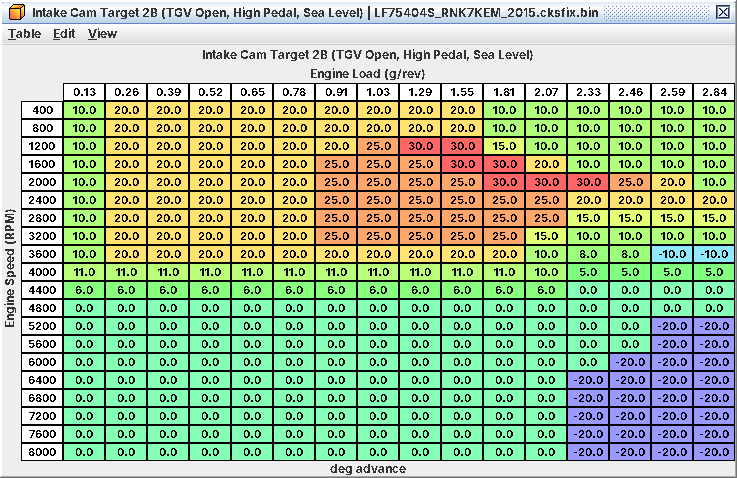
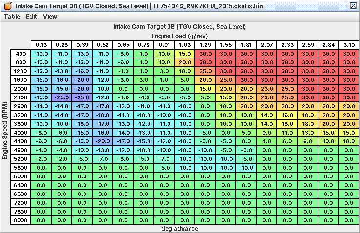

# 8. Cam timing (AVCS)

All four cams are variable: one intake and one exhaust cam per bank, each on its own oil control valve. The ECU works
out one intake target and one exhaust target and drives both banks to them. This chapter is about the targets: which
map is live when, and how to move them. The control loop is in A08.

## 8.1 Read the sign convention first

| | Intake maps | Exhaust maps |
|---|---|---|
| Unit | crank degrees of *advance* from rest | crank degrees of *retard* from rest |
| 0 | rest = fully retarded (inferred: mechanical stop) | rest = fully advanced (inferred) |
| Bigger number | earlier intake events | later exhaust events |
| Stock range | about -20 to +30 | 0 to 51 |

* *Bigger number = more overlap on both cams.* Intake advance opens the intake earlier; exhaust retard closes the
  exhaust later.
* Crank degrees, not cam degrees.
* Negative intake cells just park the cam at rest. There is nothing past rest; stock uses negatives at light load and
  in the top-right corner of some maps.
* Exhaust targets are never negative. The exhaust *coolant offsets* are: they pull the exhaust cam back toward rest on
  a cold engine.
* The logger uses the same frame: J29/J30 Intake Cam Advance and J31/J32 Exhaust Cam Retard (banks 1 and 2) compare
  directly with the maps.

## 8.2 Which map is live

Three target sets per cam, each with an altitude (A) and a sea-level (B) map. All are by rpm and load (g/rev), all
user level 2, in folders AVCS > Intake Targets and AVCS > Exhaust Targets.

| Set | Maps | Live when |
|---|---|---|
| 1, Normal | **Intake Cam Target 1B (TGV Open, Normal, Sea Level)**, **Exhaust Cam Target 1B (TGV Open, Normal, Sea Level)** | TGVs open, pedal below the high-pedal latch |
| 2, High Pedal | **Intake Cam Target 2B (TGV Open, High Pedal, Sea Level)**, **Exhaust Cam Target 2B (TGV Open, High Pedal, Sea Level)** | TGVs open, high-pedal latch set (about 90 % pedal) |
| 3, TGV Closed | **Intake Cam Target 3B (TGV Closed, Sea Level)**, **Exhaust Cam Target 3B (TGV Closed, Sea Level)** | TGVs closed |

*Sea level vs altitude.* **AVCS Barometric Blend** (level 3) gives the share of the A maps: 100 % A at or below 84 kPa
baro (about 5,200 ft), 0 % A at or above 98 kPa (about 1,000 ft). Near sea level only the B maps count. Tune at
altitude and the A maps (or a blend) are live.

*TGV open vs closed.* The ECU blends set 3 against set 1/2 by the actual TGV open fraction, so a TGV move gives a
smooth cam transition (about 1 s closed to open). The TGVs close at light load on a warm engine (C10, 10.11). In
practice:

* Warm cruise and light part throttle: *set 3*. These two maps set the cam timing you drive on most of the time.
* Anything harder, above 5,200 rpm (stock TGV torque threshold is 0 there), or coolant below 41 °F (5 °C): set 1 or 2.

*Normal vs high pedal.* The latch sets at **High Pedal Entry Threshold** (90 % pedal) with vehicle speed steady and
clears below **High Pedal Exit Threshold** (85 %). **High Pedal Tip-In Rate Threshold** sets it at once on a fast stab
above about 89 %. The same latch selects **Injection Timing (High Pedal)**. That set 1 means "normal driving" and set
2 "near wide-open pedal" is inferred from these conditions.

*Set 2 is the WOT intake map, and it is not a copy of set 1.* Stock 2B differs from 1B in two ways:

* below about 1.03 g/rev (spool-up after a full-pedal tip-in) 2B holds 20-25° of intake advance where 1B sits near
  rest;
* in the boosted cells (1.29 g/rev and up, about 1,200-4,400 rpm) 2B mostly runs 10-20° *less* intake advance than 1B.
  From about 4,800 rpm the two are the same.

So a WOT pull near sea level runs **Intake Cam Target 2B (TGV Open, High Pedal, Sea Level)**. The exhaust 1B and 2B
maps are close at high load and differ mainly at light load.

*WOT intake map: about 20° during spool, backing off to 10° in the high-load cells below 3,600 rpm*

*Cruise intake map: parked at rest at very light load, advancing to 20-30° as load rises*

## 8.3 Cold engine and enable conditions

*Coolant offsets.* Each offset table is scaled by a coolant factor (128 = 1.0) and added to the final target.

| Offset | Factor | Stock |
|---|---|---|
| **Intake Cam Coolant Offset B (Sea Level)**, **Intake Cam Coolant Offset A (Altitude)** | **Intake Cam Coolant Factor** | all 0: no effect |
| **Intake Cam Coolant Offset 3B** | **Intake Cam Coolant Factor 3** | all 0 |
| **Exhaust Cam Coolant Offset B (Sea Level)** | **Exhaust Cam Coolant Factor** | down to -51° at light load; factor 1.0 to 50 °F (10 °C), 0 from 122 °F (50 °C) |
| **Exhaust Cam Coolant Offset 3B** | **Exhaust Cam Coolant Factor 3** | down to -51° with the TGVs closed |

The A/B offsets apply *whatever the TGV state*, so with the TGVs closed the B offset stacks on top of the 3B offset:
stock pulls the exhaust cam back twice at light load until the coolant reaches about 122 °F. The 2017+ images add
**Exhaust Cam Coolant Offset 2B (High Pedal, Sea Level)** and its intake/altitude siblings, all 0 in stock.

*When the cams move at all* (level 3, folder AVCS Control & Feedback). Until all are met both cams sit at rest and
ignition and open-loop fuel use their "AVCS Inactive" maps (C06, C07):

| Table | Stock |
|---|---|
| **AVCS Activation Delay After Start** | hold after every start: 10 s below -4 °F (-20 °C), 2.8 s warm, 3.7 s hot |
| **AVCS Minimum Oil Temp (IAT at Start)** | 176 °F (80 °C) oil after a -40 °F start, 77 °F (25 °C) after a 32 °F start, none from 41 °F |
| **Intake AVCS Minimum RPM (Oil Temp)**, **Exhaust AVCS Minimum RPM (Oil Temp)** | 365 rpm with 194 °F (90 °C) oil, up to 855 rpm at 284 °F (140 °C); cams also park above 8,600 rpm (fixed) |

2018 images add cam-target ceiling tables by oil temperature. With the stock breakpoints the "Oil Temp Low" table is
the ceiling at *every* temperature (Mid/High are unreachable); it is 90° stock, so it never limits. If you lower it,
it caps the cam at all temperatures.

## 8.4 Workflow: move the cams

*Goal.* Change overlap and intake timing at a given rpm and load: faster spool, a different top end after a turbo or
intake change, or better light-load efficiency.

*Tables.*

| Table | Level | Job |
|---|---|---|
| **Intake Cam Target 2B (TGV Open, High Pedal, Sea Level)**, **Exhaust Cam Target 2B (TGV Open, High Pedal, Sea Level)** | 2 | WOT pulls and spool-up |
| **Intake Cam Target 1B (TGV Open, Normal, Sea Level)**, **Exhaust Cam Target 1B (TGV Open, Normal, Sea Level)** | 2 | Part throttle with TGVs open, above 5,200 rpm, cold |
| **Intake Cam Target 3B (TGV Closed, Sea Level)**, **Exhaust Cam Target 3B (TGV Closed, Sea Level)** | 2 | Warm cruise and light load |
| The A (Altitude) maps | 2 | Only if the car lives or is tuned above about 1,000 ft |

*What has to move with them.*

* *Set 1 in the high-load cells.* A full-pedal pull can start in set 1 and switch to set 2 when the latch sets, and a
  roll-on at 85 % pedal never leaves set 1. Decide what you want there; stock set 1 runs more intake advance on boost.
* *Timing.* Overlap changes residuals and so knock margin, but neither side of the timing limit has a cam axis: the
  Base Timing and Primary Ignition maps only switch between their AVCS Active and Inactive versions (C07). Re-check
  knock in every cell you moved.
* *Air model and fuel.* The VE tables have no cam input (C04) and the open-loop maps have no cam axis (C06). The model
  is trimmed toward the MAF, so moderate changes are absorbed; after big ones compare model vs MAF and watch trims and
  the wideband.
* *Both A and B* if the car sees altitude.

*Procedure.*

1. Log stock behaviour where you want to change things: rpm, load, J29-J32, the targets L22/L23 (logging-patched ROM),
   pedal and TGV state, so you know which set was live.
2. Work in steps of about 5°, only in cells the car actually runs through, and blend into the neighbours so the target
   does not jump as load moves.
3. Mind the sign: more intake advance = bigger intake number; more exhaust retard = bigger exhaust number.
4. Keep sets aligned where they hand over: set 1 vs set 3 around the TGV torque thresholds, set 1 vs set 2 at high
   load, so a set change does not snap the cams.
5. Flash, warm the engine fully, log.

*Log / verify.* J29-J32 are the actual cams, L22/L23 the targets (patched ROM), J24-J27 the valve duties.

* Actual vs target: J29/J30 against L22, J31/J32 against L23. Settled error within a degree or two. A cam that stays
  several degrees off is out of authority (oil pressure, or a target the cam cannot reach) or needs feedback work
  (A08).
* Both banks should agree.
* Under boost: spool (boost vs rpm), FBKC, FLKC and DAM (C07). At light load: idle and cruise quality and trims.

*Pitfalls.*

* *Sign errors.* Typing "advance" into an exhaust map gives the opposite of what you wanted.
* *Wrong set.* A warm car at cruise runs set 3; a WOT pull runs set 2. Editing 1B and expecting WOT to change does
  little.
* *A instead of B.* Near sea level the A maps do nothing.
* *Negative intake cells* don't retard past rest.
* *Feedback tables are not targets.* The duty, rate, OCV and oil-factor tables (level 4) shape how the cam gets there.
  Leave them unless the cams lag or oscillate after a hardware change (A08).
* *Cold work.* Below the enable conditions the cams don't move, and the stock exhaust offsets hold the exhaust near
  rest at light load to about 122 °F. Do cam work hot.
