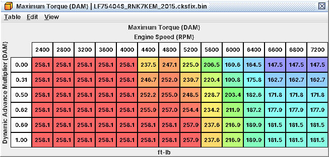
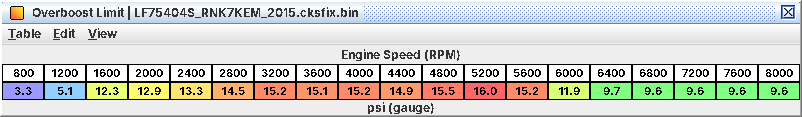

# 9. Rev limiter, speed limiter, overboost and protection

This chapter covers the limits that take power away on purpose: rev limiter, overboost cut, speed limiter and the
fail-safe rev limit. It also separates two things tuners mix up on this ECU: the *torque limits* that set how much
power the car makes, and the *rev/boost cut tables* that only act while a cut is running.

Every limiter works through the torque request (C18): the ECU enters a limit state, the state picks a torque cap, and
the cap becomes a throttle cap plus a number of cylinders to fuel-cut. *None of the stock limiters cuts or retards
spark.* All of this is read from the code, not seen on a car: verify your first change with a log (9.7).

## 9.1 The limits at a glance (stock WRX)

| Limit | Trigger | What it does | Releases | Tables |
|---|---|---|---|---|
| Rev limiter | above 6,700 rpm | Fuel cut on all four, every firing; throttle closed toward 37 ft-lb; spark unchanged | Fuel at 6,700 rpm *and* MAP below 168 kPa abs (9.7 psi); throttle cap at 6,600 rpm | Rev Limit … (level 1) |
| Overboost cut | Boost above **Overboost Limit** + 4.8 psi | Throttle cap at once; fuel cut on all four once boost has also been 3.9 psi over the limit for 2 s | Boost below limit + 2.6 psi | Overboost … (levels 1-3) |
| Speed limiter | Off in stock | Fuel cut on all four; no throttle cap, no spark change | 2 km/h below the cut speed | Vehicle Speed Limit … (levels 2-3) |
| Fail-safe rev limit | Rail-pressure deviation / sensor or injector-driver fault active | Fuel cut above 6,100 rpm | 100 rpm lower | Fail-Safe Rev Limit … (levels 2-4) |
| Torque limits | Always | Cap target torque, so throttle and boost target | n/a | **Maximum Torque (IAT)**, **Maximum Torque (DAM)** (level 1) |

The decel fuel cut uses the same cylinder-cut machinery but is drivability (C10). The Forester tS (LF78001H) and the
early-2015 LV9N images have a tighter overboost state (limit + 1.5 psi, ending 1.5 psi *below* the limit) and lower
rev limits; A09 has every value per image.

## 9.2 Workflow: move the rev limiter

*Goal.* Change the rpm where the engine is cut.

*Tables* (all level 1, Torque & Throttle > Torque Limits & Engine Protection):

| Table | Stock | Role | Set to |
|---|---|---|---|
| **Rev Limit RPM** | 6,700 | Starts the limiter; the only value that starts a cut | New limit |
| **Rev Limit Full Cut RPM** | 6,700 | Fuel cut on, once the limiter has started | New limit |
| **Rev Limit Full Cut Reset RPM** | 6,700 | Fuel cut off | New limit (or lower, 9.3) |
| **Rev Limit Stage 1 RPM** | 6,700 | Throttle cap drops to the 37 ft-lb stage above this | New limit |
| **Rev Limit Stage 2 RPM (Stage 1 Hold)** | 6,700 | Stage 1 holds above this | New limit |
| **Rev Limit Reset RPM** | 6,600 | End of the limiter state (throttle cap off) | New limit - 100 |
| **Rev Limit Reset Maximum MAP** | 168 kPa abs (9.7 psi) | Neither the cut nor the state can release at or above this | See below |

*What has to move with them.*

* *All six rpm values together.* Raise only **Rev Limit RPM** and the limiter still works but is a full cut from the
  first instant. Raise the others and leave **Rev Limit RPM** at 6,700 and the car still cuts at 6,700.
* **Rev Limit Reset Maximum MAP** on a boosted car. Stock, the cut cannot release while MAP is at or above 168 kPa
  abs, so on the limiter under boost fuel stays off until the closing throttle pulls the manifold down. Raise it above
  peak boost (up to the 256 kPa abs / 22.4 psi MAP ceiling) to release on rpm alone. Leaving it stock gives a longer,
  deeper cut per bounce under boost: harder on the drivetrain, but no overshoot.
* *Everything above the old limit.* Check Base Timing, Primary Ignition, KCA, open-loop fuel, the cam maps and
  **Target Boost** in the rpm range you are opening up (C07).
* **FBKC Window RPM Maximum** (6,400 rpm stock): above it knock correction freezes. Raise it with the limit (C07).
* *Leave the fail-safe limits at 6,100 rpm.* A WRX that hits a wall at exactly 6,100 rpm has a fuel-system fault
  (9.6).

*Procedure.*

1. Set the five rpm values to the new limit and **Rev Limit Reset RPM** 100 lower. The editor rounds to the 0.195-rpm
   storage step; that's normal.
2. Decide on **Rev Limit Reset Maximum MAP**.
3. Check the main maps above the old limit.
4. Flash, warm up, approach the new limit at light load in a low gear first, then under boost.

*Log / verify.* J01 rpm, J07 MAP, J11 commanded throttle, J04 timing; on the patched ROM L02 throttle torque request.
On the limiter: rpm bounces tightly at the new value, timing steady, L02 drops to 37 ft-lb, the commanded throttle
closes. Still cutting at the old rpm: **Rev Limit RPM** was not changed.

*Pitfalls.*

* **Rev/Boost Limit Torque (Base)** is not a torque limit for driving. Raising it gives nothing (9.4).
* The Forester tS limits at 6,100 rpm and the CVT-coded LV9N101C at 6,500; same procedure.

## 9.3 Workflow: change how the limiter feels

*Goal.* Softer or harder limiter, a throttle-only first stage, or a fuel-only limiter. These follow from how the code
gates the cut; they are *inferred, not driven*. Try one at a time.

| You want | Change | Expected effect |
|---|---|---|
| Longer cut per bounce, slower bounce | **Rev Limit Full Cut Reset RPM** 100-200 rpm below **Rev Limit Full Cut RPM** | Fuel stays off until rpm has fallen further. Stock has no rpm hysteresis on the fuel cut, so it bounces right on 6,700 |
| Throttle-only soft stage, then hard cut | **Rev Limit Full Cut RPM**, **Rev Limit Full Cut Reset RPM** and **Rev Limit Stage 1 RPM** above **Rev Limit RPM** | Between the two only the throttle cap acts; fuel cut only above the full-cut rpm |
| Fuel-only limiter (no throttle dip) | Clear **Rev/Boost Limit Torque Caps Enable** (level 3) | No throttle cap in the cut. *This also removes the overboost throttle cap* |
| Spark cut or retard | Not available | Clearing **Limit-State Spark: Normal Target in Rev/Overboost Cut** (level 4) switches the cut to the torque-reduction spark path; the resulting timing is not worked out. Leave it set |

The throttle-side caps, **Rev/Boost Limit Torque (Stage 1)** (37 ft-lb), **Rev/Boost Limit Torque (Stage 2)** (52
ft-lb, never selected in stock) and **Rev/Boost Limit Torque (Base)** (108-207 ft-lb by rpm), are only read during a
cut. A soft stage shows in the log as the throttle closing while rpm still creeps up, with no fuel cut until the
full-cut rpm.

## 9.4 Torque limits vs the cut tables

The most common misunderstanding on this ECU. If the car won't make the torque you asked for, it's the top half of
this table, never the bottom half.

| Table | Level | Acts | Limits power in normal driving? |
|---|---|---|---|
| **Maximum Torque (IAT)** | 1 | Always | *Yes.* 258 ft-lb warm from about 2,000 rpm; less at low rpm and with very cold air |
| **Maximum Torque (DAM)** | 1 | Always | *Yes.* 258 ft-lb to about 4,000 rpm, tapering above; lower with low DAM |
| **Throttle Torque Request Cap** | 3 | Always | Yes, on big tunes: 369 ft-lb on request *plus losses*, so it binds from roughly 284-358 ft-lb requested |
| Requested Torque maps | 1-2 | Always | Indirectly: what the pedal can ask for (C05) |
| **Rev/Boost Limit Torque (Base)**, **Rev/Boost Limit Torque (Stage 1)**, **Rev/Boost Limit Torque (Stage 2)** | 2-3 | Only in a rev or overboost cut | *No* |
| **VDC Torque Request Correction** | 4 | Only while stability control asks for less torque | No (C19) |
| Brake override tables | 4 | Brake over a held pedal above 7 km/h | No, unless you ride the brake (C10) |

*The real torque cap: 258 ft-lb to about 4,000 rpm, tapering above 6,000 rpm and with low DAM*

To make more power raise the Requested Torque maps, both Maximum Torque tables and, if needed,
**Throttle Torque Request Cap**. C05 has the full procedure, including the reference torques and boost tables that
must follow.

## 9.5 Workflow: keep overboost protection when you add boost

*Goal.* A working overboost cut after raising **Target Boost**.

*Tables.*

| Table | Level | Stock | Role |
|---|---|---|---|
| **Overboost Limit** | 1 | by rpm, 16.0 psi peak | The reference; baro- and IAT-compensated like **Target Boost** |
| **Overboost Cut Margin (Limit State)** | 3 | 4.8 psi (33 kPa) | Above limit + this: cut state, throttle cap at once |
| **Overboost Cut Hysteresis (Limit State)** | 3 | 2.2 psi (15 kPa) | State ends below limit + (margin - this) = + 2.6 psi |
| **Overboost Margin** | 2 | 3.9 psi (26.7 kPa) | Above limit + this, time counts toward the overboost flag |
| **Overboost Delay** | 2 | 2.0 s | Time over limit + **Overboost Margin** before the flag sets |
| **Overboost Flag Reset Margin** | 3 | 0 | Flag clears when boost falls to limit + this |

*How it combines.* The cut state alone caps the throttle. The fuel cut needs the state *and* the flag. So: sustained
boost 4.8 psi over the limit closes the throttle at once and cuts fuel to all four after 2 s; if boost comes back over
+4.8 psi while the flag is still set, the fuel cut is immediate (inferred). Fuel returns below limit + 2.6 psi. During
the cut the throttle is capped by **Rev/Boost Limit Torque (Base)** by rpm, or by the 37 ft-lb stage above 256 kPa abs
MAP or above **Rev Limit Stage 1 RPM**.

*What has to move with them.*

* **Target Boost** and **Boost Limit** (C05). Raise **Overboost Limit** rpm for rpm with them; stock peaks are equal.
* *The ceiling.* The pressure the overboost check reads stops at 269.3 kPa abs (24.4 psi). With the 4.8 psi margin an
  **Overboost Limit** above about 236 kPa abs (*19.5 psi*) can never trigger the cut, and the fuel-cut flag dies above
  about 243 kPa abs (20.6 psi). The protection is then silently gone. To keep it, lower
  **Overboost Cut Margin (Limit State)** (and **Overboost Margin** for the fuel cut): limit + margin must stay under
  269 kPa abs.
* **Overboost Margin** is unsigned. A "negative" entry wraps to about +250 kPa and switches the fuel cut off.
* Above 256 kPa abs (22.4 psi) the ECU can't measure MAP at all without a code patch (C11).

*Procedure.*

1. Set the new **Target Boost** and **Boost Limit** (C05).
2. Set **Overboost Limit** at each rpm to the highest target you command there. The margins are the tolerance.
3. Check every cell is at or below 19.5 psi, or reduce the margins.
4. Leave **Overboost Delay** at 2.0 s unless your boost control overshoots briefly by design.

*Overboost reference by rpm; the cut acts 4.8 psi above it, the fuel cut after 2 s at 3.9 psi above it*

*Log / verify.* L11 target boost, L12 boost control pressure (patched ROM), J07/J08, J11 commanded throttle, J10 or
L13 wastegate duty. An overboost cut is the throttle dropping at once with boost high, then a hard stumble 2 s later.
Compare L12, not J07, with the limit: it is the pressure the check uses.

*Pitfalls.* Overboost almost always means a stuck wastegate or a duty map far too high. A wastegate fault drives duty
to 0 %, which lowers boost.

## 9.6 Speed limiter and fail-safe rev limit

*Speed limiter (off in stock).* It needs three values, all km/h on a byte (255 = off): **Vehicle Speed Limit** minus
**Vehicle Speed Limit Offset** starts the state, **Vehicle Speed Limit Minimum RPM** (6,375 rpm stock, part of why it
is off) must also be met, and **Vehicle Speed Limit Full Cut Speed** is where fuel is cut on all four
(**Vehicle Speed Limit Full Cut Speed Hysteresis**, 2 km/h, releases it). No throttle cap, no spark change: it feels
like a hard fuel-cut bounce. The state cannot end while MAP is above **Vehicle Speed Limit Reset Maximum MAP** (168
kPa abs). Enabling it is untested. To remove one someone else added, set **Vehicle Speed Limit** and
**Vehicle Speed Limit Full Cut Speed** back to 255. Vehicle speed comes only from the stability-control module over
CAN; with that frame lost the ECU uses a fixed 10 km/h, so a speed limiter can't act (C19).

*Fail-safe rev limit.* While a rail-pressure or injector-driver fault is active the ECU cuts fuel above
**Fail-Safe Rev Limit (Rail Pressure Fault)** / **Fail-Safe Rev Limit (Injector Driver Fault)** (6,100 rpm), releasing
100 rpm lower; never below idle target + 200 rpm. The rail-pressure limit is driven by the rail-pressure deviation
monitor and a pending rail-pressure *sensor* fault (P0192/P0193); the flag mapping is inferred. The injector-driver
limit follows P062D/P2146.

*P0088 does not trigger the 6,100 rpm cut.* It trips when actual rail pressure exceeds
**P0088 Rail Pressure High Limit** plus about 2.5 MPa for about 2 s (about 17.5 MPa / 2,540 psi stock) and recovers at
the limit itself (15.0 MPa / 2,175 psi). While it is pending the ECU caps the throttle with
**Throttle Limit (Fuel Pressure Fault)** (about 18 % at 2,000-4,000 rpm, 6 % from 4,400 rpm): a car that suddenly goes
flat on a pull with a P0088 is on this cap. Raise the P0088 limit only together with your rail-pressure targets (C03).
Injector-circuit faults have their own cap, **Throttle Limit (Injector Circuit Fault)**. Leave all of these alone
otherwise: they protect the engine from running lean on a failing high-pressure fuel system.

## 9.7 What a limit looks like in the logs

| Symptom | Likely cause | Confirm with |
|---|---|---|
| rpm bounces tightly at the limit, timing steady, throttle closes | Rev limiter, normal | J01, J04, J11, L02 |
| On the limiter under boost the cut lasts longer, rpm falls well below | **Rev Limit Reset Maximum MAP** holding the cut | J07 above 168 kPa abs during the cut |
| Throttle drops at high boost, hard stumble 2 s later | Overboost cut | L12 vs limit + 4.8 psi |
| Hard wall at 6,100 rpm, usually with a fuel-system code | Fail-safe rev limit | Stored DTCs (rail-pressure deviation, P0192/P0193, P062D/P2146) |
| Throttle shut down to a few percent on a pull, P0088 pending | Fuel-pressure throttle limit | Rail pressure L09 vs target L10, J11 |
| Target torque flat below what the pedal asks, boost under target | **Maximum Torque (IAT)** or **Maximum Torque (DAM)** | L01 vs the requested map; J14 DAM; J03 IAT |
| Power fades while braking with the pedal held | Brake override | Pedal, speed (C10) |

A09 lists every limiter value for each image; C18 explains the limit states and the cylinder cut.
