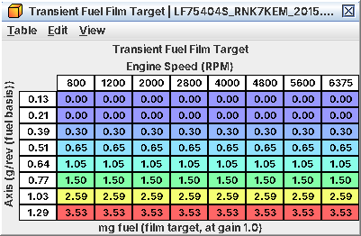
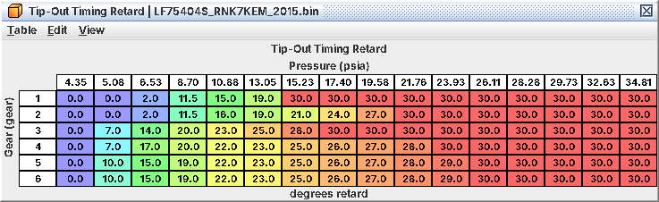
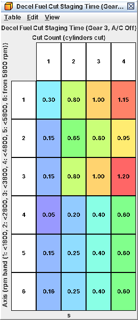
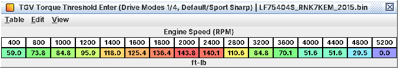

# 10. Drivability

C05 and C07 decide what the car makes at WOT. This chapter is everything in between: tip-in, lift-off, coasting, idle,
starting, pull-away, cruise and the TGVs. Most of it is small corrections layered on the torque request, fuel and
spark, mostly at level 3. Stock is a sensible compromise: change these only for a problem you can see in a log. All
effects below are read from the code, not driven.

*Manual vs AT/CVT.* The 2015-2018 WRX images are manual: tables named "(AT/CVT …)" do nothing on them. The Forester tS
(LF78001H) and LV9N101C are CVT-coded: there the AT/CVT tables are the live ones and the manual tables are not.

## 10.1 Tip-in and transient fuel

*Goal.* No lean stumble or rich bog when the throttle opens or load climbs fast.

Two per-cylinder transient terms are added to the pulse:

* *Throttle-rate term* (accel/decel fuel on throttle movement): more fuel while the throttle opens, less while it
  closes. Size = **Transient Fuel Throttle-Rate Gain** (by coolant) x **Transient Fuel Throttle-Rate RPM Multiplier**;
  the closing side is floored by **Transient Fuel Throttle-Rate Term Minimum**.
* *Film term* (wall-wetting): **Transient Fuel Film Target** is a film mass (mg) by load and rpm. When it rises, the
  difference goes into the next injections and decays. Scaled by **Transient Fuel Film Gain RPM Multiplier**. Stock
  blocks the negative side, so a load drop removes no fuel.

Event enrichments compete with open-loop enrichment, largest wins (C06): **Standstill Tip-In Enrichment** (pulling
away cold: 12.4 % at 14 °F / -10 °C, 0 above 50 °F), **Fuel Cut Recovery Enrichment (Pedal Pressed)** and
**Fuel Cut Recovery Enrichment (Pedal Released)** (after a cut while the O2 sensor reads lean, up to 15-20 %; probably
refilling the cat's oxygen store), and the cold-only TGV transition fuel (10.11).

*Tables.*

| Table | Level | Stock |
|---|---|---|
| **Transient Fuel Throttle-Rate Gain** | 2 | 255 cold, 103 at 86-140 °F, 64 from 176 °F (80 °C) |
| **Transient Fuel Throttle-Rate RPM Multiplier** | 2 | 0.24 at idle, 0.55 from 4,000 rpm |
| **Transient Fuel Throttle-Rate Term Minimum** | 3 | about -1,000 µs cold, -500 µs warm |
| **Transient Fuel Film Target** | 2 | 0 up to 0.21 g/rev, 0.3 mg at 0.39 g/rev, 3.5 mg at 1.29 g/rev; same at every rpm |
| **Transient Fuel Film Gain RPM Multiplier** | 3 | 1.0 to 2,000 rpm, 0.69 from 5,200 rpm |

*Film target in mg: zero at light load, rising with load, flat across rpm*

*What has to move with them.*

* *New injectors.* The throttle-rate term and its minimum are injector time (µs at the 0.3 MPa reference): rescale
  them with the flow like every µs table (C03). The film target's values are fuel mass, *but its load axis scales
  with* **Injector Scaling**: multiply the axis by new raw / 2918 to keep the same real loads.
* *The AT/CVT and Off-in-Stock copies* of the throttle-rate gain: keep them equal so a coding change doesn't surprise
  you. Only **Transient Fuel Throttle-Rate Gain** is live on a manual.
* LTFT learning is blocked while the throttle-rate term is active, so transient errors don't poison your trims.

*Procedure.*

1. Warm car, 3rd gear, tip in from steady cruise at 2,000, 3,000 and 4,000 rpm with a wideband.
2. Lean spike right as the throttle opens: raise **Transient Fuel Throttle-Rate RPM Multiplier** there by 10-20 %.
   Lean dip a few tenths later as load builds: raise **Transient Fuel Film Target** in the load range you pass
   through.
3. Rich spike: lower the same. Rich on lift-off rarely matters; decel fuel cut follows.
4. Cold behaviour: the coolant shape of **Transient Fuel Throttle-Rate Gain**, at 68-104 °F (20-40 °C).

*Log.* Wideband, J11 commanded throttle, J15 throttle, J33 pedal, J01, J07, J02; L24 pulse width and L16 A/F
correction on the patched ROM.

*Pitfalls.* The film term reacts to *changes* in the table value: if you add rpm shape, keep it smooth, or a step
along rpm at constant load becomes a fuel pulse. The Tip-In Extra Pulse tables never fire on the reference ROM (level 5).

## 10.2 Tip-in timing retard

*Goal.* Soften or sharpen the hit on a stab at mid-high rpm.

The ECU classifies each tip-in from the throttle movement over 40 ms into classes 1-4 (class 4 = a jump from below
**Tip-In Retard Class 4 Start Throttle Maximum** to at least **Tip-In Retard Class 4 Throttle Minimum**). Classes 3
and 4 get a fixed 10° retard (a calibration constant, not a table), only between 3,900 and 6,375 rpm, warm, pedal
pressed. It runs from **Tip-In Timing Retard Start (Below 200 km/h)** to **Tip-In Timing Retard End (Below 200 km/h)**
(10 ms steps, by rpm), then comes out at **Tip-In Timing Retard Decay (Below 200 km/h)** degrees per event. Each has a
"From 200 km/h" copy. **Tip-In Timing Retard Temperature Adder** adds retard by IAT (stock 0).

| Table | Stock |
|---|---|
| **Tip-In Timing Retard Start (Below 200 km/h)** | 0 (starts at once) |
| **Tip-In Timing Retard End (Below 200 km/h)** | 0.30 s, 0.50 s from 6,000 rpm (Forester 0.06 s) |
| **Tip-In Timing Retard Decay (Below 200 km/h)** | 1° per event |

*Soften:* lengthen End or lower Decay. *Remove:* End to 0. The 10° itself can't be changed from the definition.

*Log.* J04 and J11 at the fastest rate you can; a 0.3 s retard is easy to miss.

*Pitfall.* The retard comes off after the timing limit, so it shows in fired timing (J04) but not in L03 Base Timing.

## 10.3 Surge damping (low-gear shuffle)

*Goal.* Stop low-gear bucking after a throttle step, or make the damping less intrusive.

After a big enough throttle step (measured on **Surge Damping Throttle Flow Map**) the ECU counts rpm swings and pulls
timing on each:

retard = **Surge Damping Timing Curve (Gear 1)** (by throttle-flow step; one table per gear) x
**Surge Damping Timing Phase Factor (Gear 1, Below 1800 RPM)** (by swing count; per gear, below/from 1,800 rpm) x
**Surge Damping Timing Coolant Factor** x **Surge Damping Timing Combustion Mode Factor**.

Stock:

* Curves -20 to -25° for small steps; in gears 2-5 they fall to 0 above about a 37 % flow change, 1st keeps -20°.
* Phase factors are non-zero only on swing counts 1, 3 and 5, the rpm-rising half of the oscillation (1st gear below
  1,800 rpm: 0.5 / 0.3 / 0.25). The retard pushes against the driveline as it winds up.
* 6th gear has none: **Surge Damping Timing Curve (Gear 6)** and its phase factors are all 0. Both must be non-zero to
  add it.
* Coolant factor 0.30 at 14 °F and below, full from 32 °F; mode factor full only in normal combustion.

*Less intervention:* scale the phase factors down. *More damping:* raise them or the curve. One gear at a time.

*Log.* J01 at the fastest rate, J04, J11, gear. A 1st-gear buck is a few hundred ms per cycle.

*Pitfall.* The (AT/CVT Gear n) surge tables do nothing on a manual. **Filtered RPM Rate Timing Term** (unused on the reference ROM)
looks like another damper but its output limits are 0.

## 10.4 Lift-off: tip-out retard and the dashpot

*Goal.* Clean lift-off with no shunt; no jolt on a coasting downshift.

* **Tip-Out Timing Retard** (level 3, by gear and MAP): pulls timing when rpm rises within 1 s of lifting, warm (from
  158 °F / 70 °C), above about 10 km/h, below 6,600 rpm. Latched on the event, removed at once afterwards. Stock 0 at
  4.4 psia, up to 30° toward and above atmospheric. Probably for driveline shunt and blipped downshifts.
* **Timing Request Recovery Rate After Tip-Out**: how fast the timing request climbs back to the closed-pedal target
  after a lift. Pedal released, that request is the live side of the timing limit, so this shapes coast timing (C07).
  Lower = softer.
* *Dashpot.* Moving in gear, **Minimum Idle Air (Moving in Gear)** floors idle air by rpm, so the throttle can't snap
  shut. Raise to soften throttle closing (slower rpm fall), lower for quicker rev drops.

*Lift-off retard by gear and MAP: none at deep vacuum, up to 30° toward atmospheric*

*Pitfall.* More dashpot means decel fuel cut has to cut against more air: watch for a harsher cut (10.5).

## 10.5 Decel fuel cut and resume

*Goal.* Control when fuel is cut on overrun, how gently, and when it comes back.

*How it works.* Pedal released and at least 6 s after start, the cut arms above the *resume rpm* + 200. Resume rpm =
idle target + **Decel Fuel Cut Resume RPM Adder (Coolant)** (+ **Decel Fuel Cut Resume RPM Adder (Low Speed)** below
15 km/h). The cut holds down to the resume rpm; once rpm has dropped below it with the pedal still up, re-arming needs
+1,300 rpm for 3 s, then +800, until the pedal is pressed. After **Decel Fuel Cut Delay** cylinders are cut in stages:
**Decel Fuel Cut Staging Time (Gear 3, A/C Off)** and its siblings (gears 1-6, A/C off/on) give, per rpm band, the
times at which 1, 2, 3 and 4 cylinders are cut. In neutral **Decel Fuel Cut Staging Time (Neutral)** cuts all four at
once.

Stock, warm, above 15 km/h, 700 rpm idle: the cut starts near 1,200 rpm and fuel returns near 1,000 rpm. Below 15 km/h
both rise by 900 rpm.

*Time to cut 1, 2, 3 and 4 cylinders by rpm band: gentle at low rpm, quicker above 3,800 rpm*

*Fuel return.* **Decel Fuel Cut Resume Timing Retard** (by coolant; up to -25° from 122 °F) applies for 10 events when
fuel returns at the resume rpm with the pedal up, then ramps out. A -5° offset held in long warm cuts is removed by
**Decel Fuel Cut Recovery Timing Ramp (Closed-Pedal Resume)** / **Decel Fuel Cut Recovery Timing Ramp (Pedal Resume)**
(5°/event: gone at once). Fuel cut recovery enrichment adds fuel while the O2 sensor reads lean (10.1).

*Tables.*

| Table | Level | For |
|---|---|---|
| **Decel Fuel Cut Resume RPM Adder (Coolant)** | 2 | Fuel back at higher rpm: less stall risk, less engine braking |
| **Decel Fuel Cut Resume RPM Adder (Low Speed)** | 2 | Same, below 15 km/h |
| **Decel Fuel Cut Delay** | 2 | Longer wait before cutting |
| Decel Fuel Cut Staging Time (gear tables) | 2 | Softer (larger times) or quicker (smaller) cut |
| **Decel Fuel Cut Resume Timing Retard** | 3 | Softer or firmer fuel return |

*What has to move with them.* Resume rpm rides on the idle target: raise idle (10.6) and the cut points rise too. Keep
times increasing along each staging row. Gear, rpm band and A/C state are latched when the cut starts. Edit the A/C On
and Off sets alike unless you have a reason (the A/C meaning is inferred).

*Log.* J01, J33, J13, J04, wideband (full lean in the cut), L24 (0 during the cut).

*Pitfalls.* "It never cuts": check the 6 s after-start lockout and that the pedal reads exactly zero. Resume adders
too low: fuel returns late and a light flywheel dips below idle.

## 10.6 Idle (summary)

Full workflow in C17, every table in A17.

* *Warm idle speed, manual:* **Idle Speed Target (Warm Idle, Mode 5)** (level 2): 1,450 rpm cold, 700 rpm from 176 °F.
  Edit **Idle Speed Target (Warm Start, Mode 3)** and **Idle Speed Target (Warm-Up Drive-Off, Mode 7)** alongside.
  Mode 6 and 8 tables are AT/CVT only.
* *Cold fast idle:* **Idle Speed Target (Post-Start, Modes 1/2)**.
* *Matching air:* scale the matching base-air tables by the same ratio. At a settled warm idle the TGVs are normally
  closed, so **Idle Base Air (Mode 5, TGV Closed)** is the table in use; change it together with
  **Idle Base Air (Mode 5)**.
* *A/C:* the A/C Idle Air Steady and Initial Kick tables, 16 in all, by switch and speed.
* *Hunting:* leave the feedback tables alone until base air is right.
* *Idle and coast timing:* **Closed-Pedal Timing Target** plus its corrections. The pedal-released Base Timing maps
  are only a ceiling above it on the reference ROM (C07).

## 10.7 Pull-away and stalling

*Goal.* Hard to stall from rest, especially with a light flywheel or heavy clutch.

* **Pull-Away Anti-Stall Air** (manual only): extra air by how far rpm dips below a held reference while pulling away
  in gear with the pedal pressed. Stock maxes out at a 30 rpm dip. Raise it for more forgiving launches from rest.
  **Pull-Away Anti-Stall Reference Decay** sets how fast the reference follows rpm down.
* **Idle RPM-Drop Recovery Air (Drop Continuing)** / **Idle RPM-Drop Recovery Air (Drop Slowing)**: extra air when rpm
  falls 40+ rpm below target with the pedal up.
* Often the real fix for a "dead" pull-away is the first few percent of the Requested Torque map (C05).

*Log.* J01, J33, J11, J13.

## 10.8 Cranking and after-start

*Goal.* Quick, clean starts hot and cold; no flare, no stumble.

Everything is by coolant; several tables split by start type (first start, restart after key-off, restart after a
stall; meanings inferred).

1. *Cranking pulse.* **Cranking Fuel (First Attempt)** / **Cranking Fuel (Repeat Attempt)** (raw units: scale them
   proportionally) x **Cranking Fuel RPM Multiplier (TGV Open)** / **Cranking Fuel RPM Multiplier (TGV Closed)** x the
   start-type coolant multipliers x **Cranking Fuel Barometric Multiplier** x **Cranking Fuel Pedal Multiplier**.
   Stock cuts cranking fuel at 100 % pedal: floor it to clear a flooded engine.
2. *Secondary pulse.* **Cranking Fuel Secondary (First Attempt)** is the cranking pulse when the engine cranks in
   normal combustion mode instead of the start mode: after about 10 s of cranking, with the low-rail-pressure start
   latch, or on a re-crank. It is also a floor on fuel after the catch, faded by
   **Cranking Fuel Decay (First Attempt)** and **Cranking Fuel Secondary Decay (First Attempt)**: keep each Decay pair
   equal.
3. *Low rail pressure at start.* **Low Rail Pressure Start Enrichment** (+50 % between 14 and 104 °F) and
   **Cranking Fuel Secondary Low Rail Pressure Multiplier**.
4. *After-start.* **Start Enrichment (Load, TGV Open)** / **Start Enrichment (Load, TGV Closed)**, then
   **After-Start Enrichment 1 (TGV Open)** to 3 and their decay tables, and the running-path
   **Running After-Start Enrichment 1 (First Start)** to 3 per start type with their decays. The largest active term
   wins; the running terms also block LTFT learning. LV9N images use the "(Index 0-3)" set instead, without a TGV
   split.

*Injection angle.* A normal start uses **Start Injection Angle (Fuel Mode 0)** (a compression-stroke injection,
80-116° BTDC warm). **Cranking Injection Timing** applies only in the normal-combustion cranks listed in step 2 (stock
245° BTDC, intake stroke).

*Air and spark after start.* **Post-Start Idle Air (Initial)** holds extra air, decaying by
**Post-Start Idle Air Decay** after **Post-Start Idle Air Decay Delay**; each has a TGV Closed twin.
**Post-Start Closed-Pedal Timing Advance (Coolant at Start)** adds to the closed-pedal target for the first moments,
which does advance fired idle timing on the reference ROM. Cold start catalyst heating is a separate system (C12).

*Procedure.*

1. One change at a time, one start per coolant band. You get one real cold start a day.
2. Long crank then catches: more cranking fuel at that coolant if the plugs are dry, less if wet or rich-smelling.
3. Starts then stumbles within 1-2 s: after-start enrichment or post-start air at that temperature.
4. Flares too high: lower **Post-Start Idle Air (Initial)** or **Idle Speed Target (Post-Start, Modes 1/2)**.

*Log.* J01, J02, wideband, L08 combustion mode, L09/L10 rail pressure.

*Pitfalls.*

* Many cranking tables are unused on the reference ROM or belong to an unused routine (level 5); editing them does nothing. So does
  **After-Start Enrichment Coolant Multiplier (Repeat Start)**.
* **Start History Reset Delay (Coolant)** decides when the next start counts as a first start again. Wrong tables on a
  restart? This is why.
* *New injectors:* the cranking pulses (primary and secondary) are injector time, rescale them (C03). The after-start
  enrichments are fractions and follow **Injector Scaling** by themselves.
* E85 needs big cold increases in cranking fuel and after-start enrichment.

## 10.9 Cruise control

Cruise turns speed error into a torque request, then into a pedal equivalent, and the ECU uses the higher of that and
the real pedal. The converters are **Cruise Pedal Equivalent (Other Drive Modes)** and its mode 2 / mode 3 / Meter
Cruise Option copies (stock 100 % from 258 ft-lb). *Change the Requested Torque maps (C05) and cruise feel changes*
unless you keep these roughly their inverse. While cruise holds the throttle, the Throttle Opening from Target Torque
(Cruise …) maps replace the normal opening maps (inferred); their Monitor copies must match. The controller tables
(level 4) are best left alone (A10).

## 10.10 Brake override

Brake over a held accelerator above 7 km/h ramps the pedal signal down; no DTC. For left-foot braking on track,
**Brake Override Delay** (level 4) is the one that matters: 2 s at light pedal, 0.5 s from 60 % pedal. Longer lets you
overlap the pedals longer before torque is cut. Think about why it exists before you weaken it. Other tables: A10.

## 10.11 TGVs

The TGVs close at light load for charge motion, and TGV state selects or blends timing, fuel, cam, EGR and idle-air
tables (TGV Open / TGV Closed pairs).

* *When they close:* requested torque below **TGV Torque Threshold Enter (Drive Modes 1/4, Default/Sport Sharp)** (59
  ft-lb at 400 rpm, 144 ft-lb peak at 2,000, 0 from 5,200 rpm), air flow below **TGV Air Quantity Maximum (Enter)**
  (about 47 g/s), coolant above **TGV Coolant Minimum** (41 °F / 5 °C), held for **TGV Close Delay** (1 s at
  standstill, 2 s moving). They reopen above **TGV Torque Threshold Exit (Drive Modes 1/4, Default/Sport Sharp)** (173
  ft-lb peak) or **TGV Air Quantity Maximum (Exit)** (about 50 g/s). Sport (mode 2) and Intelligent (mode 3) have
  their own pairs, nearly identical on the reference ROM.
* **TGV IAT Threshold** keeps them open in cold air at speed (stock: never up to 54 km/h, below 23 °F / -5 °C at 120
  km/h).
* *Blending:* **TGV Open Fraction from Position (Closing)** / **TGV Open Fraction from Position (Opening)** turn valve
  position into the open fraction that blends every pair. Keep them identical.
* *Keep them open always* (TGV delete): set every
  **TGV Torque Threshold Enter (Drive Modes 1/4, Default/Sport Sharp)** and the mode 2/3 Enter tables to 0. The TGV
  Closed tables then go dead, and the TGV fault monitoring needs dealing with (DTC switches, C11). Inferred from the
  close conditions; not tried.
* *Transition fuel:* **TGV Transition Enrichment (Closing)**, cold only
  (**TGV Transition Enrichment Coolant Multiplier**: full to 104 °F, 0 from 140 °F).

*TGVs may close below this requested torque: peak at 2,000 rpm, zero from 5,200 rpm*

*Pitfall.* **TGV Drive Duty (Opening)**, **TGV Drive Duty (Closing)** and **TGV Motor Duty Compensation** drive the
actuator itself. Leave them unless the actuators change.
