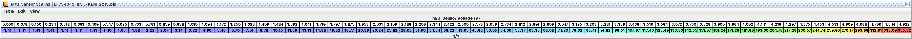

# 11. Hard limits and gotchas

One checklist for the whole book: the walls in the code, the tables that don't do what their names say, and the traps
a tuner from older Subarus walks into. Keep it open while you tune. *(inferred)* = my reading of the code, not a
direct trace; *(open)* = nobody knows yet.

## 11.1 Walls in the code (no table moves them)

1. *MAP tops out at 256 kPa abs (22.4 psi at sea level)* whatever sensor is fitted; stock reaches it at 4.44 V. A
   3-bar sensor buys resolution, not range. Everything that uses MAP (air model, pressure axes, logged MAP) stops
   there; more boost needs a code patch the definition doesn't have. To fit another sensor anyway:
   **MAP Sensor Multiplier** = its slope in kPa/V, **MAP Sensor Offset** = its kPa at 0 V (0.5 V = 20 kPa, 4.5 V = 300
   kPa gives 70 and -15). New thermistor in a TMAP: update **Intake Air Temp Sensor 2 Scaling** (temperatures only,
   item 15). The logged MAP (J07) is one byte: 255 kPa max.
2. *Boost control and the overboost check read a pressure that stops at 269.3 kPa abs (24.4 psi).*
3. *Overboost protection dies silently above about 19.5 psi* (236 kPa abs) of **Overboost Limit** on the WRX: the cut
   needs limit + 4.8 psi and the reading can't get there. The fuel-cut flag dies above about 20.6 psi in every image.
   Lower **Overboost Cut Margin (Limit State)** and **Overboost Margin** to keep it (C09).
4. *Engine load clamps at 3.31 g/rev* (256 %; 100 % = 1.293 g/rev). Every load axis tops out there.
5. **Base Fuel Quantity Limit** caps base fuel: 4.98 g/rev with stock **Injector Scaling**, out of reach, but it falls
   with the scaling: about 3.32 g/rev at 1.74 g/s (E85 by lowering the flow figure), below the load clamp under 1.73
   g/s. Past it the car goes lean. Raise it in proportion when you lower the flow figure (C03).
6. *MAF:* **MAF Sensor Scaling** ends at 4.92 V; P0103 sets above **MAF Sensor Voltage High Limit (P0103)** (4.79 V,
   about 318 g/s on the stock curve); logged MAF (J05) clips at 300 g/s. Bigger housing: rescale all 64 points and
   keep peak flow under 4.79 V.
7. *The 218 g/s air copy is harmless.* One copy of cylinder air saturates there; only purge, TGV request, monitors,
   charging and the CAN torque value read it. Fuel, load, timing and boost don't. No action.
8. *Torque ceiling about 457 ft-lb* (619 Nm) in the internal unit. Long before that, **Throttle Torque Request Cap**
   (369 ft-lb on request *plus losses*) binds from roughly 284-358 ft-lb requested, and **Air Quantity for Torque**
   has a torque axis ending at 277 ft-lb: extend it for big tunes (C05).
9. *Rail pressure: P0088 trips at* **P0088 Rail Pressure High Limit** *+ 2.5 MPa* for about 2 s: about 17.5 MPa (2,540
   psi) stock, recovering at 15.0 MPa (2,175 psi), the stock peak target. P0087 counts below
   **P0087 Rail Pressure Low Limit** - 0.30 MPa. A pending P0088 caps the throttle
   (**Throttle Limit (Fuel Pressure Fault)**, about 6 % from 4,400 rpm); it does not trigger the 6,100 rpm fail-safe
   cut (C09). Raise the limit with your targets (C03).
10. *HPFP command upper clamp* = **HPFP Command Maximum Base** + **HPFP Command Range** (225° + 120° = 345° in the
    pump frame stock). **HPFP Command Minimum** only equals the base in stock; raising it does not raise the ceiling.
11. *Sensor fault limits are raw voltages* (P0102/P0103, P0107/P0108, P0112/P0113, P0097/P0098, P0117/P0118,
    P0192/P0193, P0197/P0198). Rescaling a sensor doesn't move them; check them after a sensor swap.
12. *The 5 V ADC reference is assumed.* Every "V" in the definition rests on it; kPa, g/s and °F are exact either way.

*Stock MAF curve: 312.6 g/s at 4.77 V; P0103 sets above 4.79 V*

## 11.2 Tables that don't do what the name suggests

13. **Rev/Boost Limit Torque (Base)** (and Stage 1/2) only act inside a rev or overboost cut. Raising them gives no
    power. The real caps are **Maximum Torque (IAT)** and **Maximum Torque (DAM)** (258 ft-lb stock) (C09).
14. **Boost Limit** is not an overboost cut. It is the torque model's full-load manifold pressure: target MAP = torque
    request / full-load reference x this. Raise it with **Target Boost** (C05).
15. *IAT 1 and IAT 2 share one voltage axis.* **Intake Air Temp Sensor Scaling** and
    **Intake Air Temp Sensor 2 Scaling**: edit temperatures only. IAT 2 (probably the TMAP) feeds the air model's
    density; IAT 1 is the logged IAT and drives most compensations.
16. *Base Timing is a ceiling, not the timing.* Fired base = min(Base Timing, Primary Ignition + KCA + FLKC). At high
    load the Primary side is lower in stock, so **Primary Ignition (TGV Open, AVCS Active)** plus KCA is your WOT
    timing; at idle and coast **Closed-Pedal Timing Target** is. Raising Base Timing where the other side is lower
    does nothing, and KCA can never lift timing above Base Timing (C07). The min() is computed, not yet seen in a log.
17. **Torque Reduction Spark Retard** must stay the exact inverse of **Ignition Efficiency vs Retard**: together they
    build the min() above. Edit neither, or both.
18. *No per-cylinder knock retard.* FBKC is one value for all four; knock on any cylinder pulls all four. Logged Total
    Knock Correction (L07) is a sum nothing on the coil path uses.
19. *FBKC holds, then recovers.* Inside the knock window, after knock stops the retard is *held* for 100 knock-free
    events, then given back at **FBKC Recovery Step (State 0x0F)**. **FBKC Recovery Step** is the rate outside the
    window and in a few special states. Below **FBKC Window RPM Minimum** (1,200 rpm) no new retard is taken and
    existing retard is given back; above **FBKC Window RPM Maximum** (6,400 rpm) it freezes. Raise the maximum with
    the rev limit.
20. *FLKC uses three rpm ranges* with the stock boundaries (2,400 / 4,400 rpm; the rest sit above the limiter).
    **DAM Step Gain (FLKC Cell)** cells run 0-34 and index 0 is used.
21. *Knock thresholds are named by window* ("Full Window" / "Short Window"); older names had them swapped. 3.0 = no
    knock energy above background.
22. *Closed-loop target has a lean cap.* The four Closed Loop Target Lean Limit tables, e.g.
    **Closed Loop Target Lean Limit (TGVs Open, Normal Mode)**, stop the target at about 14.7 AFR warm. Leaner cells
    are silently cut back (C06).
23. *Open loop takes the richer of two paths.* **Primary Open Loop Fueling** and the four TGV/AVCS variants: to lean
    out, edit both sides; to richen, either works. **Open Loop Fueling Floor (Outside Closed Loop)** is a floor
    whenever the ECU is out of closed loop (C06).
24. **Injector Scaling** *is a flow, and µs tables don't follow it.* After an injector change set the scaling,
    **Injector Latency** and **Injector Minimum Pulse Width**, then rescale by hand: cranking pulses, the
    throttle-rate transient terms, the HPFP fuel-quantity axes, and the load axis of **Transient Fuel Film Target**
    (C03, C10).
25. *Start injection angle.* A normal start uses **Start Injection Angle (Fuel Mode 0)**.
    **Cranking Injection Timing** only applies on long cranks, low-rail-pressure starts and re-cranks (C10).
26. *LTFT is 0.39 % per count*, not 0.78 %. Old logger definitions showed double.
27. *The two reference torques.* **Throttle Opening Map Reference Torque** and **Full-Load Reference Brake Torque**
    are equal from 2,000 rpm stock; keep them equal and edit their Monitor copies. Only the first changes
    part-throttle opening (C05, C13).
28. *Requested Torque drive modes.* Mode 4 = Sport Sharp (S#), 2 = Sport (S), 3 = Intelligent (I), 1 = default (no
    SI-Drive request) *(inferred from the stock maps)*. On the WRX MT modes 1-3 are identical and mode 4 is the mode-1
    data on a compressed rpm axis: *more* torque at low rpm, less from about 2,400 rpm. Edit every mode the car can
    select (C05).
29. *Three idle altitude factors.* **Idle Air Altitude Factor (Key-On/Cranking)** is key-on and cranking only; the two
    Running copies are separate. Edit all three.
30. *Cruise follows Requested Torque* through the Cruise Pedal Equivalent tables. Change the torque maps a lot and
    cruise feel changes (C10).
31. *CAN torque tables only change what other modules see.* Engine Torque from Load (CAN …) and the Full-Load Air Flow
    (CAN Torque) tables don't touch fuel, spark, throttle or boost. Keep them plausible: VDC and the cluster read
    them.
32. *The cylinder-cut levels are shared* by the limiters and the decel fuel cut stages. Leave them.
33. **Overboost Margin** *is unsigned*: a "negative" entry acts as about +250 kPa and the fuel cut never arms.
34. *Cam ceilings (2018).* With stock breakpoints the "Oil Temp Low" ceiling applies at every temperature; Mid/High
    are unreachable. 90° stock, so harmless until you lower it.
35. **Rev Limit RPM** *starts the limiter*; the other five rpm values only shape it. Under boost the cut can't release
    above **Rev Limit Reset Maximum MAP** (168 kPa abs) (C09).

## 11.3 Copies, selectors and which table is live

36. *Monitor copies must match.* Every "(Monitor)" table is a separate copy for the torque monitor. Edit both or
    expect a plausibility fault *(inferred reaction)*. List: C01.
37. *One set of bytes, several names.* Descriptions saying "One table edits all … copies": nothing extra to do.
38. *A level 5 (Debug) table does nothing until its gate is changed, and a table of an unused routine is never read.*
    Some live tables are all zero, so filling them takes effect (the three 2017+ exhaust-temperature enrichment
    adders). If an edit does nothing, check the table's level and its "When used:" line first.
39. *AT/CVT tables do nothing on a manual*, and flipping **Transmission Coding: Automatic/CVT** is not a way to use
    them (it changes gear calculation, torque limits, CAN and idle logic). On AT/CVT-coded images (LF78001H, LV9N101C)
    they are the live ones; there the Requested Torque "(…, AT/CVT)" table is the whole map, not a blend.
40. *Idle modes 6 and 8 are AT/CVT only.* Manual warm idle is **Idle Speed Target (Warm Idle, Mode 5)** (C10).
41. *"TGV Closed" is the normal light-load state*, not a fault mode. At a settled warm idle the TGVs are closed, so
    the "(TGV Closed)" idle base-air tables are the ones in use.
42. *Cam maps:* near sea level only the B maps count, and **Intake Cam Target 2B (TGV Open, High Pedal, Sea Level)**,
    not 1B, sets WOT intake timing. Cruise runs set 3 (C08).
43. *2017+ Spark Air Compensation Limiter:* the "(Alt)" tables are live, the base ones unused. On 2015/2016 the base
    tables are live.

## 11.4 Per-image differences

| Image | What changes for the tuner |
|---|---|
| LF78001H (2016 Forester tS) | CVT-coded: AT/CVT tables live. Rev limit 6,100 rpm. Overboost cut state at limit + 1.5 psi, ending 1.5 psi below the limit. |
| LV9N101C (early 2015) | CVT-coded. Rev limit 6,500 rpm. |
| LV9N100F (early 2015) | Manual. Fail-safe rev limits at maximum (effectively off). |
| LV9N101C / LV9N100F | Overboost state as the Forester. Older software: one open-loop path (no TGV/AVCS set), cam targets only as "A (Altitude)" maps, one pedal-released base timing map, smaller open-loop axes, after-start enrichment by index (no TGV split). About 60-80 entries absent. |
| LF79002P / LF79100P / LF9C100P (2017-2018) | Spark Air Compensation Limiter "(Alt)" live; exhaust-temperature enrichment adders (zero); extra cam coolant offsets (zero); no engine-stop CAN frame. |
| LF9C100P (2018) | Cam target ceilings; the two catalyst-heating phase-2 angle variants differ. |
| All | Same logger slots, same limiter logic, same walls (11.1). |

Calibration addresses differ between images: use the definition for your image and never copy raw bytes across.

## 11.5 Conventions that trip people up

44. *psi gauge is against a fixed 101.325 kPa*, not measured baro. At altitude "15 psi" is still 204.7 kPa abs; the
    ECU's own altitude handling is **Target Boost Baro Compensation**.
45. *Load is g/rev* (100 % = 1.293 g/rev); torque is ft-lb. Older notes in % and Nm convert.
46. *Cam signs:* intake = advance from rest, exhaust = retard from rest; bigger = more overlap on both (C08).
47. *Injection angles* are °BTDC of compression TDC in one 720° frame (zero point inferred). Compare angle tables only
    with each other.
48. *Vehicle speed only comes from CAN.* Lose the VDC frame and every speed-dependent table sees a fixed 10 km/h
    (C19).

## 11.6 What is inferred or untested

* *Nothing has been run on an engine.* Every behaviour in this book is decoded from code.
* The timing min() (item 16): first patched-ROM log, J04 against L03, L05, L06, will confirm it.
* *The logging-patched ROMs and flashing a modified image are untested on this ECU.*
* Inferred: SI-Drive positions (a CAN capture of the knob would settle it; the two SI-Drive images disagree on whether
  mode 1 or 2 is stronger); monitor-copy fault reaction; soft-limiter options (C09); IAT 2 in the TMAP; which injector
  L24 shows; the neutral switch on the catalyst-heating exit.
* *(open)* Several limit states are not decoded (C18). A second cylinder-cut source, probably limp mode, is not in the
  definition. Gear-indexed tables may use the 5th-gear row for 6th if the gear value reaches 6 (not confirmed).

When a log disagrees with this book, the log wins. Write down what you saw.
