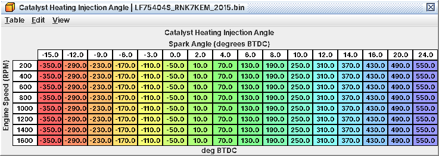

# 12. Combustion modes, stratified start and catalyst heating

For the first few seconds after every start this engine does not run like the engine you tune. It steps through a
start sequence that uses compression-stroke injection and heavy spark retard to light off the catalyst, and none of
your timing or open-loop fuel tables apply until it is done. This chapter tells you what you will see in a cold-start
log and the two cases where a tune has to care. Tables: folder Fueling / Catalyst Heating & Stratified Start; every
one is listed in A12.

> Disabling catalyst heating on a road car is emissions tampering. 12.5 is for competition-only cars.

## 12.1 The five combustion modes

After every start the ECU steps a combustion mode 0 → 1 → 2 → 3 → 4. Mode 4 is normal running. On the logging-patched
ROM you can log it (L08 Combustion Mode).

| Mode | What it does | Injection | Spark | Rail pressure target |
|---|---|---|---|---|
| 0 | Start | One compression-stroke pulse (**Start Injection Angle (Fuel Mode 0)**, 80-116° BTDC, 160° very cold) | Start path | **Target Rail Pressure (Combustion Mode 0)**, 1,450-2,175 psi (10-15 MPa) |
| 1 | Early warm-up | Split: intake stroke + late compression | Phase-2 retard | **Target Rail Pressure (Combustion Mode 1)**, 2,175 psi (15 MPa) |
| 2 | Stratified catalyst heating | One late compression pulse timed off the spark | Heavy retard, **Catalyst Heating Spark Retard** | **Target Rail Pressure (Catalyst Heating)**, 2,175 psi |
| 3 | Catalyst heating phase 2 | Split, about 40 % in the late pulse | Milder retard, **Catalyst Heating Spark Retard (Phase 2)** | **Target Rail Pressure (Combustion Mode 3, Pedal Released)** / **Target Rail Pressure (Combustion Mode 3, Pedal Applied)**: 2,175 psi cold, down to 435 / 1,160 psi (3 / 8 MPa) hot |
| 4 | Normal | One intake-stroke pulse (260-360° BTDC) | Your timing tables (C07) | **Target Rail Pressure** (C03) |

Table names say "Fuel Mode" where they mean the per-injector mode: combustion mode 0 → fuel mode 0, modes 1 and 3 →
fuel mode 2 (split), mode 2 → fuel mode 3, mode 4 → fuel mode 1. Injection angles are degrees BTDC of the injected
cylinder's compression TDC: 180-540° is the intake stroke, 0-180° the compression stroke (zero point inferred).

## 12.2 What happens in each phase

*Mode 0 (start).* A normal start fires compression-stroke pulses
at **Start Injection Angle (Fuel Mode 0)**. **Cranking Injection Timing** (245°, intake stroke) is *not* the normal
start angle: it only applies when the engine cranks in mode 4, which happens after about 10 s of cranking, when the
low-rail-pressure start latch is set, or on a re-crank. In those same cases
the **Cranking Fuel Secondary (First Attempt)** / **Cranking Fuel Secondary (Repeat Attempt)** tables are the cranking
pulse.

*Low rail pressure skips the whole sequence.* If rail pressure is still low some time into a start, a latch forces
mode 4 straight away and switches cranking fuel to its low-pressure multipliers
(**Cranking Fuel Secondary Low Rail Pressure Multiplier**, **Low Rail Pressure Start Enrichment**). A tired or
slow-priming pump therefore never runs the heating phases.

*Mode 2 (stratified heating).* Spark is walked toward base timing minus **Catalyst Heating Spark Retard** and floored;
on the reference ROM the target sits on the floor, about 20° ATDC (unit inferred). The fuel arrives just before that late spark in
a single compression-stroke pulse (**Catalyst Heating Injection Angle**, by rpm and spark target, clipped to 10.5-180°
BTDC), so a rich cloud sits at the plug and the late burn dumps heat into the exhaust. Rail pressure is held at 2,175
psi. That single pulse is all mode 2 injects on the reference ROM. The code also schedules a second, very late pulse
(**Catalyst Heating Injection Angle 2**, pinned at its limit, about 170° ATDC), but its fuel comes from
**Catalyst Heating Second Injection Share**, which is 0 on the reference ROM, so it never fires. Raising the share would move that
fraction of the fuel into an expansion-stroke pulse; I haven't tested that and there's no reason to on a stock exhaust.

Mode 2 is only entered while coolant is between **Catalyst Heating Coolant Minimum** (−40 °F / −40 °C)
and **Catalyst Heating Coolant Maximum** (167 °F / 75 °C) and rail pressure is
above **Catalyst Heating Rail Pressure Minimum** (73 psi / 0.5 MPa), plus a few checks that are read but not named. It
lasts at most **Catalyst Heating Maximum Time** (10 s). Otherwise the ECU goes straight from mode 1 to mode 3.

*Injection angle follows the spark target; stored cells outside 10.5-180° BTDC are clipped*

*Modes 1 and 3 (split injection).* A first pulse in the intake stroke
(**Catalyst Heating Phase 2 Injection Angle Base (TGV Normal)**
/ **Catalyst Heating Phase 2 Injection Angle Base (TGV Closed)**, 270° cold to 290° hot) and a second late in
compression (**Catalyst Heating Phase 2 Injection Angle (TGV Normal)**
/ **Catalyst Heating Phase 2 Injection Angle (TGV Closed)**, 40°). **Start Split Injection Second Share (Idle)**
/ **Start Split Injection Second Share** put about 40 % in the second pulse. Spark is base
minus **Catalyst Heating Spark Retard (Phase 2)**.

Mode 3 ends when an internal heating-progress counter
reaches **Catalyst Heating Phase 2 Exit Threshold (Neutral Switch Off)** (in gear)
or **Catalyst Heating Phase 2 Exit Threshold (Neutral Switch On)**, or after **Catalyst Heating Phase 2 Maximum Time**
(5 s very cold, 2 s at 32-104 °F / 0-40 °C, 1 s from 176 °F / 80 °C).

In mode 1, **Start Spark Target Base (Mode 1)** and its adders set the spark *target* that the torque model and the
cold-start monitors work with, not the spark that fires. Editing them changes how the torque model compensates, not
where the plug fires.

## 12.3 What does not work until mode 4

* Your timing tables (C07). In modes 0-3 the fired spark comes from the heating retard chain.
* Primary open-loop fuel (C06): only in mode 4 (and mode 0).
* Long-term fuel trim learning (C06).
* Surge damping (**Surge Damping Timing Combustion Mode Factor** is 0 outside mode 4).
* The closed-loop target lean limit has separate "Normal Mode" and "Other Modes" tables (C06).

So a cold-start log that looks wrong for the first 10-20 s is usually just the sequence. Judge your tune from mode 4.

## 12.4 When a tune has to care

*Bigger injectors.* The late compression and split pulses are small. With much bigger injectors they can hit the
minimum pulse width (C03) and the start runs richer than intended. Log injector pulse (L24) and rpm through the first
minute of a cold start and check that pulses in modes 1-3 sit above **Injector Minimum Pulse Width**.

*Pump or rail changes.* Modes 1-3 hold 2,175 psi. A pump that cannot build that quickly trips the low-rail latch
(12.2): the car starts and drives fine, but the heating phases never run and the cold-start monitors behave
differently.

*Cold-start monitors.* P050B (cold start ignition timing) checks that final timing really is retarded against the
spark target plus **Cold Start Timing Monitor Band (Coolant)**, car stopped. P050A (cold start idle air) checks that
rpm reaches the idle target. Leave the sequence alone on a street car and both keep passing.

## 12.5 Competition car: disabling stratified heating

1. Set **Catalyst Heating Coolant Maximum** below **Catalyst Heating Coolant Minimum** (for example Maximum at its
   lowest value). Mode 2 is then never entered. (Setting Catalyst Heating Maximum Time to 0 still enters mode 2 for
   one pass.)
2. Optional: set **Catalyst Heating Phase 2 Maximum Time** to 0 to drop mode 3's retard too.

Expected (inferred): P050B simply never runs, so readiness stays incomplete; P050A is unaffected. Verify with logged
cold starts (L08 steps 0 → 1 → 3 → 4, never 2) and a readiness check. A factory bit that jumps straight to mode 4 at
key-on also kills the low-rail-pressure start fallback; it is deliberately not in the definition.

## 12.6 What to log on a cold start

L08 Combustion Mode, coolant (J02), rpm (J01), Ignition Timing (J04), Base Timing (L03), Fuel Rail Pressure (L09) and
target (L10), injector pulse (L24). L03 is the selected base map plus IAT and coolant comp; the gap between L03 and
J04 during modes 1-3 is the heating retard. Not settled: the meaning of the phase-2 exit counter and of the
catalyst-heating readiness flag (**Catalyst Heating Readiness Idle Stability Time**).
