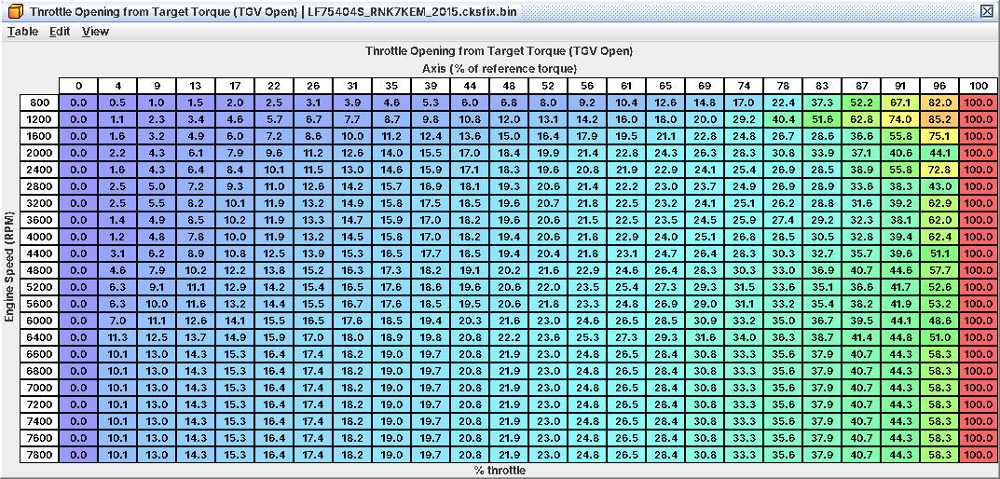

# 13. Torque and throttle model

C05 tells you what to change for power. This chapter explains what sits between the pedal and the throttle blade, so
you can predict what an edit will do and recognise a torque limit in a log. Per-table detail is in A13.

The pedal does not open the throttle. The pedal asks for *torque*, and three actuators deliver it: the throttle (air
below atmospheric), the wastegate (air above atmospheric, C14), and spark plus fuel cut for fast reductions (13.5,
C18). Everything is in brake torque (what reaches the flywheel), except inside the throttle model, which adds the
engine's friction and pumping losses (**Friction and Pumping Torque Loss**, 12-85 ft-lb).

This was reproduced with a numeric model of the ECU's own lookups but not on a car. The quick live check: log
commanded throttle (J11) against pedal (J33) at part throttle before and after an edit
to **Throttle Opening from Target Torque (TGV Open)**.

## 13.1 Pedal to target torque

```
pedal ─► Accelerator Pedal Scaling (1:1 stock)
      ─► Requested Torque (drive-mode map, rpm x pedal)
      ─► + cruise / additive torque
      ─► min( CAN torque limit from VDC, Maximum Torque (IAT), Maximum Torque (DAM), two internal limits )
      ─► tip-in / tip-out shaping (Target Torque Rise / Fall tables)
      ─► max( idle and cruise floors )
      ─► TARGET TORQUE  ──► boost side: Target Boost, wastegate duty (C14)
                        └─► throttle side (13.2)
```

* *Drive-mode maps.* One Requested Torque map per drive mode, picked by the SI-Drive request over CAN
  (C19): **Requested Torque (Drive Mode 1, Default)** (no SI-Drive, and the only map a WRX MT
  uses), **Requested Torque (Drive Mode 2, Sport)**,
  **Requested Torque (Drive Mode 3, Intelligent)**, **Requested Torque (Drive Mode 4, Sport Sharp)**. The positions
  are inferred from the stock maps. On the AT/CVT coding the "(…, AT/CVT)" tables are the whole map and the plain ones
  are ignored; on a manual the AT/CVT ones do nothing.
* *Caps: lowest wins.* Cold intake air or lost DAM lowers target torque, and therefore throttle *and* boost target.
* *Shaping* limits how fast target torque may rise after a tip-in (two stages, by gear and rpm, faster with more
  pedal) and fall on tip-out. It delays the boost target too. Tuning it is a drivability job (C10).
* *Floors.* Idle speed control and cruise can lift target torque above the shaped request.

Target torque feeds the boost side and the throttle side independently. A throttle-side limit does not lower the boost
target, and the boost side does not see what the throttle did.

## 13.2 Target torque to throttle opening

*The opening tables set part throttle.* Target torque is divided by **Throttle Opening Map Reference Torque** (by rpm:
103 ft-lb at 800 rpm, 217-223 ft-lb from 2,000 to 4,800 rpm, 165 ft-lb from 6,600 rpm). The result, 0-100 %, is the
column of eight *Throttle Opening from Target Torque* tables. At or above the reference torque every one of them says
100 %: wide open.

| | No EGR | EGR |
|---|---|---|
| TGVs closed | **Throttle Opening from Target Torque (TGV Closed)** | **Throttle Opening from Target Torque (TGV Closed, EGR)** |
| TGVs open | **Throttle Opening from Target Torque (TGV Open)** | **Throttle Opening from Target Torque (TGV Open, EGR)** |
| Cruise | four "(Cruise, …)" twins of the above | |

The TGV pair is blended by actual TGV position and the EGR pair by how much EGR is really flowing. The cruise set
replaces the normal set while cruise is in control and the pedal is not overriding it (inferred). A warm car at part
load mostly runs the TGV Open tables, or TGV Closed at light cruise (C08).



*Throttle opening by rpm and target torque as % of the reference torque; every row reaches 100 % at the reference torque*

*The torque detour cancels out at part throttle.* The ECU then converts the opening to torque and back to an
opening. **Throttle Required Area** is the exact inverse of **Torque Fraction from Throttle Area**, so at part
throttle the full-load reference and the losses drop out:

*commanded throttle ≈ opening table + idle air.*

Scaling **Full-Load Reference Brake Torque** by 0.9 changed part-throttle opening by 0.00 % in the model. The detour
exists to add idle air (it can only open the throttle further), to apply the rev/overboost throttle caps (13.4), to
carry requests above full-load torque, to add air when spark runs well behind its target (cat heating, active retard;
factor 1.0 in normal warm running), and to compute the target MAP the model expects from **Boost Limit**.

*The full-load reference.* The model divides by a full-load torque built from **Full-Load Reference Brake Torque**
(scaled by baro; the IAT factor is flat 1.0) plus **Full-Load Reference Torque Loss**: stock about 235 ft-lb at 2,000
rpm, 249 at 4,000, 232 at 6,400, at sea level. From 2,000 rpm Full-Load Reference Brake Torque *equals* Throttle
Opening Map Reference Torque, so the point where the throttle goes wide open and the point where the excess-torque
path takes over are the same. Keep them equal when you raise either (C05).

*No altitude correction at part throttle.* The opening tables are not density corrected; the same target torque gives
the same opening at any altitude. Only the wide-open point moves.

*Output.* **Throttle Opening (Required Area)** turns area (about 2,150 mm² wide open) into the commanded throttle
(J11); **Throttle Area from Opening** is its inverse. Touch them only for a different throttle body (C04). The ETC
target then gets **Start Throttle Opening Add (Coolant)** while cranking, an idle floor and the limp
caps **Throttle Limit (Fuel Pressure Fault)** and **Throttle Limit (Injector Circuit Fault)**. A failed throttle
position sensor caps the blade at about 24 %; both failed, or 16 V or more, and the motor is switched off. With the
engine stopped the pedal drives the throttle directly (handy on the bench).

## 13.3 Throttle and boost hand over at the reference torque

Below the reference torque (about 220 ft-lb from 2,000 rpm stock) the throttle meters the air with the wastegate open;
above it the throttle is wide open and the wastegate alone controls torque (C14.7). Move request, caps, reference
torque, Target Boost and duty together.

## 13.4 Where the throttle closes below the driver's request

| Cause | What you see | Lowers boost target? |
|---|---|---|
| A torque cap (IAT, DAM, VDC) or tip-in shaping | Target torque (L01) below the Requested Torque map value | Yes |
| Rev limit or overboost-cut state | Throttle torque request (L02) clamped to **Rev/Boost Limit Torque (Stage 1)** (37 ft-lb) or **Rev/Boost Limit Torque (Base)** (108-207 ft-lb) | No |
| **Throttle Torque Request Cap** (369 ft-lb on request + losses) | Binds from about 284-358 ft-lb of target torque: raise it on a big tune | No |
| Fault cap or ETC fault | J11 pinned at a low value, DTC set | No |

## 13.5 Spark and fuel-cut torque reduction, and why it sets WOT timing

The model also keeps an estimate of the torque the engine is actually making (**Air Quantity for Torque** plus the
air-path lag tables). When a cap is below that estimate, the ratio between them sets:

* a *cylinder cut*: below 75 % one cylinder in four, 50 % two, 25 % three, 3.9 % all four
  (**Cylinder Cut Torque Ratio (1 Cylinder)** to **Cylinder Cut Torque Ratio (4 Cylinders)**). The rev limiter asks
  for zero torque, so it always cuts all four (C18). The same thresholds stage the decel fuel cut;
* a *spark reduction*, done like this: the ECU takes how far the timing request (Primary Ignition or the closed-pedal
  target, plus comps, KCA and FLKC) sits below base timing, turns that retard into a torque efficiency
  with **Ignition Efficiency vs Retard**, multiplies by the cap ratio (1.0 when nothing binds), and turns it back into
  retard from base timing with **Torque Reduction Spark Retard**.

Because those two tables are exact inverses, with no cap the round trip lands exactly on the request: *fired timing =
the lower of base timing and the request*. That is the timing min() rule of C07, and it is why Primary Ignition plus
knock advance is effectively your WOT timing at high load in stock. A binding cap pulls further, floored at about 40 %
efficiency (about 34° of pull).

*Keep Torque Reduction Spark Retard the exact inverse of Ignition Efficiency vs Retard.* Edit one alone and fired
timing stops landing on the request even with no cap active.

In the rev, overboost and speed-limit states the stock flags keep spark on its normal target
(**Limit-State Spark: Normal Target in Rev/Overboost Cut**, **Limit-State Spark: Normal Target in Speed Limit**), so
those cuts are fuel only.

## 13.6 Monitor copies

A second copy of the request and throttle model runs as a safety monitor with its own tables: every Requested Torque
map, the normal and cruise opening tables, both reference torques, the loss tables, the area tables, Idle Air Request
to Throttle Area and Start Throttle Opening Add. Each copy is named "(…, Monitor)" and sits right after its
original. *Make every edit in the Monitor copy too.* A mismatch is expected to set a throttle/torque plausibility
fault (reaction not traced, inferred).

## 13.7 Cheat sheet

| You want | Change | Don't bother with |
|---|---|---|
| More or less throttle for the same pedal at part throttle | Low-pedal cells of the Requested Torque map, or the Throttle Opening from Target Torque tables (TGV Open and TGV Closed) | Full-Load Reference Brake Torque, Full-Load Reference Torque Loss, Friction and Pumping Torque Loss, Throttle Required Area: they cancel at part throttle |
| More torque and boost at full pedal | Requested Torque, both Maximum Torque tables, Target Boost, wastegate duty (C05) | Rev/Boost Limit Torque (Base): it only acts during a cut |
| Throttle to go wide open later or earlier | **Throttle Opening Map Reference Torque** (+ Monitor); it rescales every part-throttle column | |
| A model that matches a higher-torque tune | **Full-Load Reference Brake Torque** (+ Monitor) to the new full-load torque, **Throttle Torque Request Cap**, the **Air Quantity for Torque** axis (ends at 277 ft-lb) | |
| A different throttle body | **Throttle Area from Opening**, **Throttle Opening (Required Area)**, **Throttle Area from Throttle Position (Airflow Model)** + Monitor copies (C04) | |

Log: J11 commanded throttle, J33 pedal; on the patched ROM L01 target torque, L02 throttle torque request, L19
torque-model opening, L20 required area, L21 ETC target (C02).
