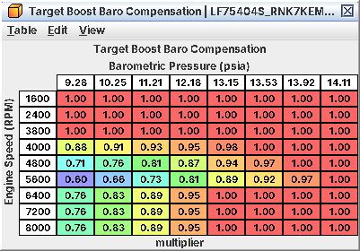

# 14. Boost control loop

The wastegate controller is ordinary feed-forward plus PI on boost pressure. What catches people out is the axis: the
target and both duty tables are looked up on *target torque* (C13), not on pedal, throttle or load. The workflow for
adding boost is in C05; per-table detail and the exact arithmetic are in A14. Read from the code, not checked on a
running engine.

## 14.1 Units

* The loop runs every 20 ms and works in *absolute pressure*. The definition shows psi gauge against sea level (101.3
  kPa) with kPa abs as the alternate. Inside the ECU, gauge values are taken against the baro sensor.
* The loop sees MAP lightly averaged; this copy stops at 269.3 kPa abs (24.4 psi at sea level). The MAP value the rest
  of the ECU uses stops at 256 kPa abs (22.4 psi; C11).
* Higher duty = more boost. A fault forces 0 %: wastegate open.

## 14.2 The target

```
target = Target Boost(rpm, target torque) x Target Boost Baro Compensation(rpm, baro)
                                          x Target Boost IAT Compensation(IAT)        (absolute pressure)
```

* Because the axis is target torque, a gentle pedal gives a vacuum or low-boost target, a torque cap (cold IAT, low
  DAM, VDC) drops the boost target directly, and tip-in shaping slows the boost target as well as the throttle.
* The compensations multiply *absolute* pressure: 0.96 on 211 kPa abs (15.9 psi) is 203 kPa abs, 1.2 psi less boost,
  not 0.6 psi.
* **Boost Limit** and **Overboost Limit** get the same compensation but are not part of the target. Boost Limit is the
  torque model's full-load MAP (C13); Overboost Limit drives the overboost cut (14.6).



*Boost target multiplier by rpm and baro: 1.0 near sea level, down to about 0.6 at altitude between 4,000 and 6,000 rpm*

## 14.3 Feed-forward duty

```
comp = Wastegate Duty Baro Compensation(rpm, baro) x Wastegate Duty IAT Compensation(IAT)
duty = min( Wastegate Duty Initial(rpm, TT) x comp + P + I ,  Wastegate Duty Maximum(rpm, TT) x comp )
```

* **Wastegate Duty Initial** is the duty at zero error. Stock it is 0 below about 175-220 ft-lb of target torque at
  most rpm, so there the wastegate is open and the throttle alone controls the air (14.7).
* **Wastegate Duty Maximum** caps the total and stops the integral growing once duty reaches it.
* **Wastegate Duty IAT Compensation** is 0 below about 14 °F (−10 °C), so no boost control at all with very cold
  intake air, and 1.31 from 104 °F (40 °C). It multiplies both tables, so a hot car runs about a third more duty than
  the table says.

*Get Wastegate Duty Initial right.* Feedback is a slow trim, not the main controller.

## 14.4 Feedback

Error = target − measured (positive = under target).

*When it runs.* The target, as gauge pressure against baro, must be above **Boost Feedback Activation Threshold**
(stock −1.0 psi below 2,800 rpm, 4.1 psi from 2,800 rpm, 1 psi hysteresis), rpm above **Boost Feedback Minimum RPM**
(1,000), and the boost state normal (14.5). Otherwise P = 0 and the integral resets to 0. So at light load (vacuum
target) there is no feedback, and above 2,800 rpm it only starts once the target is over about 4 psi.

*P.* **Boost Proportional**(error) × **Boost Proportional IAT Gain**: stock +4 % duty at 3 psi under, −7.5 % at 3.9
psi over, ×1.31 with hot intake air.

*I.* Every 20 ms, while under target by at least **Boost Integral Positive Error Deadband** (0.1 psi) and duty below
the compensated maximum, add **Boost Integral Step (Positive Error)** × its IAT gain, up to **Boost Integral Maximum**
(+10 %). While over target with duty at least 5 %, add **Boost Integral Step (Negative Error)** × its IAT gain, down
to **Boost Integral Minimum** (−90 %). Stock steps are at most about 0.2 % per 20 ms (about 10 %/s).

The integral starts from 0 every time feedback switches on, and nothing in the boost code learns a long-term
correction. All three IAT gains are 0 below about 14 °F and 1.31 from 104 °F.

## 14.5 Boost states

| State | When | Duty |
|---|---|---|
| Normal | No fault, no special request | Controller duty |
| Fault | Sensor or system faults, engine not running, a high-load check (a low-DAM duty cut exists but is disabled in stock) | 0 % |
| Fixed-duty request | A request from the fueling code (purpose not identified) and its ramp back | Fixed values, all 0 % in stock |

*0 % duty with a positive boost target means the boost code is in a fault or forced state.* Read the DTCs.

## 14.6 Overboost protection is not in this loop

The loop has no boost cut. Protection sits in the torque code (C09, C18) and acts through the throttle and injectors;
it never lowers the target or the duty.

| Event (WRX) | Result |
|---|---|
| Boost ≥ compensated Overboost Limit + **Overboost Cut Margin (Limit State)** (4.8 psi / 33 kPa) | Cut state: throttle capped at once |
| Boost ≥ limit + **Overboost Margin** (3.9 psi / 26.7 kPa) for **Overboost Delay** (2.0 s) | Overboost flag; together with the cut state, full fuel cut |
| Boost falls **Overboost Cut Hysteresis (Limit State)** (2.2 psi / 15 kPa) below the cut level | Cut state ends |

Forester tS and LV9N images use a 1.5 psi (10 kPa) cut margin and 2.9 psi (20 kPa) hysteresis. **Overboost Margin** is
unsigned: a "negative" entry acts as about +250 kPa.

*Ceiling.* The measured pressure stops at 269.3 kPa abs, so on the WRX an Overboost Limit above about 236 kPa abs
(19.5 psi) can never trigger the cut. On the 10 kPa images the throttle-cap state stays reachable up to a limit of
about 259 kPa abs, but the fuel cut needs the flag too and stops being reachable above about 243 kPa abs (computed).

## 14.7 Throttle and wastegate together

Below the reference torque where the throttle reaches wide open (about 220 ft-lb from 2,000 rpm stock, C13) the
throttle meters the air and the wastegate is mostly open. From there to the 258 ft-lb cap the throttle is wide open
and the wastegate alone controls torque. Two consequences:

* *Boost targets below the wide-open column* only matter as far as the throttle allows. A high target there just winds
  feedback up while the throttle sets the real boost.
* *Target Boost and the duty tables share the torque axis.* When you raise target torque, the duty at the new torque
  column has to make the boost the target asks for at that rpm.

## 14.8 Reading a boost log

| Log | Source | Use |
|---|---|---|
| Target Boost | L11 (patched) | Compensated target |
| Boost Control Pressure | L12 (patched) | What the loop sees |
| Manifold Absolute / Relative Pressure | J07 / J08 | MAP; one byte, so nothing above 255 kPa abs |
| Wastegate Duty | J10, L13 (full resolution) | Final duty |
| Wastegate Duty Feedback | L14 (patched) | P + I (scaling inferred) |
| Target Torque | L01 (patched) | Which column of Target Boost and duty is live |
| IAT, baro | J03, J09 | For the compensations |
| Commanded throttle | J11 | Is the throttle wide open? |

A healthy WOT pull: throttle 100 %, boost within about 1 psi of target once spooled, feedback small and not pinned
at +10 %, duty below the compensated maximum. Feedback pinned at +10 % means Initial duty is too low for that cell;
boost over target with feedback deep negative means it is too high.
