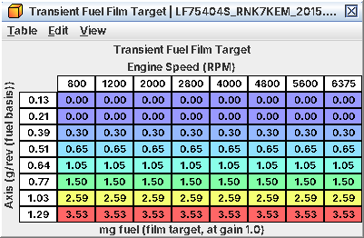

# 15. The fueling chain

One injection, from the air the ECU thinks is in the cylinder to the pulse that opens the injector. The workflows are
in C03 (injectors, rail pressure), C04 (air measurement), C06 (mixture targets) and C10 (transients); A15 has the
arithmetic for checking a log against the code. Read from the code, untested on a car.

## 15.1 The chain at a glance

```
MAF ─► manifold model (VE, throttle flow, IAT 2) ─► cylinder air ─► load (g/rev, clamp 3.31)
                                                       │
base fuel = cylinder air / 14.7 x Injector Scaling     (time at the 0.3 MPa / 44 psi reference)
   x fuel factor: Fuel Factor Correction + enrichment (richest request wins)
   x trims: closed-loop correction, long-term trim, minus purge vapour
   [start / cat-heating phases: start-path factor instead (C12)]
per cylinder: x Per-Injector Fuel Trim, + transient fuel, never below the decaying cranking pulse
pulse = Injector Latency(P) + quantity x Injector Flow Compensation(P), at least Injector Minimum Pulse Width
```

## 15.2 Air: a MAF-anchored manifold model

The ECU fuels neither from the MAF directly nor from MAP alone. It runs a small model of the intake every combustion
event (structure read, interpretation inferred):

1. Flow through the throttle is computed from the estimated boost pressure ahead of it, the pressure ratio
   (**Throttle Flow Function**), throttle area (**Throttle Area from Throttle Position (Airflow Model)**) and
   temperature (**Throttle Flow Temperature Correction**).
2. The boost-pressure estimate is pulled until modelled throttle flow equals the filtered MAF flow. *The MAF anchors
   the model.*
3. A modelled manifold pressure fills with throttle flow and empties with cylinder flow.
4. Cylinder flow = VE (**Volumetric Efficiency (TGV Closed)** / **Volumetric Efficiency (TGV Open)**, blended by TGV
   position) × modelled manifold pressure × displacement × rpm / IAT 2 temperature.
5. Load = cylinder air per rev, clamped at 3.31 g/rev (256 %).

What that means for a tuner:

* *In steady state, cylinder air equals MAF flow.* Steady-state fuel errors are MAF scaling (C04).
* *VE shows up in transients*: it sets how fast cylinder air follows a throttle step before the model and the MAF
  agree again. Tip-in lean or rich spikes after an intake or cam change point at VE as much as at transient fuel.
* *The real MAP sensor* only speeds the model up when MAP moves fast, and stands in when the model is not running or
  on sensor faults.

A second copy of the airflow saturates at 218 g/s. Only side functions read it (purge, evap and cat monitors, TGV
transition fuel, the exhaust temperature filter, charging, the CAN torque estimate). Fuel, load, timing and boost use
the full-range value, so 218 g/s is not a power limit (C11).

## 15.3 Base fuel and its two ceilings

Base fuel = cylinder air / 14.7 × **Injector Scaling** (C03). 14.7 is a code constant: your AFR targets are applied as
enrichment on top of it. The result is a pulse time at the 44 psi (0.3 MPa) reference pressure; every µs value
downstream is "reference µs" until flow compensation converts it to real rail pressure.

* **Base Fuel Quantity Limit** caps base fuel. Stock it is about 5 g/rev of air at stock Injector Scaling:
  unreachable. It is a fuel quantity, so it moves with Injector Scaling. E85 done by lowering the flow figure to 1.74
  g/s puts it near 3.32 g/rev, right at the load clamp. *Rescale it with every Injector Scaling change* (new = stock ×
  new raw Injector Scaling / stock raw; A15), or the engine goes lean at high airflow (inferred).
* *Load clamps at 3.31 g/rev.* Base fuel is computed from air, not load, so fuel keeps rising; but every load-indexed
  table (open-loop fuel, timing) stops moving above the clamp.

## 15.4 The fuel factor: richest request wins

Base fuel is multiplied by a factor built from:

* **Fuel Factor Correction (RPM x Load)**: a fixed correction in every state (only active at light load below 1,600
  rpm in stock).
* *Enrichment.* The largest of: (primary open-loop + additional enrichment, at least the open-loop floor, capped at
  λ 0.5); warm-up + after-start enrichment; standstill tip-in enrichment; a fuel-cut recovery term (probably). Primary
  open loop is itself the richer of **Primary Open Loop Fueling** and the TGV/AVCS group (C06). *The groups do not
  add: the richest one wins.*
* TGV transition fuel and two small trims, added.
* Closed-loop correction × long-term trim, minus purge vapour, as one bracket.

*Commanded λ in a log is not the whole story.* The ECU reports 256 / (256 + warm-up + primary open loop + additional
enrichment). The floor, after-start, tip-in and fuel-cut terms are left out, so a scan tool can show leaner than what
is really commanded.

In the start and cat-heating phases (C12) the factor is built from the after-start and start enrichment tables instead
(C10), and primary open-loop fuel does not apply.

## 15.5 Per cylinder: trims and transient fuel

Each cylinder's quantity is multiplied by its **Per-Injector Fuel Trim 1** … **Per-Injector Fuel Trim 4** (flat in
stock) and the transient term is added. It never drops below the decaying cranking pulse (C10). Transient fuel runs
every 10 ms, only while running, with two terms:

* *Wall film.* When **Transient Fuel Film Target** rises from one pass to the next, the difference is added to the
  following injections and decays away slowly (about 98.5 % kept per injection, so tens of injections). A falling load
  removes nothing in stock. The values are fuel mass, but the *load axis is fuel-based and scales with Injector
  Scaling*: after an injector change multiply the axis by new raw / 2918 (C03).
* *Throttle rate.* Throttle movement × **Transient Fuel Throttle-Rate Gain** (by coolant) × its rpm multiplier adds
  fuel on opening and removes it on closing, short-lived (25 % kept per pass), limited
  by **Transient Fuel Throttle-Rate Term Minimum**. This term is in µs: *rescale it after an injector change* (C03).

Neither acts in the first second with the pedal released or at a steady idle at standstill. Tip-in and tip-out mixture
problems on a modified car are these two terms plus VE (15.2); C10 has the workflow.



*Wall-film fuel mass by load: 0 at 0.21 g/rev, 3.5 mg at 1.29 g/rev, the same at every rpm*

## 15.6 Injections and the final pulse

* *Single injection* in normal running: the double and triple injection quantity windows are all 65535 in stock. Only
  the start and cat-heating phases split (C12).
* *Angle:* **Injection Timing (Single Injection)** (260-360° BTDC, early intake
  stroke), **Injection Timing (High Pedal)** from 90 % pedal, plus **Injection Timing Additive** × its multiplier.
* *Pulse* = **Injector Latency** + quantity × flow compensation (**Injector Flow Compensation (Injectors 1/3)**
  / **Injector Flow Compensation (Injectors 2/4)**, by rail pressure), at least **Injector Minimum Pulse Width**. L24
  logs this final value for one injector.
* Cut cylinders (rev limit, overboost, decel) get no pulse at all, not the minimum (C18).

## 15.7 Purge and closed loop, in brief

*Purge* is fuel the ECU did not inject. The learned vapour concentration × purge rate is subtracted inside the trim
bracket. Purge is closed during open-loop enrichment (**Purge Rate (Open-Loop Enrichment)** is 0) and cut back when
any pulse gets within **Purge Injector Minimum Pulse Margin** of the minimum pulse: relevant for big injectors at
idle. The valve tables only need touching for a different valve.

*Closed loop* compares the target (C06) with the front A/F sensor; the correction (L16) enters through the short-term
trim term. Its average updates one of the long-term trim cells, which then apply in every state, open loop included.
A06 has the state machine and limits.
