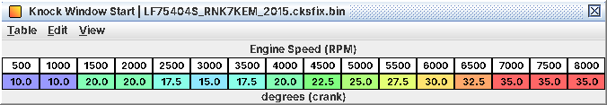

# 16. Knock control

C07 tells you which knock tables to touch. This chapter explains what happens between the knock sensor and the coil,
so you can read FBKC, FLKC and DAM in a log and know which parts are safe to change. Per-table detail is in A07.
Decoded from code, not checked on a running engine.

## 16.1 The chain

Once per combustion event (every 180° of crank), for the cylinder that just fired:

1. *Listen* during a crank-angle window after TDC (16.3).
2. *Split* the sensor signal into 8 frequency channels (inferred from the arithmetic; frequencies not worked out) and
   measure each channel's energy.
3. *Compare* each channel with its own learned background: ratio 1.0 = at background.
4. *Score*: add the three largest ratios. That sum is the knock intensity (3.0 = all three at background).
5. *Decide*: intensity above *Knock Threshold (…)* for that event slot = knock.
6. *React*: FBKC pulls timing at once; FLKC and DAM learn slowly.

In stock channels 1, 7 and 8 are switched off by calibration; only 2-6 count. Intensity and threshold cannot be logged
on any ROM yet, so threshold edits are blind (16.4).

## 16.2 Event slots, not cylinders

Every per-cylinder knock table is per *event slot* 1-4
(**Knock Threshold (Event 1, Short Window)**, **Knock Window Overlap Margin (Event 1)**, …). The firing order is
1-3-2-4, but which slot is which cylinder has *not been mapped*. Edit all four slots alike unless you have measured a
per-cylinder difference.

## 16.3 The knock window and which threshold set is live

* *Start*: **Knock Window Start** by rpm: 10° ATDC to 1,000 rpm, 20° at 1,500-2,000, 15-17.5° at 2,500-3,500, then
  from 20° at 4,000 rpm up 2.5° per 500 rpm to 35° from 7,000 rpm.
* *Length*: **Knock Window Length**, 20° below about 2,000 rpm, 25° above.
* *Extension*: with timing at or below **Knock Window Extension Timing Threshold** (4° BTDC), the window grows
  by **Knock Window Length Extension** (15°) and stays long until timing is 2° above the threshold. Late combustion
  ends late, so the window follows it.

*The window picks the threshold set.* Normal window → *Knock Threshold (Event n, Short Window)*; extended window
→ *(Event n, Full Window)*. These names were corrected on 2026-10-30 (the older names had the sets swapped). In warm
running at real timing you are always on the *Short Window* set. Full Window only comes in at very retarded timing:
cat heating, heavy torque reduction, deep knock retard.

*Where listening starts, by rpm: 10° after TDC at idle, 15-20° in the midrange, 35° from 7,000 rpm*

## 16.4 Background, window steps and thresholds

The background is a slow filter of each channel on non-knocking events. When the window changes length, the energy
jumps for reasons that have nothing to do with knock; *Knock Background Window Step (Event n, Channel m)* shifts the
reference for that one event so the switch does not read as knock. *Knock Window Overlap Margin (Event n)* (4-5°)
handles a window that runs into the next event. These are level 4: leave them unless you are recalibrating knock
detection with proper equipment.

Stock *Knock Threshold (Event n, Short Window)* is 10-16 by rpm and flat across load; the Full Window set is 8-14. A
knock call therefore needs the strongest channels at roughly 3-5× background. Raise a threshold to make that rpm band
less sensitive, lower it for more. A noisy modified valvetrain at high load could justify a load shape, but only from
measured intensity data.

A secondary detector (**Secondary Knock Threshold (Event 1)** …) is at maximum everywhere in stock and never fires;
its retard steps are unused.

## 16.5 FBKC: one integrator, hold then recover

FBKC is the only knock term added straight into fired timing, after the timing min() rule and the rate limiter (C07).
It is *one value for the whole engine*: knock on any cylinder retards all four. There is no per-cylinder knock retard.

Each event the ECU picks one action, in priority order:

| Condition | FBKC does |
|---|---|
| Knock control switched off (calibration) | 0 |
| Pedal released or load at minimum | Recovers by **FBKC Recovery Step** |
| Knock sensor fault | Fixed at about −4.9° (inferred: fault default) |
| rpm above **FBKC Window RPM Maximum** (6,400 stock) | Held |
| rpm below **FBKC Window RPM Minimum** (1,200 stock) | No new retard; recovers by **FBKC Recovery Step** |
| Knock (intensity above threshold) | Pulls **FBKC Retard Step (Knock, State 0x0E)** / **FBKC Retard Step (Knock, State 7)** (1.4° each) |
| No knock, fewer than 100 events since the last knock | *Held* |
| No knock, 100+ events since the last knock | Recovers by **FBKC Recovery Step (State 0x0F)** (0.35°) |

Floor: minus **FBKC Maximum Retard** (about 12°). Cap: 0.

*What that looks like in a log.* One knock event costs 1.4°, which then sits there for 100 clean combustion events (1
s at 3,000 rpm, 0.5 s at 6,000) before it comes back at 0.35° per event (four events). A burst of knock that pulls 5°
holds 5° for those 100 events, then recovers in about 15 events. So FBKC on this ECU looks like flat steps with a
quick ramp back, not a sawtooth. **FBKC Recovery Step** is *not* the normal recovery rate; to change how fast timing
comes back after knock in the rpm window, edit **FBKC Recovery Step (State 0x0F)** (and the 100-event hold is a
calibration value not in the definition).

*FBKC freezes near the limiter.* Above 6,400 rpm it is held, neither pulling nor recovering.
Raise **FBKC Window RPM Maximum** if you raise the rev limit (C09).

## 16.6 FLKC, DAM and KCA

* *FLKC*: learned timing corrections in backup RAM, one per cell. Cells are 7 rpm ranges × 5 load ranges from the FLKC
  Range Boundary tables (cell index 0-34, index 0 used), but only three rpm ranges fall below the stock 6,700 rpm
  limit, so 15 cells are live. Positive learning is capped at the advance DAM has not yet given;
  in **FLKC Advance Learning Inhibit Zones** it can only learn retard (inferred).
* *DAM*: one global value, 0-1.0 in 1/16 steps, 11/16 after a reset. It moves by the FLKC step
  × **DAM Step Gain (FLKC Cell)** for the current cell: large drops after knock, small rises with clean running. Stock
  gains are non-zero only in the middle three load ranges (0.41-3.19 g/rev) of the three live rpm ranges.
* *KCA* = **Knock Correction Advance Max A (TGV Open)** (blended with the TGV Closed table) × **KCA DAM Curve A** +
  the B pair × **KCA DAM Curve B** (B only near full DAM): the advance DAM unlocks.

Where they act:

* *DAM* caps target torque through **Maximum Torque (DAM)** (so low DAM drops boost at high rpm), adds fuel
  through **Low-DAM Enrichment** and the open-loop DAM additive, and scales KCA.
* *KCA and FLKC go on the request side of the timing min() rule.* Fired timing is the lower of Base Timing (+ IAT and
  coolant comps) and Primary Ignition + the same comps + EGR advance + enrichment retard + KCA + FLKC (C07, C13).
  * Where the request is the lower side (high load in stock), KCA and FLKC move fired timing nearly degree for degree.
    Example, 4,000 rpm and 2.07 g/rev, TGVs open: Primary 3°, Base 21°, full-DAM KCA about 6.7°, fired about 9.5°
    (computed).
  * Where Base Timing is lower, more KCA adds nothing, and a negative FLKC stays hidden until it drags the request
    below Base Timing.
* The *total knock correction* that the logging patch shows (L07) is not on the coil path in stock; read FBKC (L04),
  FLKC (L05) and KCA (L06) separately.

## 16.7 What to log and what is open

Log L04 FBKC, L05 FLKC, L06 KCA, J14 DAM, J04 timing, L03 base timing, rpm and load. Not settled: the slot-to-cylinder
mapping, the channel frequencies and background floor curves (not in the definition), the full DAM state machine (only
its main learning state is decoded) and the exact FLKC update.
