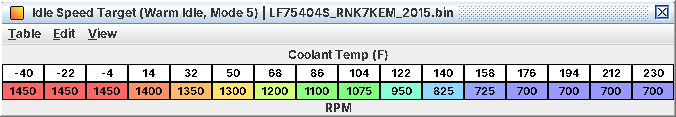

# 17. Idle control

Idle is air-led: a target rpm, a feed-forward "base air" for that target, adders for known loads, feedback and
learning on top, and a torque loop that uses spark to catch fast rpm changes. The idle air is turned into throttle
area and added to whatever the torque model asks for. This chapter explains the pieces so a raised idle or a hunting
idle makes sense; the short workflow is in 17.6 and C10, every table in A17. Values are LF75404S (2015 WRX, manual);
the CVT images idle lower (575 rpm hot) and use the AT/CVT-only modes 6 and 8. Decoded from code, untested on a car.

## 17.1 The chain

1. *Target rpm*: one table per idle mode (17.2), by coolant, ramped on mode changes, then raised to any minimum that
   applies (17.3).
2. *Base air*: one table per mode, by coolant, with a "(…, TGV Closed)" twin.
3. *Adders*: A/C, electrical load, post-start air, target-change feed-forward, rpm-drop recovery, pull-away
   anti-stall.
4. *Feedback* (17.4) and *learning* (17.5).
5. *Scale and floor*: × **Idle Air Altitude Factor (Running, A/C Off)** (and its twins), floored
   by **Minimum Idle Air (Moving in Gear)** while rolling in gear.
6. *To the throttle*: **Idle Air Request to Throttle Area** turns it into throttle area, added to the torque-model
   area (C13). Idle air can only open the throttle.

*Base air is in "base-air units"* with no known physical meaning: hot base air of 1536 is about 1.9 % commanded
throttle. Treat it as relative: 10 % more base air is 10 % more idle air.

*TGV Closed is the normal warm-idle case.* At a settled warm idle the TGVs are commanded closed, so the "(…, TGV
Closed)" base-air tables are the ones you are probably on (**Idle Base Air (Mode 5, TGV Closed)**). Always edit the
pair.

## 17.2 Idle modes

On a manual car only modes 1, 2, 3, 5 and 7 occur.

| Mode | When | Target | Base air |
|---|---|---|---|
| 1 | Engine not turning | **Idle Speed Target (Post-Start, Modes 1/2)** | **Idle Base Air (Post-Start, Modes 1/2)** |
| 2 | After a start below 167 °F (75 °C) coolant | same | same |
| 3 | After a hot start, 167 °F and up | **Idle Speed Target (Warm Start, Mode 3)** | **Idle Base Air (Warm Start, Mode 3)** |
| 5 | Normal warm idle | **Idle Speed Target (Warm Idle, Mode 5)** | **Idle Base Air (Mode 5)** |
| 7 | Driven off after a cold start, still warming | **Idle Speed Target (Warm-Up Drive-Off, Mode 7)** | **Idle Base Air (Warm-Up Drive-Off, Mode 7)** |
| 4 | Never entered on the reference calibration | **Idle Speed Target (Cold Idle, Mode 4)** | **Idle Base Air (Cold Idle, Mode 4)** |
| 6, 8 | AT/CVT only | AT/CVT tables | AT/CVT tables |

* 2 → 5 after 2 s of running once the car moves or coolant reaches **Idle Post-Start Mode Exit Coolant** (122 °F / 50
  °C for a cold start). Moving while still cold (below about 167 °F) goes to 7 instead; 7 → 5 when warm.
* *3 → 5 only when the car moves.* A hot restart idles on the Mode 3 target until you drive off.
* Changes are ramped by **Idle Target Ramp Rate (Mode 2 to 5)** and its siblings: a slow fade into mode 5, fast into
  2, 3 and 7, instant from 1 to 5.

| Coolant | Modes 1/2 and 7 | Mode 3 | Mode 5 |
|---|---|---|---|
| −40 °F (−40 °C) | 1,800 | 1,800 | 1,450 |
| 68 °F (20 °C) | 1,800 | 1,800 | 1,200 |
| 122 °F (50 °C) | 1,450 | 1,450 | 950 |
| 158 °F (70 °C) | 1,450 | 725 | 725 |
| 194 °F (90 °C) up | 700 | 700 | 700 |

*Warm idle target: 1,450 rpm cold, 700 rpm from 176 °F (80 °C)*

## 17.3 Minimum idle speed

The target is raised to the highest of: **Idle Speed Minimum (Baro, Oil Temp)** (575 rpm; 650 at 248 °F / 120 °C oil,
700 at 266 °F / 130 °C, probably for oil pressure), fixed minimums for electrical/fan load (about 675 rpm) and other
conditions (700-860 rpm, not fully decoded), and a minimum sent over CAN by another module. *Setting a warm idle below
575 rpm does nothing.* Scan-tool idle adjust and idle control exist but are not calibration.

## 17.4 Feedback: two loops

*Air loop.* An incremental PI controller on manifold pressure and "flow" (MAP ×
rpm). **Idle Speed Feedback Map (Target MAP Offset)** turns rpm error and rpm rate into a target-MAP offset (more air
when slow and falling, less when fast and rising): it is effectively the loop
gain. **Idle Speed Feedback RPM Error Factor (Above Target)** scales the over-speed side. It only runs at idle with
rpm near or below target.

*Torque loop (inferred).* Within about 500 rpm of target the limit logic enters an idle state whose torque cap
is **Idle Speed Torque Feedback P** (by target and rpm error) + **Idle Speed Torque Feedback D** (by target and rpm
change), scaled by **Idle Speed Torque Feedback Reference Torque**. Stock it cuts about 6-15 ft-lb when 200 rpm fast
and adds 1-2.5 ft-lb when 200 rpm slow. The torque model delivers that quickly with spark and slowly with air. *Never
set the Reference Torque to 0*: it zeroes the loop.

*Leaving idle.* The feedback air in use when you touch the pedal is carried over and bled off like a dashpot
(**Idle Feedback Carry-Over Decay (Positive)** / **Idle Feedback Carry-Over Decay (Negative)** and the two Carry-Over
Limit tables).

## 17.5 Learning

* *Slot learning*: when feedback stays outside a small band, a learned value steps, separately for A/C off and A/C on.
  Backup RAM, added into idle air.
* *Long-term transfer*: a slower filter follows it (**Idle Learn Filter Gain (A/C Off)** and siblings).
* *Drive-history bias*: **Idle Learn Bias** shifts learned air down after long idling and up after sustained driving
  (only from 176 °F / 80 °C; purpose inferred, maybe heat soak).
* Cleared by the scan-tool idle-learning reset.

*This is why base air matters.* Wrong base air gets learned away, so idle looks fine after a few drives, then
misbehaves after a battery disconnect or with the A/C on.

## 17.6 Idle spark

With the pedal released the same timing min() rule applies as everywhere else (C07, C13):

* *Base side*: **Base Timing (Pedal Released, TGV Open)** / **Base Timing (Pedal Released, TGV Closed)**.
* *Request side*: **Closed-Pedal Timing Target** + **Post-Start Closed-Pedal Timing Advance (Coolant at Start)** (+
  KCA + FLKC).
* Both sides get the IAT comp and **Closed-Pedal Timing Coolant Compensation** × its rpm multiplier, so those move
  fired idle timing directly.

Stock the request side is lower (6-9° against 19-28° at idle; 17° against 34° at 2,000 rpm), so *Closed-Pedal Timing
Target sets idle and coast timing* and the pedal-released Base Timing maps are only a ceiling. Then rate limits (with
the pedal released +5° / −10° per event), the idle torque loop's retard, the A/C and decel-cut retards, and the
caps **Ignition Timing Cap (Pedal Released, TGV Open)** / **Ignition Timing Cap (Pedal Released, TGV Closed)**. Low
idle timing probably leaves the torque loop room to add torque fast with spark (inferred). To change idle timing, edit
Closed-Pedal Timing Target and keep it below the pedal-released Base Timing maps.

## 17.7 Changing idle speed

The workflow is in C10. The rules that come from this chapter: change the target for every mode you care about and
scale base air by about the same ratio in *both* the normal and the TGV Closed table (700 → 850 rpm: about +20 % as a
first guess); reset idle learning before judging base air; at a warm idle in neutral, steady positive feedback means
base air is low, negative means high. The decel fuel cut points ride on the idle target (C18). Get base air right
before touching the feedback map, and then trim it 10-20 % at most. The three Idle Air Altitude Factor tables hold the
same data: edit all three. **Idle Air Request to Throttle Area** and **Idle Air from Throttle Area (Torque Request)**
are inverses: edit them as a pair (plus the Monitor copy).

*Log:* rpm (J01), coolant (J02), MAP (J07), commanded throttle (J11), battery (J12), speed (J13), timing (J04). The
idle target and idle air are not on any logger definition yet; compare rpm with the table value (A17 has the RAM
addresses for a memory-read logger on LF75404S).
