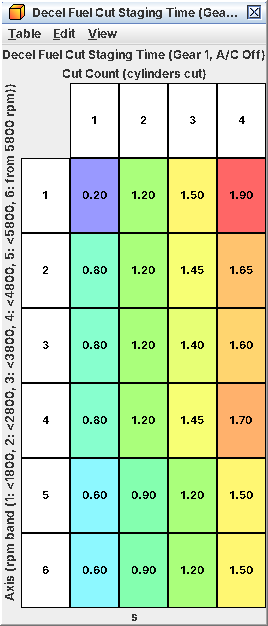

# 18. Limit states and cuts

C09 tells you which tables move the rev limiter, overboost cut and speed limiter. This chapter explains the machinery
so you can read a limiter event in a log: how the ECU decides to take power away, how that becomes a throttle cap and
a fuel cut, and why spark is left alone. The decel fuel cut uses the same machinery. Exact comparisons are in A18.
Read from the LF75404S code (same logic in every image), not observed on a running engine.

## 18.1 Every cut is a torque request

The ECU does not simply "cut fuel at 6,700". Instead:

1. A *limit state* is picked from the conditions (idle, decel, rev limit, overboost, speed limit …).
2. The state sets a *torque cap*.
3. Cap ÷ the torque the engine is making = a *number of cylinders to cut*, 0-4 (C13).
4. In the rev/overboost state only, the *throttle* is also capped by small torque tables.
5. Spark stays on its normal target.

That is why the rev limiter, overboost cut, speed limiter, decel fuel cut and fail-safe rev limit all end in the same
four *Cylinder Cut Torque Ratio* values.

## 18.2 The states that matter

| State | Entered when | Torque cap |
|---|---|---|
| Normal | nothing special | normal caps (C13) |
| Idle | idle torque loop in charge | idle torque feedback (C17) |
| Decel fuel cut | closed-pedal cut condition held for **Decel Fuel Cut Delay** | steps down by stage (18.6) |
| *Rev / overboost* | rev latch *or* overboost latch | zero while the full-cut latch or the overboost flag is set; otherwise none (throttle cap only) |
| *Speed limit* | speed latch | zero at or above **Vehicle Speed Limit Full Cut Speed**; otherwise none |

Rev limit and overboost share one state, which is why they share the throttle-cap tables. A few further states exist
whose triggers are not decoded; none is the speed limiter.

*Latches* (A18 has the exact comparisons):

* *Rev*: sets above **Rev Limit RPM**; releases at **Rev Limit Reset RPM** *and* MAP
  below **Rev Limit Reset Maximum MAP** (168 kPa abs, 9.7 psi).
* *Full cut* (inside the rev state): sets at **Rev Limit Full Cut RPM**; releases at **Rev Limit Full Cut Reset RPM**
  with MAP below the same reset MAP. Stock it equals Rev Limit RPM, so the rev state is a full cut from its first
  moment.
* *Overboost*: sets at compensated **Overboost Limit** + **Overboost Cut Margin (Limit State)**;
  releases **Overboost Cut Hysteresis (Limit State)** lower.
* *Overboost flag*: boost above limit + **Overboost Margin** for **Overboost Delay** (2.0 s); clears at
  limit + **Overboost Flag Reset Margin**. On its own it does nothing; it turns the rev/overboost state into a full
  fuel cut.
* *Speed*: speed ≥ **Vehicle Speed Limit** − offset with rpm ≥ **Vehicle Speed Limit Minimum RPM**; releases below
  that with MAP at or below its reset MAP. Stock 255 km/h (158 mph) with a 6,375 rpm minimum: off.

*The MAP condition on release* is why a boosted engine sits on the cut longer: it cannot end while the manifold is
still above 168 kPa abs.

## 18.3 From cap to injectors

Every 10 ms: ratio = capped torque ÷ last pass's torque. At or above 75 % nothing is cut; 50-75 % one cylinder in
four; 25-50 % two; 3.9-25 % three; below 3.9 % all four. A zero cap always cuts all four, so the rev limiter and the
overboost fuel cut are always full cuts.

Per firing, the ECU applies a fixed pattern (1 in 4, 1 in 2, 3 in 4, every firing). *A cut cylinder gets no injection
at all*, not even the minimum pulse. *Spark is not cut*: the coil scheduler never sees the cut, so a fuel-cut cylinder
still sparks on air. The fail-safe rev limit, an internal status value and a stop request (probably an
immobiliser-type check, inferred) force all four regardless.

## 18.4 The throttle side

In the rev/overboost state only, the throttle torque request is capped:

| Condition | Cap | Stock |
|---|---|---|
| rpm above **Rev Limit Stage 1 RPM**, or MAP above **Rev/Boost Limit Torque Stage 1 MAP** (256 kPa abs) | **Rev/Boost Limit Torque (Stage 1)** | 37 ft-lb |
| Stage 2 conditions (thresholds equal stage 1's in stock) | **Rev/Boost Limit Torque (Stage 2)** | 52 ft-lb, never used |
| otherwise | **Rev/Boost Limit Torque (Base)** | 108-207 ft-lb by rpm, about 165 near the limiter |

**Rev/Boost Limit Torque Caps Enable** (set) switches this on. The monitor uses the same data, so there is no extra
copy to edit. This cap does not lower the boost target; the closing throttle is what brings boost down.

## 18.5 Spark in the limit states

Normally the torque model takes torque away with spark via **Torque Reduction Spark Retard** (C13). In the
rev/overboost and speed-limit states the stock flags **Limit-State Spark: Normal Target in Rev/Overboost Cut**
and **Limit-State Spark: Normal Target in Speed Limit** keep the normal spark target. With the first flag cleared, a
full cut would ask for about 34° of retard. *Stock limiters are pure fuel cuts: no retard, no spark cut.* Leave the
flags set.

## 18.6 Decel fuel cut

The same machinery, driven gently:

1. *Entry*: pedal released, at least about 6 s since start, rpm above the resume rpm + 200.
   After **Decel Fuel Cut Delay** (0.05 s warm above 1,500 rpm, else 0) the cut state starts.
2. *Staging*: the gear, an rpm band (boundaries 1,800 / 2,800 / 3,800 / 4,800 / 5,800 rpm) and A/C state are latched;
   the matching **Decel Fuel Cut Staging Time (Gear 1, A/C Off)** (and siblings, plus neutral) gives the times at
   which 1, 2, 3 and 4 cylinders are cut. Stock: gear 1 gets to all four in about 1.5-2.0 s, gears 4-6 in 0.4-1.1 s,
   neutral at once (0.10 s).
3. *Exit*: rpm down to the resume rpm, or pedal pressed. Resume rpm = idle
   target + **Decel Fuel Cut Resume RPM Adder (Coolant)** (+ **Decel Fuel Cut Resume RPM Adder (Low Speed)** below 15
   km/h / 9 mph). Warm with a 700 rpm idle, the cut starts near 1,200 rpm and ends near 1,000.
4. *After*: **Decel Fuel Cut Resume Timing Retard** and the recovery ramps soften the return of torque.

Staging is held back while cruise holds speed (up to 18 s). Raising idle raises both cut points. C10 has the tuning.

*Rows = rpm band at the start of the cut; columns = time until 1, 2, 3 and 4 cylinders are cut*

## 18.7 Fail-safe rev limit

Outside the state machine. **Fail-Safe Rev Limit (Rail Pressure Fault)** (6,100 rpm) applies while the rail-pressure
deviation monitor has flagged a fault or P0192/P0193 is pending (bit mapping
inferred); **Fail-Safe Rev Limit (Injector Driver Fault)** (6,100 rpm) while an injector-driver fault has the fuel
system in its low-pressure fail-safe. Above the lowest active limit (never below idle
target + **Fail-Safe Rev Limit Minimum Above Idle Target**) all four cylinders are cut, released 100 rpm lower.
Throttle and spark are untouched; the car just stops pulling at 6,100. A pending P0088 (rail pressure too high)
does *not* trigger this limit; it brings **Throttle Limit (Fuel Pressure Fault)** instead (C13). Off (at maximum) on
LV9N100F.

## 18.8 What a limiter looks like in a log (stock WRX)

*Rev limiter (6,700 rpm)*

| Event | Result |
|---|---|
| rpm above 6,700 | All four cylinders cut within one 10 ms pass plus one firing; throttle capped toward 37 ft-lb; spark normal |
| rpm back to 6,700, MAP below 168 kPa abs | Fuel returns at once. No rpm hysteresis on the fuel, so it bounces on 6,700 |
| 6,600-6,700 rpm | Still in the state; throttle cap is the Base table (about 165 ft-lb), rarely binding |
| rpm ≤ 6,600, MAP below 168 kPa abs | State ends |
| MAP at or above 168 kPa abs | Cut holds until the closed throttle pulls the manifold down |

*Overboost (stock limit peak 211 kPa abs / 15.9 psi)*

| Event | Result |
|---|---|
| Boost ≥ limit + 33 kPa (about 244 kPa abs, 20.7 psi) | Cut state at once: throttle capped (Base table, Stage 1 above 256 kPa abs); no fuel cut yet |
| Boost ≥ limit + 26.7 kPa for 2.0 s | Flag sets; with the cut state active, full fuel cut |
| Boost below limit + 18 kPa | Cut state ends; fuel returns even if the flag is still set |
| Boost at or below the limit | Flag clears |

Forester tS and LV9N images: cut state from limit + 10 kPa, ending 10 kPa below the limit. Rev limit 6,700 on the WRX,
6,100 on the Forester tS, 6,500 on LV9N101C (A09).

*What other modules see.* The torque reported over CAN fades out during a fuel cut and back after it
at **CAN Engine Torque Fuel-Cut Fade Rate** (C19). It changes what VDC and the cluster see, not the cut.

*Open:* the undecoded limit states; which cylinders a partial cut hits each cycle (probably the same ones, inferred);
a second cut source used under an internal fault latch (probably limp mode, not in the definition); speed-limit fuel
trims (zero in stock).
