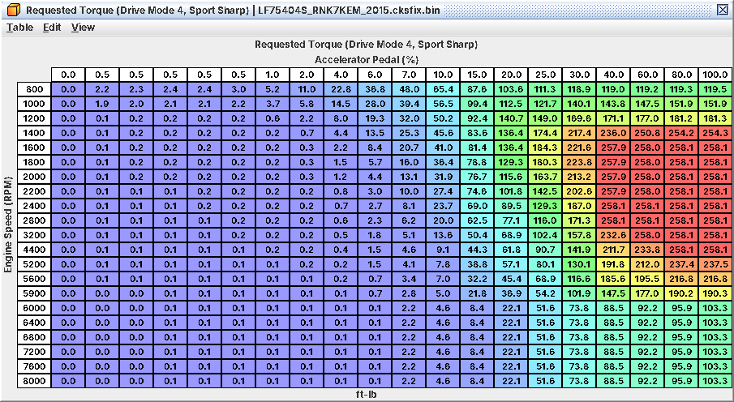

# 19. CAN: SI-Drive, VDC and cruise

Several things a tuner cares about arrive over CAN: the SI-Drive mode that picks the Requested Torque map, the
stability control's torque limit, brake pressure for brake override, vehicle speed itself, and on some cars the cruise
switches. The ECU in turn tells VDC and the cluster how much torque it is making. This chapter covers what that means
for a tune; bit-level detail is in A19. Read from LF75404S (2015 WRX 6MT) unless marked.

## 19.1 Overview

| From / to | IDs | What matters |
|---|---|---|
| VDC → ECU | 0x0D0-0x0D4 | *Vehicle speed (the only speed source)*, wheel speeds, brake pressure, torque limit |
| Meter → ECU | 0x282, 0x3D1 | *SI-Drive request*, market/units code (cruise), option bits, ambient temperature |
| Body / other → ECU | 0x152, 0x280, 0x370, 0x161, … | Idle air adders for electrical and A/C load; CAN cruise switches (some cars) |
| TCU → ECU | 0x148, 0x149, 0x368 | *Ignored on the manual coding* |
| ECU → bus | 0x140, 0x141, 0x144, 0x360-0x362 | rpm, pedal, throttle, torque (requested / estimated / maximum), temperatures, MAP, gear, drive mode |

Frames are polled every 10 ms. Checking is light: a frozen rolling counter for 2 s flags "invalid", a frame missing
for 0.5 s counts as lost, and only 0x161 carries a checksum.

## 19.2 SI-Drive and the drive modes

The meter sends the SI-Drive request in 0x282; the ECU turns it into a drive mode 1-4 and picks the matching Requested
Torque map, tip-in shaping, TGV thresholds and cruise pedal table. Which knob position is which mode is *inferred from
the stock maps* (no CAN capture yet):

| Drive mode | SI-Drive position | Requested Torque map |
|---|---|---|
| 1 | Default: no SI-Drive request (and the only map on cars without SI-Drive) | **Requested Torque (Drive Mode 1, Default)** |
| 2 | Sport (S) | **Requested Torque (Drive Mode 2, Sport)** |
| 3 | Intelligent (I) | **Requested Torque (Drive Mode 3, Intelligent)** |
| 4 | Sport Sharp (S#) | **Requested Torque (Drive Mode 4, Sport Sharp)** |

* On the WRX MT images modes 1-3 hold identical maps. Mode 4 is the mode-1 data on a compressed rpm axis: *more*
  torque than mode 1 at low rpm from part to full pedal (about 119 vs 63 ft-lb at 30 % pedal, 800 rpm), about the same
  near 2,000 rpm, and *less* from about 2,400 rpm (103 vs 190 ft-lb at 6,400 rpm, full pedal). It is not simply a
  softer map.
* *Mode 1 is the fallback* for most states of the mode logic and when the request is missing. *Mode 3 is refused until
  the engine has once passed about 126 °F (52 °C) coolant and the pedal has been lifted below 5 %*; until then the car
  stays in its previous mode (inferred wording of a read condition).
* A calibration value can force a fixed mode; it is 0 (off) in stock and not in the definition.
* The ECU echoes the mode in use in 0x141, so one passive CAN log while turning the knob would confirm the positions
  (A19).

| Follows the drive mode | Tables |
|---|---|
| Driver demand | the four Requested Torque maps (+ Monitor; "(…, AT/CVT)" on AT/CVT coding) |
| Tip-in shaping | Target Torque Rise tables per mode (C10) |
| TGV open/close torque | **TGV Torque Threshold Enter (Drive Modes 1/4, Default/Sport Sharp)**, **TGV Torque Threshold Enter (Drive Mode 2, Sport)**, **TGV Torque Threshold Enter (Drive Mode 3, Intelligent)** and the Exit tables |
| Cruise | **Cruise Pedal Equivalent (Other Drive Modes)**, **Cruise Pedal Equivalent (Drive Mode 2, Sport)**, **Cruise Pedal Equivalent (Drive Mode 3, Intelligent)** |

*Sport Sharp: the mode-1 map on a compressed rpm axis, stronger at low rpm and weaker from about 2,400 rpm*

*For the tune.* A Requested Torque change moves target torque, and with it throttle, boost target and wastegate duty
(C05). Doing it per mode is how you build a mild / normal / aggressive set on an SI-Drive car. On a WRX MT, edit mode
1 (and keep 2-3 matching if you want to be safe) plus mode 4 if it is reachable on your car. If you make one mode much
stronger, check that mode's TGV thresholds and its Cruise Pedal Equivalent table.

## 19.3 VDC torque limit

VDC sends a torque request and a torque limit in 0x0D2. While its "limit active" flag is set, a small loop
(**VDC Torque Request Correction** plus an integral) *caps target torque*. Because target torque is the axis of Target
Boost and the throttle maps, a VDC intervention drops both throttle and boost. Lost VDC frames give a request of 0 and
a limit of about 301 ft-lb (408 Nm), which never binds. (That this is the traction/stability torque reduction is
inferred from the sender; the arithmetic is read.)

* A sudden drop in target torque with no pedal change on a slippery road or in a slide is VDC, not your tune.
* VDC works from what the ECU reports (19.6). Raise torque a lot and it is controlling an engine it does not know;
  keep the reported values plausible.

## 19.4 Vehicle speed and brake override

*The ECU has no speed sensor.* Speed (J13) comes only from VDC frame 0x0D1. It feeds cruise, the fans, idle, brake
override, the decel fuel cut and every speed-dependent table. *If the VDC frames are lost the ECU uses a fixed 10 km/h
(6 mph)*: the car then idles, decel-cuts and runs its fans as if creeping along.

*Brake override.* Brake pressure (0x0D1, inferred) above **Brake Override Brake Pressure Threshold** while the
accelerator is held, above 7 km/h (4 mph), for **Brake Override Delay** (2 s at light pedal, 0.5 s from 60 %): the ECU
ramps the pedal down at **Brake Override Pedal Limit Ramp-Down Rate** to **Brake Override Pedal Limit Floor** (1-3 %),
and restores it over **Brake Override Recovery Time** on release. If a driver reports power fading while left-foot
braking, this is why. All level 4; changing it is a safety decision, not a tuning one.

## 19.5 Cruise control

Cruise works out a torque from the speed error, turns it into an equivalent pedal with the Cruise Pedal Equivalent
table for the drive mode, and the ECU uses the higher of that and the real pedal. So *cruise goes through your
Requested Torque maps*. Stock the pedal tables map 0 ft-lb to 0 % and 258 ft-lb (350 Nm) to 100 %. Rework the
Requested Torque maps heavily and cruise response changes unless you match the Cruise Pedal Equivalent tables. While
cruise is in control (no pedal override) the four cruise throttle-opening tables replace the normal ones
(inferred). **Cruise Torque Limit Offset** caps how hard cruise can drive. The meter's market code
selects **Cruise Maximum Speed (km/h Meter)** or **Cruise Maximum Speed (mph Meter)** and the speed conversion so the
set speed matches the speedometer.

## 19.6 What the ECU sends

| ID | Period | Contents |
|---|---|---|
| 0x140 | 10 ms | rpm, driver / cruise / effective pedal, throttle, MIL, ETC fault, A/C, pedal released |
| 0x141 | 10 ms | Torque request and estimated torque, filtered rpm, gear, drive mode in use |
| 0x144 | 20 ms | Maximum available torque, cruise state |
| 0x360 | 50 ms | Oil and coolant temperature, MAP, cruise lamps and set speed, fans, A/C |
| 0x361 | 50 ms | Gear code, MIL code, baro, engine-not-rotating |
| 0x362 | 50 ms | Battery current and state of charge (inferred) |

The torque request and estimate follow the torque model, so they track your tune by themselves. The *maximum available
torque* does not: it comes from **Engine Torque from Load (CAN, DAM 1.0)** / **Engine Torque from Load (CAN, DAM 0)**
and **Full-Load Air Flow Estimate (CAN Torque)** (level 4). With a bigger turbo raise the full-load air estimate, or
VDC and the cluster see too little torque capacity. None of these tables change fuel, spark, throttle or boost. (The
measured air it compares with stops at 218 g/s, so above that the reported capacity may read low; inferred, minor.)

## 19.7 Lost frames and other inputs

| Lost | Fallback | Effect |
|---|---|---|
| VDC | speed 10 km/h, brake pressure 0, VDC request 0, limit 301 ft-lb | Speed-dependent behaviour wrong; no brake override from pressure |
| Meter 0x282 | no SI-Drive request | Probably drive mode 1 (not traced for this case) |
| Bus-off | every frame on fallback; ECU stops sending | Cluster and VDC lose engine data |

* Electrical load (0x370) and body/A/C frames (0x152, 0x280) add idle air (C17). Fuel level comes from the cluster.
* Transmission frames are discarded every pass on the manual coding and set no code; the CAN idle-request and external
  torque-limit tables are therefore "(Off in Stock)".
* Below about 9.3 V the ECU treats every frame as stale (inferred scale).

## 19.8 Logging over CAN

A CAN tool with the project DBC can log speed, wheel speeds, brake pressure, VDC requests and the ECU's own frames
passively (A19). The stock code also supports UDS periodic data at up to 100 Hz (untested). *Never inject frames on a
road car*: the ECU trusts any changing counter.

2017 and 2018 images use the same layouts with small differences that do not affect a tune (A19). Still open: wheel
order in 0x0D4, the ambient temperature scale, several senders, and a CAN capture to confirm the SI-Drive positions.
